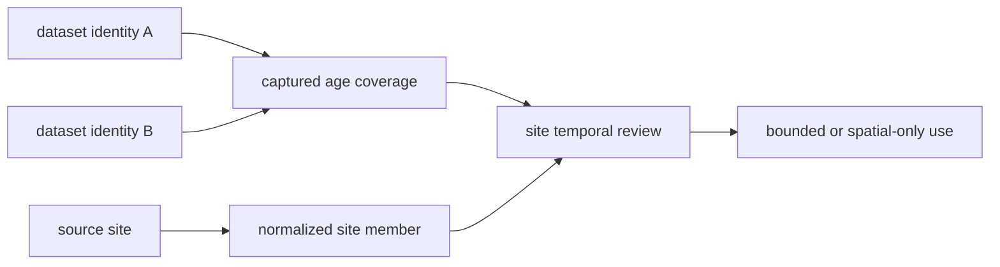
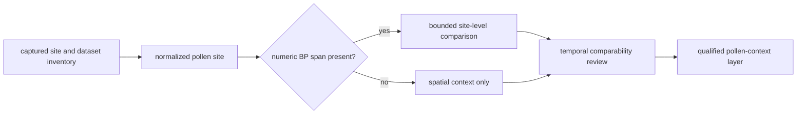
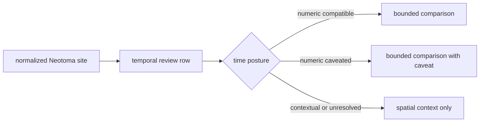
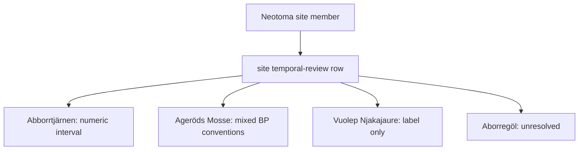
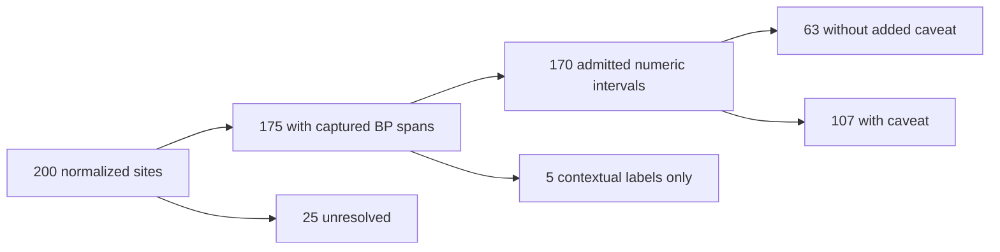

# Neotoma

Neotoma supplies primary pollen context as normalized palaeoecological site
records. It complements LandClim with a site-centered view, but temporal
support varies by record and remains distinct from a captured chronology
model.

Its pollen-site context is governed at the site and dataset levels. A public
point can orient a reader to a place, while dataset identity and the temporal
review determine whether the record supports spatial context, bounded temporal
comparison, or no numeric-time claim.

## Checked-In Evidence

The legacy point-layer temporal review covers 200 normalized sites:

| Posture | Count | Interpretation |
| --- | ---: | --- |
| site has a numeric BP span | 175 | bounded site-level comparison is possible under the recorded caveat |
| site lacks a BP span | 25 | spatial context only |
| point-layer chronology rows | 0 | the compact site layer does not embed relational chronology rows |

Within the review, 63 records are numeric intervals, 107 are numeric intervals
with caveats, 5 retain contextual labels only, and 25 remain unresolved. These
categories are more informative than calling all 200 sites “dated.”

### Relational Snapshot

The governed `data/neotoma/relational/` snapshot preserves the detailed
source relationships omitted from the compact map layer. Its manifested v2
surfaces contain 200 sites, 206 collection units, 209 datasets, 384
chronologies, 2,798 chronology controls, 12,388 samples, 23,281 age claims,
1,262 variables, and 370,936 observations.

The age claims remain partitioned by comparability: 11,526 comparable, 10,622
context-only, 294 refused, and 839 unresolved. The corrected snapshot preserves 33
conflict records and 52 orphan records rather than hiding them. Of the 200
sites, 193 have assigned governed-country decisions and are spatially eligible;
7 remain in review under `UNASSIGNED` and are blocked from propagation.

Every multipart surface is bound to source snapshot
`sha256:b2bcb99157e10b0c9f13c228acc12eabcb39d96a1f39c86ec25e34aacd78c791`
and build
`sha256:92dd52619837f3641d004a1a5dbe38f9ab6023a79f61989314bb90e612eb58e1`.
The manifest validates row counts, stable IDs, country partitions, part hashes,
and the complete materialization digest.

### Current sample-level pollen screen

The [governed prerequisite screen](../../../report/source-relations/neotoma/pollen-screen/README.md)
uses the corrected relational projection and the captured raw source. Neotoma
allows one default chronology per age type; a radiocarbon and a calibrated
default within one collection unit do not constitute a conflict. The earlier
projection incorrectly treated these as contradictory and excluded valid
count observations. The [chronology manual](https://open.neotomadb.org/manual/chronology-age-related-tables-1.html)
states this source rule.

| Source partition | Captured samples | Agreeing pollen count observations | Necessary candidate samples | Refused samples |
| --- | ---: | ---: | ---: | ---: |
| Sweden | 5,764 | 125,067 | 5,011 | 753 |
| Denmark | 279 | 7,930 | 91 | 188 |
| Norway | 3,884 | 91,852 | 3,544 | 340 |
| Finland | 2,184 | 33,171 | 1,797 | 387 |
| Unassigned | 277 | 7,503 | 194 | 83 |
| **Captured total** | **12,388** | **265,523** | **10,637** | **1,751** |

These are source prerequisites: agreeing source pollen labels, finite integer
counts and a sample-owned comparable typed age. They are not selected LRA
taxa, PPE, basin geometry or a validated pollen denominator. No real source
sample has been admitted to LRA or measured-vegetation accuracy evaluation.
The [Nordic country-held-out direct-pollen study](../../../report/regions/nordic/direct-pollen/RESULTS.md)
uses a separately declared 16-label observed-pollen subcomposition and retains
all target-country exclusions and scores.

Those 10,637 prerequisite samples occupy 163 source site IDs, 167 collection
unit IDs and 169 dataset IDs. Sweden contributes 5,011 samples at 77 sites;
Denmark 91 at one site; Norway 3,544 at 52 sites; Finland 1,797 at 28 sites;
and the unassigned review partition 194 at five sites. These counts are derived
from the sample IDs and parent IDs in the current governed screen. The earlier
3,538-sample, 54-site source review covers a narrower historical screen and
cannot certify this current candidate population.
The [current source-bound LRA prerequisite review](../../../report/source-relations/neotoma/lra-prerequisites/README.md)
retains all 10,637 sample chronology alternatives and 163 site basin review
rows. It verifies the original 54-site lakeparameter receipt before reusing its
exact full-table source pages for the current cohort. Fourteen source parameter
rows match 13 current sites, without approving historical basin geometry;
zero samples are admitted to LRA.

The [current pollen-concept priority](../../../report/source-relations/neotoma/taxon-priority/README.md)
joins the corrected 10,637-sample cohort to 1,006 Neotoma review concepts and
228,323 source-pollen-labelled count observations. All selected concepts remain
unapproved; exact `NISP` and `NISP digitized` count sums stay separate. The
earlier 674-concept priority used that narrower historical cohort.

For Abborrtjärnen, a [cross-source ABBO profile comparison](../../../report/source-relations/neotoma/abbo-profile/README.md)
matches 107 sample depths and 535 selected taxon-count cells against a separate
EPD/PANGAEA record. That record reports a 3 ha lake, but its June 2002 core
date differs from the Neotoma January 2002 collection date. Its area has no
sample-age-specific basin boundary and does not admit numerical LRA.

For Bökesjön, a [primary basin source review](../../../report/source-relations/neotoma/boke-basin/README.md)
finds a 1984 depth map and a 1.5 ha lake area, while another lake study reports
1.6 ha. Neither source links its sampling point or modern area to the Neotoma
pollen core's historical basin boundary. BOKE remains unadmitted to LRA.

### Bounded candidate sample series

`inspect_neotoma_lra_candidate_series` in the installed host materialization
API reads the authenticated raw and relational parents and requires an explicit
list of at most 16 source sample IDs. It returns a canonical, hashed review
export with each sample's source identity, native observation values and units,
count decisions, agreement of both source element labels, all typed age-claim
alternatives and reason-coded refusals. A source label of `pollen` is a review
lead only when both source element fields agree; it does not establish a
reviewed taxon mapping, PPE or compatible count denominator. The API never
chooses an age claim or produces an executable LRA request.

The [retained Ageröds Mosse source series](../../../report/source-relations/neotoma/pollen-screen/agerods-mosse.sample-series.json)
uses the current corrected source projection. Its 16 consecutive source samples
at one site contain 409 native observations, including 360 agreeing
pollen-labelled integer count candidates, and 32 alternative age claims. Four
samples lack a comparable owned age; the following 12 pass that necessary age
screen. Every sample remains refused for numerical LRA while chronology choice,
classification, PPE/parameter binding and historical basin geometry are
unapproved. These 16 rows are one bounded source series, not independent sites
or a complete basin-qualified reconstruction.

### Earlier 54-site basin source review

The authenticated site and collection-unit review retained in the external
Neotoma source-data store
(SHA-256 `aaded8ed751a8f245a357c50bb2c2a96a8710168deab7223f0c48284180e96ce`)
retains source row locators and native descriptions, geography, area, collection
unit type, depositional environment, water depth, location and collection date.
It covers the same **54 site IDs, 56 collection unit IDs and 3,538 prerequisite
samples**, with **zero basin or numerical LRA admissions**.

| Source partition | Site descriptions present | Site area values present | Point / polygon site geometries | Collection-unit environment labels present | Water depths present |
| --- | ---: | ---: | ---: | ---: | ---: |
| Sweden | 35 / 37 | 5 / 37 | 33 / 4 | 39 / 39 | 7 / 39 |
| Denmark | 0 / 0 | 0 / 0 | 0 / 0 | 0 / 0 | 0 / 0 |
| Norway | 14 / 14 | 5 / 14 | 11 / 3 | 14 / 14 | 5 / 14 |
| Finland | 1 / 1 | 0 / 1 | 1 / 0 | 1 / 1 | 0 / 1 |
| Unassigned | 2 / 2 | 0 / 2 | 2 / 0 | 2 / 2 | 1 / 2 |
| **Captured total** | **52 / 54** | **10 / 54** | **47 / 7** | **56 / 56** | **13 / 56** |

The 56 native depositional-environment labels are 20 `Lacustrine`, 20 `Bog`,
five `Glacial Origin Lake`, four `Raised Bog`, two each `Natural Lake`, `Mire`
and `Fen`, and one `Fjord`. These are review leads, not an accepted
lake/peatland classification. [Neotoma's site and collection-unit
manual](https://open.neotomadb.org/manual/database-design-concepts.html)
places depositional environment on the collection unit, warns that a site
polygon can express imprecise or concealed location, and describes this
environment as present-day context that may change through time. The site's
`area` and polygon are therefore not converted into a pollen basin radius or
diameter; their applicability and units for this captured API value require
source review. A collection date is not a sample age. Historical basin size,
source aliases, chronology, taxa/PPE and compatible counts remain unresolved.

The [retained lake-parameter source review](../../../report/source-relations/neotoma/lakeparameters/README.md)
and host `inspect_neotoma_lra_lakeparameters` consumer accept an explicitly
pinned public Neotoma lakeparameter capture, verifies every captured page and
type-table hash, and joins only exact source site IDs. The 2026-09-21 bounded
capture (`capture.json` SHA-256
`0c800ed252d6bd2bbed72f5ac7798e27d7a72f89330170b8ce33989384c758fd`)
contains 24,554 lakeparameter rows and 21 parameter types. Five rows match
five of the 54 candidate source sites: maximum depth 6 m at Swedish
Klotjärnen and 2.2 m at Lillsjön; reported surface area 2.5 ha at Norwegian
Liten Cap’pesjav’ri, 5 ha at Over Gunnarsfjorden, and 1.7 ha at Over
Kobbkrokvatnet. No parameter row was observed for the other 49 sites in
this capture. The capture used serial live `offset` pages, not a transactional
snapshot, so absence is not certified. These are native parameter labels and
reported values, not historical basin dimensions, a derived radius, a
lake-versus-peatland decision or a scientifically admitted LRA input. The
three Norwegian site-level `area` values in the earlier review differ from
their lakeparameter `Area` values; the site-area unit and meaning remain
unresolved, so those fields are not substituted for each other. The
review retains source page and row locators; **zero sites or samples are
admitted** by this source match.

The current [private taxa review replay](../../../report/taxa-review/README.md)
links **10,637** prerequisite samples to **228,323** agreeing pollen count
observations across **1,006** existing Neotoma review concepts. The samples
partition as Denmark 91, Finland 1,797, Norway 3,544, Sweden 5,011 and
unassigned 194. The complete review package has **10,908 rows** across source
families; all 1,006 selected Neotoma concepts remain `needs_discussion`.
Stable concept IDs, source identities, country frequencies, exact count sums
and reported-zero counts are retained separately. `NISP` and `NISP digitized`
are not combined. Frequency and source mass prioritize review; they do not
approve a taxon, PPE, compatible pollen denominator or LRA input.

The current dataset attribution binds those 1,006 concepts and 228,323
candidate observations to **169 source datasets** with native dataset IDs,
constituent databases, source-listed DOI values, contributor fields and
concept-level sample and observation counts. These are source attribution
leads, not verified original publications, reuse rights or scientific
admission. The source-bound priority and attribution digests and their
reproduction command are retained in the [review report](../../../report/taxa-review/README.md).

The bounded [Neotoma dataset-publications endpoint](https://api.neotomadb.org/api-docs/)
lookup covers all **169** current candidate datasets. Its 169 exact responses
and hashes are retained with a capture manifest in the private source store;
the [review report](../../../report/taxa-review/README.md) records the manifest
identity and replay command. The responses contain **223** linked publication
records: 149 datasets have exactly one provider `primary=true` publication,
7 have multiple provider-primary publications, 2 have links without a
provider-primary flag, and 11 have no linked publication. Candidate dataset
coverage is Sweden 82, Denmark 2, Norway 52, Finland 28, and unassigned 5.
Publication DOI is null on 172 of the 223 records; dataset DOI and publication
DOI remain separate.
The provider's [publication-link schema](https://open.neotomadb.org/dbschema/tables/datasetpublications.html)
allows a null primary flag. These links are citation-review leads, not verified
reuse rights or permission to publish source material. The seven ambiguous,
two unflagged and eleven missing links remain explicit review cases. Rights
review is `not_evaluated`,
and **zero samples are admitted to numerical LRA** by this lookup.

Neotoma's [2025 Data Use and Embargo Policy](https://www.neotomadb.org/data/data-use-and-embargo-policy)
(captured 2026-09-21, SHA-256
`ba75c8f22491f5b5e83a835f964aedea53b62e526cf6ea36bb10b376e774b3a4`)
states that data available through Neotoma are reusable
under CC BY 4.0 with attribution. Its publication guidance calls for the
Neotoma citation, the constituent database, original investigators and primary
publications, and a site/dataset table with the dataset DOI. The policy's EPD
appendix recommends Fyfe et al. (2009), plus Giesecke et al. (2014) for
extensive use of the described chronologies, and supplies an acknowledgment.
All 169 candidate datasets here identify EPD as their
constituent database, but **20 lack a unique provider-primary publication**
(seven multiple-primary, two unflagged and eleven no-link cases). The default
license is a
policy-level rights lead; those citation gaps, possible source-specific
protections and the scientific eligibility checks still need review before a
publication-ready LRA input can be declared. The report's rights status remains
`not_evaluated`, with zero admitted samples.

### Observed count mass in prerequisite samples

The current [Neotoma taxa-priority replay](../../../report/taxa-review/README.md)
retains exact integer pollen count sums for **10,637** prerequisite samples by
concept, source unit and country. It retains reported-zero counts separately.
These are observed source sums, not a reviewed compatible pollen denominator.

| Source partition | Prerequisite samples | Agreeing pollen count observations | `NISP` pollen source sum | `NISP digitized` pollen source sum |
| --- | ---: | ---: | ---: | ---: |
| Sweden | 5,011 | 108,167 | 6,012,091 | 12,911 |
| Denmark | 91 | 3,407 | 129,768 | 0 |
| Norway | 3,544 | 84,824 | 2,286,020 | 0 |
| Finland | 1,797 | 28,496 | 1,260,281 | 0 |
| Unassigned | 194 | 3,429 | 120,230 | 0 |

The source screen retains non-pollen counts, conflicting or missing element labels,
refused count observations and zeros in separate partitions. `NISP` and
`NISP digitized` stay separate, and `Unassigned` is not a fifth Nordic country.
Taxon/PPE, compatible denominator, source rights, selected chronology, basin
geometry and parameters remain unresolved; **zero samples are admitted to LRA**.

### Curation Lineage

| Boundary | Governing material | Decision preserved |
| --- | --- | --- |
| dataset acquisition | `raw/neotoma_pollen_dataset_downloads/manifest.json` and its captured parts | which downloaded responses belong to the snapshot |
| dataset inventory | `raw/neotoma_pollen_dataset_inventory.json` | dataset identity and coverage represented by the capture |
| site capture | `raw/neotoma_pollen_sites.json` | source site records before family normalization |
| site normalization | `normalized/nordic_pollen_sites.geojson` | stable spatial members used by public products |
| temporal review | `review/temporal_review.json` | numeric, caveated, contextual, or unresolved time posture per site |

The download bundle is preserved separately from the normalized map layer so a
reader can distinguish what the source returned from what the product admits.
A normalized point is therefore inspectable as a transformation, not presented
as an unexplained database export.

### Dataset And Site Are Different Identity Levels

A Neotoma site can expose one or more dataset records, while a dataset can
carry age-range statements, contributor notes, and lineage that do not belong
to the site name alone. Preparation therefore retains both levels:

| Identity level | What it owns | Unsafe collapse |
| --- | --- | --- |
| site | stable place-oriented source identity and reported geometry | treating the display name as a universal pollen-sequence key |
| dataset | dataset identity, type, contributor and source notes, and captured age coverage | merging several datasets into one unexplained site interval |
| normalized site member | repository spatial member plus summarized temporal posture | presenting the summary as a chronology or age-depth model |
| temporal review row | comparability decision and caveat for the current capture | inheriting family-wide time eligibility |

The review can summarize a site for product use while the captured dataset
inventory retains the members needed to challenge that summary.

## What Neotoma Supports

- site-centered pollen and palaeoenvironmental comparison;
- cross-place context across the governed capture;
- lake-linked or proximity-based pollen support under explicit spatial rules;
- temporal comparison when the individual review row records a compatible
  numeric BP interval;
- public context layers that preserve site identity and temporal posture.

## Chronology Boundaries

A site span summarizes captured age coverage. It is not equivalent to a
chronology table, age-depth model, or sample-level date. The compact point layer
contains no chronology rows, while the relational snapshot preserves
chronology, chronology-control, sample, and alternate age-claim records. A
point-layer BP span must therefore remain a display summary; analyses requiring
sample time use the relational claims and retain their comparability posture.

Units and interval semantics also matter. A numeric label is not accepted for
comparison merely because it contains “BP”; the review posture records whether
the value is compatible with repository temporal rules.

The [sample-level first-observed readiness screen](../../../report/propagation/source-first-observed/README.md)
checked complete native records and source exports for sites 12 and 3009. Its
128 source variables were each assessed under two named chronology profiles:
256 attempts, 256 explicit refusals, and zero admitted events. Missing
variable/sample cells remain unknown, the default ages are context-only, and
the alternative calibrated intervals do not establish an unambiguous order.
No accepted taxon-concept mapping is available for these variables. This
screen does not turn site-level age coverage into a propagation claim.

## Site-Level Temporal Admission

Temporal eligibility is decided per normalized site, not inherited from the
family name or the visual presence of a marker.

For a temporal comparison, retain the site identifier, numeric bounds, unit
and basis, review class, caveat, and the other member's compatible interval.
For a spatial-only comparison, say explicitly that the site contributes pollen
context without a numeric chronology claim. This prevents the 175 sites with
captured spans from making the full 200-site layer appear uniformly dated.

### Four Governed Outcomes

The checked-in review contains concrete examples of every temporal posture:

| Site | Review outcome | Why |
| --- | --- | --- |
| `13338` Abborrtjärnen | `numeric_interval` | one calibrated BP site span, `0–9815 BP`, is available |
| `12` Ageröds Mosse | `numeric_interval_with_caveat` | the site summary combines calibrated and uncalibrated radiocarbon BP conventions |
| `28859` Lake Vuolep Njakajaure | `contextual_label_only` | age coverage is visible, but the normalized record does not support repository numeric comparison |
| `2961` Aborregöl | `unresolved` | no age-range detail is available in the captured site review |

These are not successive quality grades through which every site should move.
They are claim-specific outcomes derived from the captured evidence. A site
may remain useful spatial context even when numeric comparison is refused, and
a broad numeric span does not substitute for the missing chronology rows.

### Preserve The Admission Denominator

The 175 sites with a captured BP span are not the same population as sites
admitted to numeric comparison. Admission is narrower:

| Population | Count | Permitted use |
| --- | ---: | --- |
| captured site members | 200 | denominator for the governed Neotoma layer |
| members with a captured BP span | 175 | evidence that some temporal description was captured |
| admitted numeric intervals | 63 | bounded comparison under the recorded interval semantics |
| admitted numeric intervals with caveats | 107 | bounded comparison only when the caveat travels with the result |
| contextual labels only | 5 | spatial or descriptive context; no repository numeric comparison |
| unresolved time posture | 25 | spatial context only |

Thus, 170 members currently enter numeric comparison, not 175 and not 200.
The five contextual-label members are the important boundary case: source age
coverage is visible, but the normalized review refuses to promote it into a
repository numeric interval.

Every summary must name its denominator. “Most Neotoma sites are dated” hides
the distinction between captured labels, admitted comparison intervals, and
sample chronology that this review exists to preserve.

## Relationship To LandClim

Both families provide primary pollen context, but their normalized units and
strengths differ:

- LandClim combines site sequences with REVEALS grid context;
- Neotoma centers the comparison on palaeoecological sites and their captured
  dataset coverage;
- neither family replaces the other;
- neither becomes direct sample evidence when displayed beside aDNA.

The two families are not guaranteed to be statistically independent. Captured
Neotoma dataset notes include contributions associated with the LandClim
project and the European Pollen Database. Before describing agreement as
corroboration, compare source dataset identity, contributor, site, sequence,
and age coverage. Two publication layers can be separate repository families
while still representing one upstream observation lineage.

A direct LandClim–Neotoma comparison therefore pairs a LandClim site sequence
with a Neotoma normalized site member and retains both temporal decisions. A
REVEALS grid cell may provide model context for that pair, but it does not
increase the count of site observations. If shared lineage cannot be excluded,
the result is contextual agreement rather than independent corroboration.

## Choose Neotoma For The Question

| Question | Use | Retain with the claim |
| --- | --- | --- |
| Which captured palaeoecological sites provide pollen context? | normalized site members | site and dataset identity plus publication scope |
| Can two records be compared in time? | the individual temporal-review row | bounds, units, review class, caveat, and comparison rule |
| Does a site's BP span constitute an age-depth model? | no | the span is site-level captured coverage, not sample chronology |
| Is absence from the layer evidence of no palaeoecological record? | no | capture and normalization scope must be checked first |

### Review A Refresh Across Identity Levels

Compare dataset membership before site membership. A dataset can change its
contributor, chronology coverage, or site relation without creating a new
site; conversely, a newly captured dataset can add evidence to a site already
present. The refresh receipt therefore accounts for release and dataset IDs,
site IDs, dataset-to-site relations, admitted temporal rows, exclusions, and
published site members. Equal site counts cannot prove equal pollen evidence.

## Governing Surfaces

- `data/neotoma/raw/neotoma_pollen_dataset_inventory.json` records datasets;
- `data/neotoma/raw/neotoma_pollen_sites.json` records captured sites;
- `data/neotoma/normalized/nordic_pollen_sites.geojson` governs normalized
  spatial records;
- `data/neotoma/review/temporal_review.json` governs temporal posture;
- `data/neotoma/relational/manifest.json` governs the multipart relational
  snapshot and binds its sites, units, datasets, chronologies, controls,
  samples, age claims, variables, observations, conflicts, and orphans;
- `data/source_spatiotemporal_posture_registry.json` summarizes cross-family
  comparison status.

A published Neotoma point inherits the posture of its governing review row,
not a stronger interpretation suggested by map precision.
