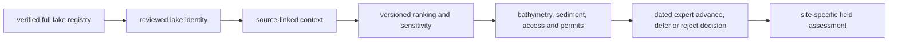

# Sweden Lake Priorities

The current governed Sweden lake ranking has **zero admitted candidates**. Its
[report](../../../report/countries/sweden/sweden_lake_evidence_richness_v66.md)
records `governing_svar_registry_missing`: the normalized SMHI SVAR registry
needed to verify lake identity and derive the candidate population is absent
from the governed source tree. The [fieldwork preparation
screen](../../../report/countries/sweden/sweden_lake_fieldwork_preparation_v66.md)
is empty for the same reason. No current lake rank, fieldwork order, score,
or shortlist is available.

A separate derived review subset at
`data/svar/review/sweden_lake_candidate_registry.geojson` contains 99 map
features. It does not replace the full normalized registry or
its source authority. The retained candidate review refers to 40,523 source
lakes, whereas a separately recovered normalized export contains 40,565. That
population mismatch and the missing source capture require reconciliation and
qualified review before either source can support a new ranking. The
[recovery record](../../../report/source-relations/svar/normalized-export/README.md)
preserves the recovered export's identity and limits.

## What the ranking would measure

The ranking design compares evidence linked to an identified official lake:
nearby human ancient DNA, direct and nearby pollen, archaeology, animal
context, evidence diversity, and an area-based lake screen. The declared
weight profile and 10, 20, 30, 40, and 50 km distance bands are documented in
the [report](../../../report/countries/sweden/sweden_lake_evidence_richness_v66.json).
These are a model definition, not an evaluated score for any current lake.

Evidence richness is distinct from coring suitability. Even a supported high
rank would not establish bathymetry, intact sediment, lake access, permits,
landowner consent, conservation compatibility, field safety, or a sampling
protocol. The [Lyngsjön visit](../../fieldwork/lyngsjon-lake-fieldwork/index.md)
is a separate dated observation and does not supply those missing measurements
for the ranking.

## Admission and decision path

Before restoring the ranking, the full registry and its candidate subset need
matching source counts, content identities, official lake identifiers, polygon
geometry, names and representative points. Temporal claims need source-owned
chronology. Source classes with unavailable authority remain context or are
excluded under the governed method; an absent value cannot be scored as an
observed zero.

A desk decision dossier for each reviewed lake must preserve the ranked result
and its version separately from the later decision. It needs source identity,
contributing evidence, basin morphology, bathymetry, sediment conditions,
shoreline and boat access, ownership and permissions, conservation limits,
hazards, logistics, dated field observations with contributor and media lineage,
and an expert reason for advancing, deferring or rejecting. Missing essential
field evidence blocks advancement. A map visit or ranking row cannot be
relabeled as sampling ready.

The current zero-candidate report therefore supports a **defer** posture for
new ranking-based field decisions. It is not an expert rejection of a particular
lake. Existing named southern Sweden sites and the Lyngsjön visit remain
separate source and fieldwork records, without a current rank inferred from
them.

## Current governed outputs

- [Lake evidence-richness report](../../../report/countries/sweden/sweden_lake_evidence_richness_v66.md)
- [Fieldwork-preparation screen](../../../report/countries/sweden/sweden_lake_fieldwork_preparation_v66.md)
- [Archaeology-weight sensitivity](../../../report/countries/sweden/sweden_lake_archaeology_sensitivity_v66.md)
- [Southern Sweden temporal synthesis](../../../report/countries/sweden/sweden_land_use_synthesis_v66.md)
- [Recovered registry source record](../../../report/source-relations/svar/normalized-export/README.md)
- [Nordic atlas](../index.md)
