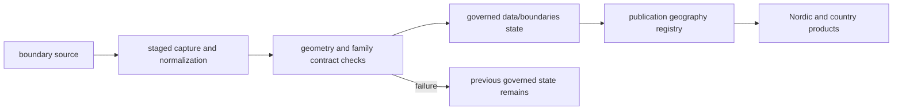
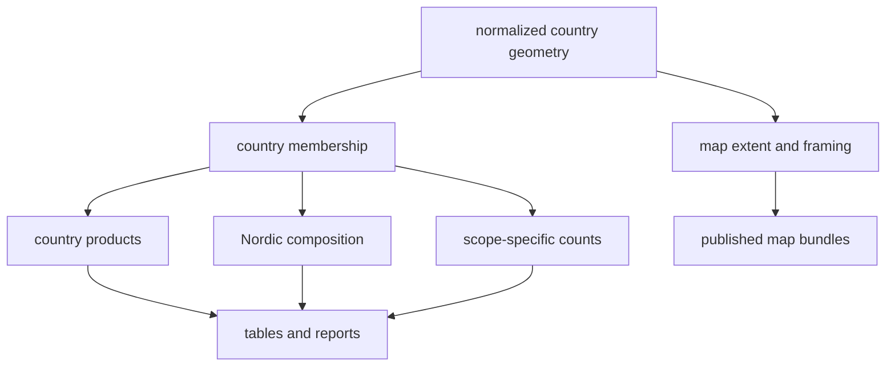
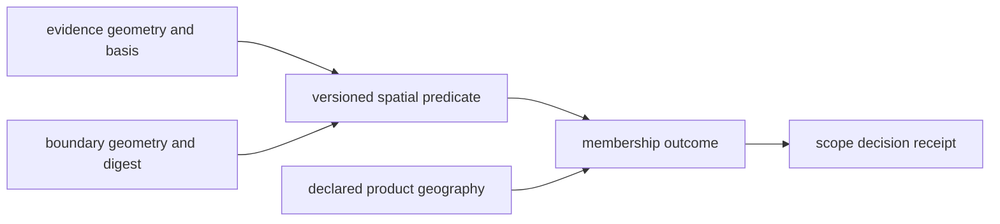

# Boundaries

The boundary family supplies the four country geometries used to define
Sweden, Norway, Finland, Denmark, and their shared Nordic scope. It governs
publication framing, country filtering, and membership tests; it contributes
no scientific weight to a feature inside a polygon.

## Captured State

The current source receipt `data/boundaries/raw/source_manifest.json` identifies
Natural Earth **Admin 0 - Countries, version 5.1.1**, under public-domain terms
in `EPSG:4326`. The exact full asset was received on **27 October 2026 at
22:49:30 UTC**; the country artifacts were built on **2026-10-28**. The v2 receipt
keeps UTC capture time separate from build date and identifies reuse of the
retained asset. Its 13,287,234 bytes and 258 source features have SHA-256
`239eec57ac17f100a11e2536cffc56752c318b50ae765b0918ff7aab4ce8f255`, matching the
earlier 4 September receipt. No second download supplied the materialization.
The normalized GeoJSON SHA-256 is
`8c011078f381380e0384edcf2b056ac5fbf5ae33d8f497e0e48b6347663c9394`.
The collector snapshot label `v66` belongs to a different inventory layer and
does not identify the Natural Earth release.

The named selection profile `nordic-four-country-admin0-with-aland` retains
these exact source administrative members:

| Public country | Source `ADM0_A3` members | Raw source features | Polygon parts |
| --- | --- | ---: | ---: |
| Sweden | `SWE` | 1 | 41 |
| Norway | `NOR` | 1 | 120 |
| Finland | `FIN`, `ALD` | 2 | 58 |
| Denmark | `DNK` | 1 | 15 |

The governing source represents Åland separately as `ADMIN=Aland`,
`NAME=Åland`, `ADM0_A3=ALD`, with the same Finnish `SOV_A3=FI1` as `FIN`.
The earlier primary-code-only selection omitted this represented unit.
The new Finnish raw artifact preserves both original feature/property objects;
normalization concatenates their polygon parts into one public Finnish
MultiPolygon, without union, simplification or coordinate changes. Each review
part retains its source administrative code. The other three raw artifacts
remain byte-identical. All 120 Norwegian parts remain, including the southern
part; the source feature does not name individual parts. The explicit Danish
selection excludes separately represented `FRO` and `GRL`, despite their shared
Danish sovereignty field. This is a declared four-country publication profile,
not a blanket sovereignty union or qualified territorial-suitability decision.

`data/boundaries/review/manifest.json` accounts for **3,039 points** and
**141 point reviews**. All four global country reviews remain pending and
release posture is `blocked_pending_qualified_boundary_review`.

| Source point population | Rows | Assigned | Review | Unassigned | `UNASSIGNED` country partition |
| --- | ---: | ---: | ---: | ---: | ---: |
| animal aDNA | 161 | 7 | 1 | 153 | 154 |
| LandClim | 490 | 476 | 14 | 0 | 14 |
| Neotoma | 193 | 193 | 0 | 0 | 0 |
| SEAD | 2,195 | 2,069 | 107 | 19 | 122 |

The seven geometry-membership changes are two LandClim records for
Kolmilaträsk (`KOLM` and the separately owned Lake Kolmilaträsk sequence),
SEAD sites 3447, 3457, 3528 and 3652, and the Kastelholm sheep locality.
Their source identities, coordinates, native country fields and lineage remain
unchanged. All seven now lie within the Finnish profile. The four SEAD points
retain review because their prior captured decisions were unassigned; their
new containment does not add them to the historical admitted SEAD cohort.

The first materialization revealed a separate comparison defect: a changed
global boundary digest alone turned 2,388 otherwise matching prior decisions
into conflicts, producing 2,403 point reviews. That literal outcome and all
3,039 dispositions remain preserved. The corrected comparator distinguishes
`agrees_authority_changed` from a different country, method or status and
retains both authority digests. Its current population is 2,384 agreements
under changed authority, four genuine prior conflicts and 651 points without
a supplied prior. Missing or malformed authority still conflicts. Neither the
new agreement token nor fresh containment grants qualified suitability approval.

One offline source adoption and review at `ff5fe8d5627fc3c38d7f5de1901a292438ccf0b7`
completed in 16.24 s with RSS 263,225,344 bytes. A separate standard-library
observer checked all five original source features, exact four-country
normalization and every point using winding-number containment and segment
distances in 10.20 s with RSS 212,287,488 bytes. The comparison-only correction
at `d5907ed0ea56c2d3f2fd96cf529939e5be8df86e` then regenerated the review in
15.74 s with RSS 111,640,576 bytes. Its independent 1.17 s readback, RSS
73,678,848 bytes, checks all 3,039 transitions, reasons, authority identities
and the complete queue while reusing the unchanged geometry qualification.
Each job meets 180 s / 768 MiB / 32 MiB; the corrected producer accounts for
13,105,440 bytes of governed products and retained artifacts before its final
small metadata/log additions. All 17 point-source files, six boundary sources,
consumed Python files, HEAD and raw index remained stable in each execution.
An earlier wrapper failed before adoption on a manifest-shape assumption;
its error is retained. No source download or geometry adoption was repeated.

The raw local observations are under `artifacts/root/aland-country-members/`
and `artifacts/verification/aland-country-members/`. These are computational
checks, not independent human scientific review. The earlier consistent
ISO-code/name correction and four nonfinal goat-locality exclusions remain
in force; their source records were not reopened or imputed here.

Decision status and governed country are different partitions. A review may
retain a derived country, while near-border and outside points can remain
`UNASSIGNED`. Strict boundary contact uses a 1e-12-degree numerical epsilon;
contact, multiple containment and proximity are reviewed deterministically.
The 0.15-degree planar proximity band is a computational review threshold,
not coordinate uncertainty or a published geodesic distance. Invalid or
out-of-range coordinates refuse; offshore points remain unassigned or reviewed
and are never snapped. Source coordinate precision remains its own evidence.
Scientific regional distances use the canonical unrounded WGS84 helper.

Existing captures and published copies retain their own boundary identities.
They are not silently relabeled as rebuilt under this newer profile. New scope
exports use `data/boundaries/normalized/nordic_country_boundaries.geojson` and
carry the current selection rule and pending-review posture.

## Acquisition And Replacement

Refresh uses a staging swap. The collector prepares a temporary family tree,
validates it, and replaces `data/boundaries/` only after success. A failed
refresh preserves the preceding governed state. This makes a geometry change
reviewable as a collection change rather than an in-place mutation of a
published product.

## How Geometry Changes Propagate

One boundary decision can affect several downstream views even when no pollen,
archaeology, hydrography, or ancient-DNA record changes:

The affected outputs must therefore move together. Updating a displayed
polygon without recomputing membership leaves the map and its counts in
different geographic states. Recomputing membership without preserving the
boundary snapshot makes the cause of a changed count impossible to recover.

## What A Boundary Decision Means

A point selected into a country product intersects the geometry used by that
product under its declared rule. The decision does not establish:

- historical nationality or cultural affiliation;
- locality precision beyond the point's own coordinate evidence;
- temporal overlap with any record in the same country;
- source completeness within the polygon; or
- scientific support from the boundary itself.

Modern framing and historical evidence remain different claims. A broad or
region-only locality cannot acquire exact country membership through an
arbitrary representative point.

## Audit A Scope Change

When a record enters or leaves a country bundle, compare three identities:

1. the evidence record and its coordinate provenance;
2. the boundary collection version and normalized digest; and
3. the product geography registry and selection rule.

An unchanged evidence record with changed boundary membership is a framing
change. An unchanged boundary with revised coordinates is an evidence change.
An unchanged pair with different product membership is a scope or admission
change. Keeping those causes separate prevents geographic filtering from
masquerading as new scientific evidence.

| Observed difference | First authority to inspect | Interpretation |
| --- | --- | --- |
| polygon outline changed | normalized boundary digest | boundary collection changed |
| record moved across an unchanged outline | record coordinate provenance | evidence location changed |
| membership changed while both are stable | product selection rule | publication scope changed |
| map outline changed but counts did not | published bundle lineage | geometry and membership may be out of sync |

Country membership is a reproducible predicate, not a property that upgrades
the underlying record. A point may be inside the current Sweden polygon while
remaining historically ambiguous, coarsely located, or temporally unrelated
to every other point in that product.

### Membership Decision Receipt

Every reusable geography decision retains both sides of the predicate:

| Receipt field | Why it is required |
| --- | --- |
| evidence member | stable object identity and the coordinate or geometry claim evaluated |
| spatial basis | reported, resolved, representative, centroid, or other governed geometry method |
| boundary identity | collection version, normalized digest, country feature, and coordinate reference system |
| predicate | containment or intersection method, including edge handling |
| decision scope | country, Nordic composition, or another named product geography |
| outcome | included, outside scope, spatially unresolved, or refused |
| product effect | affected manifest member, exclusion, count, and parent–child relation |

This receipt prevents a country label copied into a downstream table from
becoming the authority for membership. It also makes edge cases reviewable
without silently moving a source coordinate to force a desired country result.

Continue to [boundary exports](../publications/boundary-exports.md) for reuse,
[maps](../publications/maps.md) for rendering, and
[publication reports](../publications/reports.md) for scope lineage.
