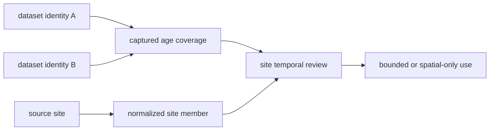
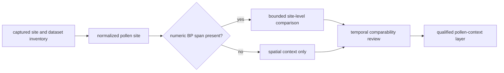
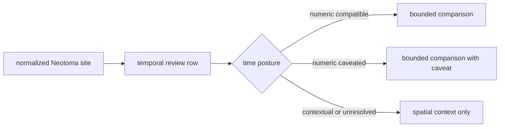
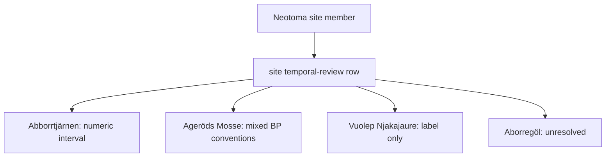
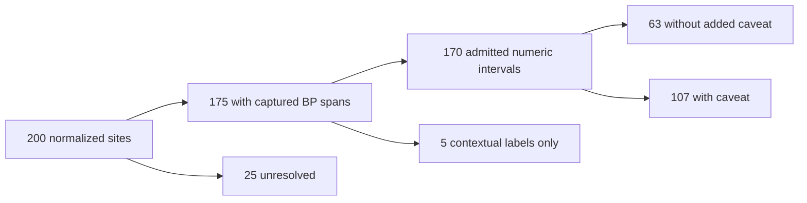

# Neotoma

Neotoma supplies primary pollen context as normalized palaeoecological site
records. It complements LandClim with a site-centered view, but temporal
support varies by record and remains distinct from a captured chronology
model.

Its pollen-site context is governed at the site and dataset levels. A public
point can orient a reader to a place, while dataset identity and the temporal
review determine whether the record supports spatial context, bounded temporal
comparison, or no numeric-time claim.

## Checked-In Evidence

The legacy point-layer temporal review covers 200 normalized sites:

| Posture | Count | Interpretation |
| --- | ---: | --- |
| site has a numeric BP span | 175 | bounded site-level comparison is possible under the recorded caveat |
| site lacks a BP span | 25 | spatial context only |
| point-layer chronology rows | 0 | the compact site layer does not embed relational chronology rows |

Within the review, 63 records are numeric intervals, 107 are numeric intervals
with caveats, 5 retain contextual labels only, and 25 remain unresolved. These
categories are more informative than calling all 200 sites “dated.”

### Relational Snapshot

The governed `data/neotoma/relational/` snapshot preserves the detailed
source relationships omitted from the compact map layer. Its manifested v2
surfaces contain 200 sites, 206 collection units, 209 datasets, 384
chronologies, 2,798 chronology controls, 12,388 samples, 23,281 age claims,
1,262 variables, and 370,936 observations.

The age claims remain partitioned by comparability: 11,526 comparable, 10,622
context-only, 294 refused, and 839 unresolved. The snapshot also preserves 150
conflict records and 52 orphan records rather than hiding them. Of the 200
sites, 193 have assigned governed-country decisions and are spatially eligible;
7 remain in review under `UNASSIGNED` and are blocked from propagation.

Every multipart surface is bound to source snapshot
`sha256:b2bcb99157e10b0c9f13c228acc12eabcb39d96a1f39c86ec25e34aacd78c791`
and build
`sha256:92dd52619837f3641d004a1a5dbe38f9ab6023a79f61989314bb90e612eb58e1`.
The manifest validates row counts, stable IDs, country partitions, part hashes,
and the complete materialization digest.

### Sample-level LRA prerequisite screen

The source-bound prerequisite report
`artifacts/v3/source/neotoma-chronology-count-frontier001/report002.json`
checks each relational sample for at least one mechanical numeric-count candidate
and at least one source age claim marked `comparable`. These conditions are
screening leads, not a selected chronology, an authenticated pollen count table,
or an executable LRA request. The report is bound to the raw archive and
relational manifests and has SHA-256
`aff96149a10b36bb89e9a781ae1f7a653b219deec6a09d2a6f089d474c3763cb`.

| Source partition | Samples | With numeric-count candidate | With count candidate and comparable age claim |
| --- | ---: | ---: | ---: |
| Sweden | 5,764 | 3,093 | 2,379 |
| Denmark | 279 | 187 | 0 |
| Norway | 3,884 | 1,233 | 921 |
| Finland | 2,184 | 402 | 127 |
| Unassigned | 277 | 194 | 111 |
| **Captured total** | **12,388** | **5,109** | **3,538** |

Every captured sample has some age claim; the comparable-claim intersection
therefore narrows the numeric-count leads from 5,109 to 3,538. Denmark's zero
is specific to this captured source and conservative count screen: its 91
comparable age claims and 187 count-candidate samples belong to disjoint
sample sets. `Unassigned` is an accounting partition, not a fifth Nordic
country. Multiple alternative claims are retained, and no age model is chosen.
The mechanical count screen also includes non-pollen source elements and
conservatively refuses observations with source identity conflicts. An
independent source-part check found 32,899 non-`pollen` elements among the
140,541 numeric-count observations and 218,833 otherwise numeric observations
refused because a parent carried a source identity conflict, including
dataset-level default-chronology assertion conflicts. That coupling still
needs source-level review; dropping the refusal would change the denominator.
Taxon/PPE, count denominator and unit, chronology selection, basin geometry
and parameter binding still require review. **Zero real Neotoma samples are
admitted to LRA or held-out vegetation scoring from this report.**

### Bounded candidate sample series

`inspect_neotoma_lra_candidate_series` in the installed host materialization
API reads the authenticated raw and relational parents and requires an explicit
list of at most 16 source sample IDs. It returns a canonical, hashed review
export with each sample's source identity, native observation values and units,
count decisions, agreement of both source element labels, all typed age-claim
alternatives and reason-coded refusals. A source label of `pollen` is a review
lead only when both source element fields agree; it does not establish a
reviewed taxon mapping, PPE or compatible count denominator. The API never
chooses an age claim or produces an executable LRA request.

For source samples `552226` through `552229` in one captured Swedish collection
unit, the bounded export preserves 116 numeric count observations: 109 carry
the exact source element label `pollen` and seven are labelled spore. It retains
four comparable typed age claims without ordering or selecting them. The four
samples remain refused for numerical LRA and held-out scoring pending chronology,
taxa/PPE, basin, unit and source-conflict review. These four source samples are
not asserted to be four independent sites or a complete stratigraphic core.

### Full-source agreeing-pollen prerequisite screen

`inspect_neotoma_lra_pollen_screen` in the installed host API reads the
authenticated source and screens every captured sample. It requires at least
one numeric count observation with **both** source element fields agreeing on
`pollen`, plus a separate typed, comparable age claim owned by that sample.
The canonical report is
`artifacts/v3/source/neotoma-pollen-screen-20260921/report002.json` (SHA-256
`e8a8f392abb5be421111a01bb75823c7743b6b3d66bc6cbb415f65dc61be4e42`).
Its independent source reconciliation is recorded in
`artifacts/v3/source/neotoma-pollen-screen-challenge-20260921/REVIEW.md`.

| Source partition | Samples | Agreeing pollen count observations | Necessary candidate samples | Refused samples |
| --- | ---: | ---: | ---: | ---: |
| Sweden | 5,764 | 63,510 | 2,379 | 3,385 |
| Denmark | 279 | 4,477 | 0 | 279 |
| Norway | 3,884 | 28,376 | 921 | 2,963 |
| Finland | 2,184 | 5,172 | 127 | 2,057 |
| Unassigned | 277 | 6,107 | 111 | 166 |
| **Captured total** | **12,388** | **107,642** | **3,538** | **8,850** |

The 140,541 mechanical count candidates comprise 107,642 agreeing pollen
labels, 32,740 non-pollen labels and 159 with a missing second element-type
field. Another 230,395 observations fail the numeric count screen. Refusal
reason counts can overlap; 8,850 is the number of distinct refused samples.
Denmark has pollen count observations, but its 187 samples with such counts are
disjoint from its 91 samples with an owned comparable age claim. The 3,538
necessary candidates equal the older count-and-age lead set for this captured
source by independently checked sample ID, not by assumption. `Unassigned`
remains an accounting partition, not a fifth Nordic country.

This is a source-screening result, not a reviewed pollen denominator or LRA
admission. Taxa/PPE, count compatibility, selected chronology, source rights,
basin geometry and parameters still need review. **Zero Neotoma samples are
admitted to numerical LRA or held-out vegetation scoring by this screen.**

The source-bound priority slice
`artifacts/v3/taxa-review/neotoma-candidate-priority-20260921/priority-successor.json`
(SHA-256 `af8e6116776ca320d416a157a79e3a6280aa8332dc72c41661aadac267461e34`)
links the 3,538 prerequisite samples to **73,559** agreeing pollen count
observations across **674 existing Neotoma review concepts**. It retains each
concept's stable row ID, source identity, country counts and distinct sample
frequency for prioritizing Anneli's review. The complete review bundle still
contains **10,908 rows** across sources; every selected Neotoma concept remains
`needs_discussion`. Frequency does not approve a taxon, PPE, count denominator
or LRA input.

### Observed count mass in prerequisite samples

The source-bound count-mass audit
`artifacts/v3/source/neotoma-candidate-mass-20260921/mass-snapshot007.json`
(`sha256:fe589394b134de482195045819437c4cd567ea15833e54cb002fb95648024e19`)
retains exact integer values for the **3,538** prerequisite samples by sample,
source unit, source element label and country. It separates reported zero from
missing or refused values. These are observed source sums, not a reviewed
compatible pollen denominator. Denmark's zero below applies to the prerequisite
sample intersection; the whole-source screen above still records Danish pollen
counts.

| Source partition | Prerequisite samples | Agreeing pollen count observations | `NISP` pollen source sum | `NISP digitized` pollen source sum |
| --- | ---: | ---: | ---: | ---: |
| Sweden | 2,379 | 47,722 | 2,032,773 | 12,911 |
| Denmark | 0 | 0 | 0 | 0 |
| Norway | 921 | 22,183 | 691,964 | 0 |
| Finland | 127 | 1,621 | 33,504 | 0 |
| Unassigned | 111 | 2,033 | 70,578 | 0 |

The audit also retains non-pollen counts, conflicting or missing element labels,
refused count observations and zeros in separate partitions. `NISP` and
`NISP digitized` stay separate, and `Unassigned` is not a fifth Nordic country.
Taxon/PPE, compatible denominator, source rights, selected chronology, basin
geometry and parameters remain unresolved; **zero samples are admitted to LRA**.

### Curation Lineage

| Boundary | Governing material | Decision preserved |
| --- | --- | --- |
| dataset acquisition | `raw/neotoma_pollen_dataset_downloads/manifest.json` and its captured parts | which downloaded responses belong to the snapshot |
| dataset inventory | `raw/neotoma_pollen_dataset_inventory.json` | dataset identity and coverage represented by the capture |
| site capture | `raw/neotoma_pollen_sites.json` | source site records before family normalization |
| site normalization | `normalized/nordic_pollen_sites.geojson` | stable spatial members used by public products |
| temporal review | `review/temporal_review.json` | numeric, caveated, contextual, or unresolved time posture per site |

The download bundle is preserved separately from the normalized map layer so a
reader can distinguish what the source returned from what the product admits.
A normalized point is therefore inspectable as a transformation, not presented
as an unexplained database export.

### Dataset And Site Are Different Identity Levels

A Neotoma site can expose one or more dataset records, while a dataset can
carry age-range statements, contributor notes, and lineage that do not belong
to the site name alone. Preparation therefore retains both levels:

| Identity level | What it owns | Unsafe collapse |
| --- | --- | --- |
| site | stable place-oriented source identity and reported geometry | treating the display name as a universal pollen-sequence key |
| dataset | dataset identity, type, contributor and source notes, and captured age coverage | merging several datasets into one unexplained site interval |
| normalized site member | repository spatial member plus summarized temporal posture | presenting the summary as a chronology or age-depth model |
| temporal review row | comparability decision and caveat for the current capture | inheriting family-wide time eligibility |

The review can summarize a site for product use while the captured dataset
inventory retains the members needed to challenge that summary.

## What Neotoma Supports

- site-centered pollen and palaeoenvironmental comparison;
- cross-place context across the governed capture;
- lake-linked or proximity-based pollen support under explicit spatial rules;
- temporal comparison when the individual review row records a compatible
  numeric BP interval;
- public context layers that preserve site identity and temporal posture.

## Chronology Boundaries

A site span summarizes captured age coverage. It is not equivalent to a
chronology table, age-depth model, or sample-level date. The compact point layer
contains no chronology rows, while the relational snapshot preserves
chronology, chronology-control, sample, and alternate age-claim records. A
point-layer BP span must therefore remain a display summary; analyses requiring
sample time use the relational claims and retain their comparability posture.

Units and interval semantics also matter. A numeric label is not accepted for
comparison merely because it contains “BP”; the review posture records whether
the value is compatible with repository temporal rules.

## Site-Level Temporal Admission

Temporal eligibility is decided per normalized site, not inherited from the
family name or the visual presence of a marker.

For a temporal comparison, retain the site identifier, numeric bounds, unit
and basis, review class, caveat, and the other member's compatible interval.
For a spatial-only comparison, say explicitly that the site contributes pollen
context without a numeric chronology claim. This prevents the 175 sites with
captured spans from making the full 200-site layer appear uniformly dated.

### Four Governed Outcomes

The checked-in review contains concrete examples of every temporal posture:

| Site | Review outcome | Why |
| --- | --- | --- |
| `13338` Abborrtjärnen | `numeric_interval` | one calibrated BP site span, `0–9815 BP`, is available |
| `12` Ageröds Mosse | `numeric_interval_with_caveat` | the site summary combines calibrated and uncalibrated radiocarbon BP conventions |
| `28859` Lake Vuolep Njakajaure | `contextual_label_only` | age coverage is visible, but the normalized record does not support repository numeric comparison |
| `2961` Aborregöl | `unresolved` | no age-range detail is available in the captured site review |

These are not successive quality grades through which every site should move.
They are claim-specific outcomes derived from the captured evidence. A site
may remain useful spatial context even when numeric comparison is refused, and
a broad numeric span does not substitute for the missing chronology rows.

### Preserve The Admission Denominator

The 175 sites with a captured BP span are not the same population as sites
admitted to numeric comparison. Admission is narrower:

| Population | Count | Permitted use |
| --- | ---: | --- |
| captured site members | 200 | denominator for the governed Neotoma layer |
| members with a captured BP span | 175 | evidence that some temporal description was captured |
| admitted numeric intervals | 63 | bounded comparison under the recorded interval semantics |
| admitted numeric intervals with caveats | 107 | bounded comparison only when the caveat travels with the result |
| contextual labels only | 5 | spatial or descriptive context; no repository numeric comparison |
| unresolved time posture | 25 | spatial context only |

Thus, 170 members currently enter numeric comparison, not 175 and not 200.
The five contextual-label members are the important boundary case: source age
coverage is visible, but the normalized review refuses to promote it into a
repository numeric interval.

Every summary must name its denominator. “Most Neotoma sites are dated” hides
the distinction between captured labels, admitted comparison intervals, and
sample chronology that this review exists to preserve.

## Relationship To LandClim

Both families provide primary pollen context, but their normalized units and
strengths differ:

- LandClim combines site sequences with REVEALS grid context;
- Neotoma centers the comparison on palaeoecological sites and their captured
  dataset coverage;
- neither family replaces the other;
- neither becomes direct sample evidence when displayed beside aDNA.

The two families are not guaranteed to be statistically independent. Captured
Neotoma dataset notes include contributions associated with the LandClim
project and the European Pollen Database. Before describing agreement as
corroboration, compare source dataset identity, contributor, site, sequence,
and age coverage. Two publication layers can be separate repository families
while still representing one upstream observation lineage.

A direct LandClim–Neotoma comparison therefore pairs a LandClim site sequence
with a Neotoma normalized site member and retains both temporal decisions. A
REVEALS grid cell may provide model context for that pair, but it does not
increase the count of site observations. If shared lineage cannot be excluded,
the result is contextual agreement rather than independent corroboration.

## Choose Neotoma For The Question

| Question | Use | Retain with the claim |
| --- | --- | --- |
| Which captured palaeoecological sites provide pollen context? | normalized site members | site and dataset identity plus publication scope |
| Can two records be compared in time? | the individual temporal-review row | bounds, units, review class, caveat, and comparison rule |
| Does a site's BP span constitute an age-depth model? | no | the span is site-level captured coverage, not sample chronology |
| Is absence from the layer evidence of no palaeoecological record? | no | capture and normalization scope must be checked first |

### Review A Refresh Across Identity Levels

Compare dataset membership before site membership. A dataset can change its
contributor, chronology coverage, or site relation without creating a new
site; conversely, a newly captured dataset can add evidence to a site already
present. The refresh receipt therefore accounts for release and dataset IDs,
site IDs, dataset-to-site relations, admitted temporal rows, exclusions, and
published site members. Equal site counts cannot prove equal pollen evidence.

## Governing Surfaces

- `data/neotoma/raw/neotoma_pollen_dataset_inventory.json` records datasets;
- `data/neotoma/raw/neotoma_pollen_sites.json` records captured sites;
- `data/neotoma/normalized/nordic_pollen_sites.geojson` governs normalized
  spatial records;
- `data/neotoma/review/temporal_review.json` governs temporal posture;
- `data/neotoma/relational/manifest.json` governs the multipart relational
  snapshot and binds its sites, units, datasets, chronologies, controls,
  samples, age claims, variables, observations, conflicts, and orphans;
- `data/source_spatiotemporal_posture_registry.json` summarizes cross-family
  comparison status.

A published Neotoma point inherits the posture of its governing review row,
not a stronger interpretation suggested by map precision.
