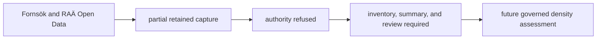
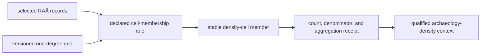

# RAÄ

RAÄ is intended to supply dense, Sweden-specific archaeology context from
Riksantikvarieämbetet's published Fornsök/Open Data surfaces. The repository
retains capture metadata and derived density files for audit, but does not
currently admit them as governed archaeology evidence. Under decision D2-033,
the exact byte-identical v0.1.8 density pair is visible by default as degraded
historical context. RAÄ authority remains refused until the raw inventory, raw
summary, normalized counts, and qualified scientific review reconcile.

## Checked-In Evidence

| Surface | Current state | Meaning |
| --- | --- | --- |
| source inventory denominator | unavailable | no admitted raw inventory and raw summary reconcile the retained metadata |
| classified-record denominators | unavailable | retained summary values are not governed evidence while authority is refused |
| density cells | 106 retained cells, default-visible as degraded context | the exact historical surface is display-only, not admitted RAÄ evidence |
| temporal evidence | not applicable | the refused density surface cannot contribute dated evidence or same-period comparison |

Missing governed denominators are not scientific zeros. The 106 retained cell
values sum to 339,412, while retained metadata reports 318,265
`Fornlämning` WFS hits. The historical producer requested the national hit
count once and each one-degree cell's hit count in a separate BBOX query. It
did not archive one source inventory and assign each record to one cell. The
arithmetic difference of 21,147 therefore compares unbound query
denominators; it is not a measured count of duplicate or missing records.
Cell-boundary overlap, source changes between requests, and spatial reach are
possible contributors, but the retained files have no record IDs, per-query
responses, or capture times to assign any share of the difference. The cell
values remain display-only and cannot support an analytical RAÄ count.

## Read A Density Cell

A retained cell currently shows only the numeric value preserved in the exact
historical one-degree surface. It cannot be called a governed RAÄ record count.
After authority admission and regeneration, a cell could answer the bounded
question of how many governed records in a selected class fall within the
aggregation area. In the current refused state it establishes none of the
following:

- a complete inventory of past activity;
- uniform survey or registration effort;
- chronology shared by records inside the cell;
- association with a nearby pollen, lake, fieldwork, or aDNA feature; or
- site-level distance from a feature to every contributing record.

Cell size is part of the result. A one-degree aggregation supports broad
national or regional context, not precise local-distance reasoning. Rendering
the cell with a smooth color ramp does not increase spatial resolution.

## Aggregation Contract

| Layer | Observation unit | Defensible denominator | Spatial meaning |
| --- | --- | --- | --- |
| source summary | WFS feature hit in the historical query | unavailable while authority is refused | one national query, without an archived disjoint record inventory |
| classified summary | record in a declared RAÄ class | the selected classification population | classification count, not event count |
| density layer | one-degree cell | 106 historical cells; count population unresolved | degraded display of the retained value only |
| map rendering | colored cell polygon | 106 display members, zero scientifically admitted members | visual orientation with authority and count warnings |

The transformation changes the observation unit. A statement about a density
cell must cite the cell and classification contract; a statement about an
individual RAÄ record requires the source record, which the public density
surface does not expose.

### Retain The Aggregation Receipt

A density comparison is reusable only when the aggregation choices travel with
the cell value:

| Receipt field | Required meaning |
| --- | --- |
| source population | governed RAÄ capture and source classification included |
| membership predicate | rule assigning source records to cells |
| grid definition | cell geometry, resolution, coordinate reference system, and boundary convention |
| numerator | count of admitted registry records in the named cell |
| denominator | selected source population or comparison-cell population used by the claim |
| missing and duplicate posture | treatment of unusable geometry, repeated identities, and multi-part records |
| product identity | publication version and stable cell identifier |

Two cells are comparable only under the same source population,
classification, grid, and membership rule. Equal color classes from different
contracts are visually similar, not necessarily quantitatively comparable.

## Audit An Archaeology-Density Claim

1. Read the visible authority posture first. The current repository state is
   degraded/refused and cannot support an archaeology-density claim even though
   the exact historical layer is displayed.
2. Identify the Sweden product, RAÄ layer, cell, historical-pair hashes and
   unbound 339,412-cell-sum versus 318,265-national-query comparison. After
   admission, identify the current capture and classification being read and
   confirm that its counts share one capture.
3. Treat the cell value as an aggregate count, not a site-level distance or a
   chronology statement.
4. State the one-degree spatial support and Sweden-only reach.
5. When comparing with SEAD, retain both observation units and do not add their
   counts into one archaeology population.
6. For a stronger local or temporal claim, return to the appropriate source
   records rather than interpolating detail from the color scale.

## Relationship To SEAD

| Dimension | RAÄ | SEAD |
| --- | --- | --- |
| reach | Sweden-specific | broader environmental-archaeology context |
| current public geometry | 106 degraded historical density cells | normalized site points |
| temporal posture | refused; no admitted time dimension | mixed site envelopes: numeric where linked chronology supports them, otherwise label-only or unresolved |
| strongest use | retained provenance pending authority admission | wider site-centered archaeology context |
| invalid shortcut | generalize Swedish density to the Nordic region | infer same-period evidence from undated proximity |

The families are complementary and must not be merged into one archaeology
denominator. Their observation units, geographic reach, spatial resolution,
and capture depth differ.

## Governing Surfaces

- `data/raa/raw/arkreg_v1_0_wfs_capabilities.xml` preserves service capability
  context;
- `data/raa/raw/publicerade_lamningar_centrumpunkt_schema.xml` preserves the
  captured feature schema;
- `data/raa/raw/fornsok_domains.json` preserves governed domain values;
- `data/raa/normalized/sweden_archaeology_layer.json` governs counts, cell
  size, classification, and source identity; and
- `data/raa/normalized/sweden_archaeology_density.geojson` governs the visible
  density geometry.

Public maps may display only the exact D2-033 historical pair while authority
remains refused. The layer must remain visibly degraded, display-only,
chronology-absent and propagation-ineligible; any substituted pair is excluded.
Continue to
[RAÄ exports](../publications/raa-exports.md) for the publication role and
[source comparison](source-comparison.md) before combining RAÄ with another
family.

## Private Source Ownership Audit

The RAÄ source package provides a private read-only ownership audit for the inspected national GeoPackage profile. Callers pin complete local source bytes, and saved inspection reconstructs every source row before returning lineage. Native records, included remains, direct/nested properties and separate point/line/polygon/positional-uncertainty rows retain their original identities and scalar values. Container-header accounting does not validate geometry or derive representative coordinates. This capability neither adopts a canonical source release nor changes the historical density authority, chronology, country assignments or scientific-review posture. Captured provider terms and HTTP custody remain explicit upstream evidence.

Native GeoPackages and large row inventories remain in caller-selected local
data directories. Git retains the audit implementation and compact contracts;
a local raw capture does not by itself change public source admission.

Legacy point/density validation requires explicit reconciled populations and a
native identifier for every feature. It refuses missing, boolean or fractional
counts, conflicting population aliases, omitted/malformed features, duplicate
JSON keys and nonfinite values. Zero remains a valid declared count. Invalid
density cells make the total unavailable instead of contributing a fabricated
zero. These checks preserve the historical population discrepancy and source
review requirements; they do not validate geometry or create source approval.
