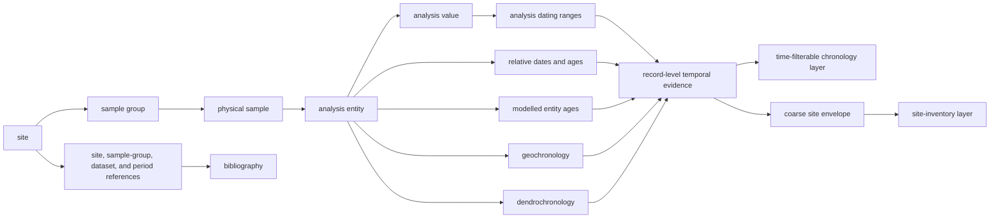
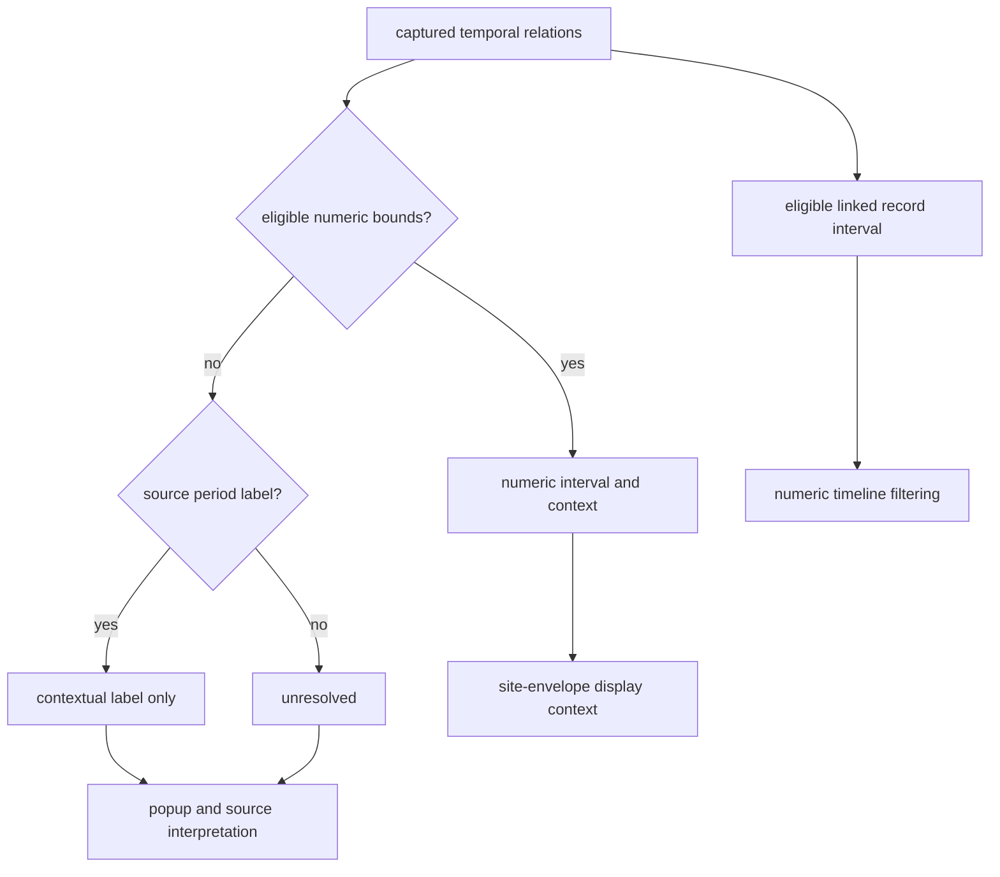
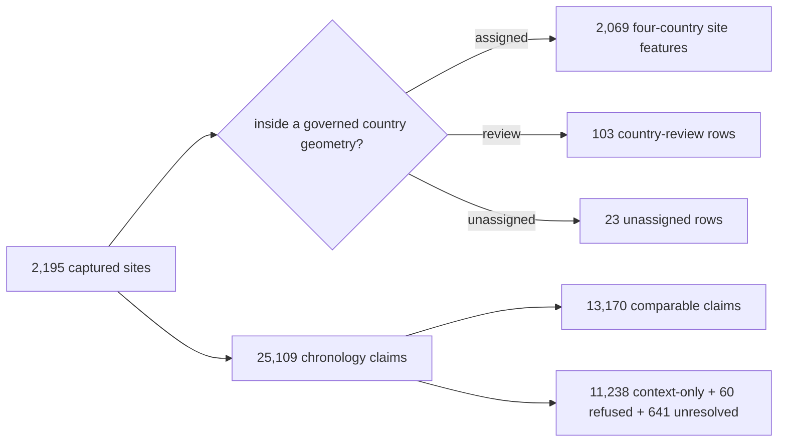

# SEAD

## Unresolved source context API

The site-inventory API reader requires filtered query projections to be `*` or
comma-separated literal field names without spaces. Unfiltered `all_rows`
passes spaced field lists through; filtered `rows_by_ids` refuses that spelling
before making a request. This restriction keeps the internally requested filter
owner unambiguous and does not establish provider support for spaced fields.

The separately named
`bijux_pollenomics.collection.sources.sead.acquisition.context` API can prepare a
private source-context packet for one or two explicitly selected native site IDs
and retained UUIDs. `SeadContextSite` requires membership status `review` or
`unassigned`; it has no assigned-country field. `acquire_unresolved_sead_context`
uses the existing nineteen chronology-context table plans and dependency filters.
It requests only identity and owner fields from `tbl_analysis_values`, not its
measurement values. Native age fields, nulls, source notes and reference IDs remain
literal context; they do not establish a dated ecological event.

The historical low-level receipt field `country_scope = [SE, DK, NO, FI]` records
**regional request intent only** in this API. It is not evidence that any returned
site belongs to those countries. The separate context manifest explicitly records
`country_admission: false` and `ecological_event_admission: false`. It cannot replace
governed country reconciliation or be consumed as a country-assigned acquisition.
Chronology, dating-laboratory, dendro-lookup and season foreign keys remain
explicitly unexpanded; nineteen completed table queries do not imply complete
native reference closure or coverage of unqueried sites.

`SeadContextLimits` may narrow the finite profile: at most 256 opener calls, one
attempt each, 16 MiB aggregate response bytes, 1 MiB per response, 20,000 rows,
100 IDs per batch, 1,000 dependency IDs per table and eleven pages including EOF.
The byte transport reserves its one-byte overflow sentinel inside the aggregate
budget, so an exhausted budget can refuse a response before using its final byte
as payload; a refused response cannot overdraw that aggregate cap.
The wall limit is 900 seconds cooperatively checked between reads, with a maximum
30-second socket timeout. The required injected byte-response opener must disable
redirects and retries; the API has no default network operation. It constructs
literal dependency-filtered URLs and checks final response identity before reading.
That check cannot undo extra requests made by a misconfigured opener. An empty
dependency set makes no request; a completed empty query differs from an absent,
partial or unqueried source population.

Output is a private immutable epoch. Existing destinations and aliased namespaces
refuse before transport. A separate owned recovery directory retains partial
responses and receipts after refusal; automatic retry or resumption is unavailable.
`read_sead_context` requires an independently recorded manifest SHA-256 and verifies
all packet members through bounded ordinary descriptors. It reads the packet's raw
context bodies, so it is not a metadata-only reader. Source notes and references
are not thereby approved for public redistribution. This API's generated checks
alone do not establish a pilot capture. A separate bounded capture of
[Troitski, site 3441](https://github.com/bijux/bijux-pollenomics/blob/main/reports/science/chronology/sead/troitski-site-3441/README.md),
retains the selected source context; its country membership remains unassigned,
and neither its chronology nor ecological events are thereby admitted. The
earlier two-site attempt remains incomplete.

SEAD contributes environmental-archaeology sites to the Nordic evidence
atlas. Those sites are not static. Many are connected to dating ranges or
relative periods in SEAD's relational database, while others still have no
usable numeric chronology. The repository preserves that unevenness instead
of forcing every site into one temporal category.

This source family stays an archaeology context layer: it is strong contextual
evidence for nearby activity and chronology review, but it is not sample-owned
proof of one lake event.

The practical rule is simple: use the governed Sweden discovery surface in the
Nordic Atlas, then return to the normalized temporal-evidence and site-inventory
products when auditing its source. The discovery surface keeps every Swedish
site, preserves each eligible linked interval, and represents missing numeric
chronology explicitly rather than as a static or timeless point.

The site-inventory reader preserves a radiometric `>` qualifier as a one-sided
source age and does not turn it into a closed numeric interval. This does not
interpret possible source pairs or admit the date for comparison. The retained
historical inventory predates this reader behavior: its 11 `>` geochronology
rows at sites 4301, 4433, 5379 and 5527 contain derived point intervals, and
their historical site spans may include those values. The checked-in site
products have not been rebuilt with the revised reader. The separately typed
geochronology claims remain context-only, with no comparable BP bounds.
Geochronology ages and uncertainties retain their source values and legacy
row-level `time_start_bp`/`time_end_bp` fields, but their calibration basis is
unspecified. The site-inventory reader therefore excludes these rows from numeric
calendar-BP site envelopes. The legacy row fields describe source-age context and
do not establish calibrated BP bounds. The checked-in site products and prior scratch
replays predate this reader correction and require a controlled rebuild and
validation before publication. The separate record-level temporal discovery
product and its context-only geochronology claims are not changed by this rule.

For dendrochronology, inventory refresh applies the same `From` qualifier
rule as the source-table projection: it retains the source row but does not add
its one-sided date to the numeric site span. This reader correction does not
rebuild the historical site products or establish a newly measured date.

Analysis-entity ages retain their source age fields, range, chronology reference
and record count, but the site-inventory reader does not assign them a BP basis
or include them in numeric site spans. The checked-in historical site products
predate this correction and may display these source values as BP coverage;
for example, sites 4465, 4645 and 4999 have such historical labels. Their
typed analysis-age claims remain unresolved. The optional site-inventory layer
is spatial context, excluded from time-matched counts; this reader change does
not rebuild that layer or change the record-level temporal discovery product.

## Current Evidence State

<!-- sead-evidence:generated:start -->
The current governed full-evidence run is `sead-full-evidence-39bfff6a-ce80714e` (`sha256:ce80714e4c9e9974b24913e5da50f49854670ed642879c1ca5076499e1d56725`). Its raw-parent admission SHA-256 is `168ad1efe6fa68cdb7789246a6cce16670377cdbacd14d1673beaab8ddd1ebd1`. Its denominators are:

| Governed population | Count | Interpretation |
| --- | ---: | --- |
| source tables | 61 | complete captured relational table set |
| sites in the Nordic bounding-box review | 2,195 | country-decision denominator |
| assigned four-country sites | 2,069 | SE 1,925, DK 59, NO 45, FI 40 |
| sites requiring country review | 103 | retained outside assigned publication membership |
| unassigned sites | 23 | retained without a governed country assignment |
| atlas SEAD features | 10,868 | 2,069 four-country site features plus 8,799 Swedish chronology-discovery features; not a distinct-site count |
| chronology claims | 25,109 | 13,170 comparable, 11,238 context-only, 60 refused by the numeric BP contract, 641 unresolved |
| source-native observations | 177,763 | quantitative observation denominator |
| source-native taxon relations | 1,974 | preserved source taxonomy, not accepted cross-source classification |
| dimension relations | 2,639 | explicit source-native measurement dimensions |
| eligible / refused propagation events | 0 / 177,763 | `refused`: `source_classification_not_accepted` |

Site, feature, claim, observation, relation, and event counts are different units. The atlas may display SEAD chronology and source-native detail, but it must not turn the refused event population into migration or propagation evidence.
<!-- sead-evidence:generated:end -->

The [source-key portability account](https://github.com/bijux/bijux-pollenomics/blob/main/reports/science/source-integrity/sead/source-key-portability/README.md)
retains the identical 61-table / 522,270 table-qualified-key exports from two
successful maintained CLI reads before and after an exclusive capsule relocation.
Its exact 188-file input recipe includes the original boundary epoch. This is
source-key, receipt and country-binding integrity, not a new chronology/event
reconstruction. Its exported `not_materialized` strings belong to the historical
raw admission; they do not negate the normalized evidence counts above.

The [source-to-map custody replay](../../../report/source-relations/sead/public-custody/README.md)
checks every assigned site ID and UUID against its country decision, mapped
site feature and Nordic map traceability record. It keeps the 126 review and
unassigned decisions outside the published site set.

An offline historical-cohort refresh can supply the retained original boundary
directory as `historical_country_authority_root` to the SEAD repository
materializer and to the source-to-map custody replay. It validates the
original admission against that authority and uses the same geometry for both
site and temporal projections. Its `sead-normalized-surface-lineage.v2` records
the historical authority and captured context digests; legacy v1 lineage remains
readable. This does not admit sites under the current boundary profile or grant
qualified review. Refreshing the checked-in products also requires their map
copies and source-custody reports to be reconciled before publication.

The [country discovery and retrieval ledger](../../../report/source-relations/sead-country-retrieval/README.md)
also reconciles all 2,195 discovered IDs to source retrieval and normalized
site rows. The source supplied no country field, so its per-country counts are
governed boundary assignments; the 126 pending decisions remain excluded.

The [four-country chronology account](../../../report/source-relations/sead/chronology-country-accounting/README.md)
groups all 25,109 reviewed claims by country, age basis and display eligibility.
Its 853 sites with claims are distinct from the 2,069 assigned site denominator;
none of those claims is admitted as an ecological event.

The [country retrieval and evidence account](../../../report/source-relations/sead/country-coverage/README.md)
finds zero terminal site losses among the 2,069 assigned sites and zero
recorded query failures across the 61-table capture. All 177,763 source-native
observation dispositions are refused for ecological events; no event is
eligible for propagation. The 126 review and unassigned site decisions remain
outside these assigned-country denominators.

The [country source-unit account](../../../report/source-relations/sead/source-unit-accounting/README.md)
separately follows assigned sites to captured sample groups, physical samples,
analysis entities, linked datasets and analysis values. The excluded 126 sites
have unknown downstream unit counts. These relations support source audit,
not a pollen cohort or an approved ecological event.

## From A Relational Database To A Map Point

A SEAD date belongs to a chain of records, not directly to a coordinate. The
collector follows that chain and retains the intermediate identities before
deriving a site envelope.

The site envelope remains a publication convenience for ranking and overview.
An open-ended `From` dendrochronological record stays contextual and does not
add a closed numeric site-envelope interval. Its qualifier and native record
identities remain available for review.
The temporal-evidence layer is the appropriate product for chronological
navigation: each feature keeps one interval and the identifiers of all source
rows grouped into it. For sample-level reasoning, continue into
`raw/nordic_sites.json`; a mapped chronology feature is more precise than a
site envelope but is still contextual evidence, not proof of a lake event.

## Site Posture And Chronology Posture

### Numeric interval and context

A site has a normalized `time_start_bp` and `time_end_bp` derived from
captured temporal relations. It may also retain the original relative-period
labels and uncertainty notes. The optional site-inventory layer displays this
envelope as context; its points are never time-filtered. Only eligible linked
record intervals in the Swedish discovery layer enter the atlas BP filter.

For example, Agerod V (`4237`) is published with a site envelope of
`7000–10000 BP`. That envelope does not make the site present in every
overlapping map window. An Agerod V discovery feature appears in a selected
window only when its own eligible source-record interval overlaps.

### Source label without numeric support

A site can have source period language but no stable numeric interval accepted
by the repository. A self-encoded label such as `CAL_1242_AD-` can be converted
because the bounds and era are present in the source value. A broad label such
as `Quaternary` cannot be placed on the slider by name alone. In the current
snapshot, such sites are part of the unresolved site population rather than a
separate numeric chronology layer.

### Unresolved

The captured relations do not support either an eligible numeric envelope or
a useful normalized period label. The site remains valid spatial context. A
null time value means “not resolved under this contract,” not `0 BP`, “modern,”
or “undated in the upstream database.”

Numbered CE/AD and BCE/BC dates cannot use year zero. The source parser
refuses such an interval while retaining its original values and labels; an
invalid endpoint cannot inherit the other endpoint. Genuine `0 BP` remains
valid. Native dates after 1950 retain their signed BP conversion, while their
admission to the current canonical timeline remains governed separately.

## How The Atlas Timeline Treats SEAD

The Nordic Atlas exposes a governed Sweden archaeology discovery layer and an
optional four-country SEAD site-inventory layer. The discovery layer contains
all 1,925 assigned Swedish SEAD sites as 7,244 linked numeric
chronology features plus 1,555 explicitly unresolved site features. Once a reader narrows
the time window:

1. numeric features remain visible only when their own linked interval
   overlaps the selected window; and
2. unresolved features are withheld because overlap is unknown.

This is different from declaring unresolved sites absent from the selected
period. The interface is refusing a comparison it cannot make.
The optional 2,069-site inventory remains spatial context at any BP window.
Its derived site envelopes are displayed for orientation and never used for
interval filtering or counted as evidence within the selected period. Static
layers such as boundaries are likewise unaffected.

The normalized temporal-evidence product remains available for audit and reuse.
It is not loaded beside the discovery layer because that would duplicate the
same record intervals.

## What The Current Capture Cannot Resolve

Of the 2,069 assigned sites, 1,219 have no defensible numeric site envelope:
1,217 are unresolved and two retain contextual labels only. The captured
bibliography offers a directly followable DOI or URL for three sites; 2,066
require the source site page or further primary evidence. The per-site
dispositions and affected UUIDs are retained in
`data/sead/review/temporal_review.json`,
`data/sead/review/access_model.json`, and
`data/sead/review/recovery_requirements.json`. These are different gaps: a
bibliography relation does not supply a sample date.

Earlier backlog counts of 1,268 sites without numeric chronology and 2,192
without a direct bibliography link belong to a different captured population.
Their differences from the current counts are **not** evidence that individual
sites were recovered. A new date or link needs an identified source relation,
stable source page, or citable primary record; otherwise the row stays
contextual with its reason visible.

## Compare SEAD With LANDCLIM And AADR Carefully

All three families can appear on one numeric BP timeline, but their
observation units remain different.

| Source family | Timed map unit | What interval overlap supports | What it does not support |
| --- | --- | --- | --- |
| SEAD temporal evidence | grouped linked chronology interval | one or more identified source chronology rows overlap the selected window | the chronology proves a lake event or every record at the site is contemporaneous |
| LANDCLIM | pollen site-sequence interval | the sequence covers part of the selected window | direct association with a nearby archaeological site |
| AADR | dated human sample or governed locality descendant | the sample chronology overlaps the window | identity between a sample and a nearby site |

Temporal overlap is therefore a candidate relation for investigation, not a
join key. Keep source identity, spatial distance, interval basis, and
observation unit with any cross-source statement.

## The 126 Captured Non-Members

The difference between 2,195 bounding-box review rows and 2,069 assigned site
points is a country-membership decision. The 126 non-members comprise 103 rows
requiring country review and 23 unassigned rows. They retain source identities
and coordinates without being silently promoted into one of the four governed
publication countries.

This is not deduplication or evidence deletion. A boundary or publication
scope change must reevaluate the same 23 identities.

## Appropriate Claims

SEAD supports:

- finding environmental-archaeology sites near a lake, pollen sequence, or
  aDNA locality under a declared distance rule;
- navigating 13,170 comparable chronology claims through interval-preserving features;
- retaining relative-period language for human interpretation without
  inventing numeric bounds;
- identifying sites whose bibliography or deeper relational evidence merits
  inspection; and
- comparing regional evidence coverage while keeping capture and publication
  denominators separate.

SEAD does not by itself support:

- treating proximity as direct association;
- treating a site envelope as a sample or event date;
- assigning dates to unresolved sites from neighbours or broad historical
  expectations;
- interpreting database density as past population or activity; or
- merging SEAD and RAÄ into one archaeology truth set.

Continue with [Sweden archaeology site discovery](../publications/archaeology-site-discovery.md)
for the complete population, readiness order, artifact set, and interpretation
contract.

## Governing Surfaces

| Surface | Responsibility |
| --- | --- |
| `data/sead/raw/nordic_sites.json` | captured site rows, relational inventories, source counts, and acquisition lineage |
| `data/sead/normalized/nordic_environmental_sites.geojson` | mapped features, temporal fields, popup evidence, and country membership |
| `data/sead/normalized/nordic_temporal_evidence.geojson` | mapped record-level chronology groups used by the atlas time filter |
| `data/sead/derived/sweden_archaeology_site_discovery.json` | complete Swedish site registry and evidence-readiness contract |
| `data/sead/derived/sweden_archaeology_site_discovery.geojson` | Atlas-ready exact intervals and explicitly unresolved Swedish sites |
| `data/sead/review/temporal_review.json` | row-level comparison posture and capture denominators |
| `data/sead/review/access_model.json` | mirrored versus upstream-only access boundary |
| `data/sead/review/evidence_legibility_review.json` | interpretability and publication risk |
| `data/sead/review/recovery_requirements.json` | remaining evidence gaps and their satisfaction signals |
| `data/source_spatiotemporal_posture_registry.json` | cross-source summary of allowed spatial and temporal use |

The [SEAD handbook](sead-handbook.md) provides a step-by-step reading method.
The [SEAD exports guide](../publications/sead-exports.md) explains which
artifact to use for analysis, review, and publication.
