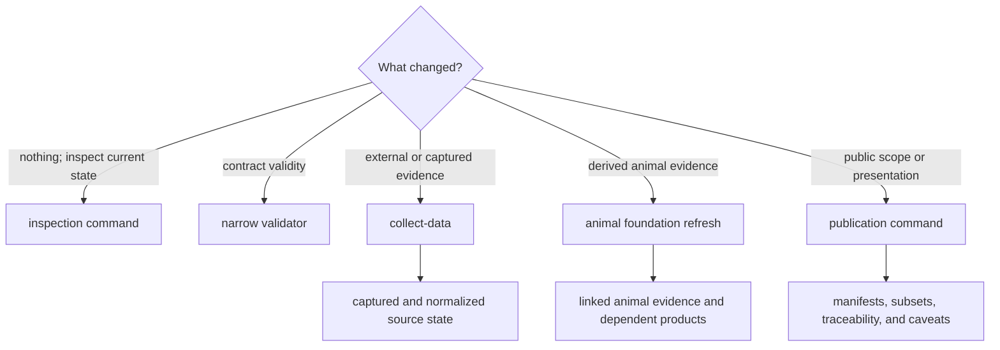
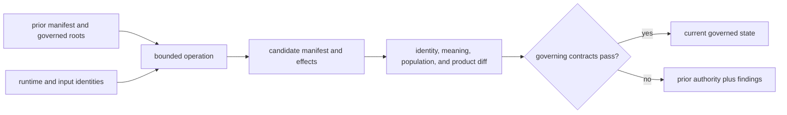

# Operator Workflows

Operations are separated by authority boundary: inspect current state, validate
a contract, collect evidence, refresh derived evidence surfaces, or publish a
product. The boundary determines network use, expected files, and what a
successful result can legitimately mean.

## Workflow Selection



## Establish The Boundary Before A Write

Before a state-changing operation, record the boundary that will make its
result interpretable:

1. resolve every relative input and output root;
2. record the runtime version, source or product version, and prior manifest;
3. name the owner whose tree may be replaced and the descendants expected to
   change;
4. identify the admission, subset, traceability, and release checks that apply;
5. decide which differences require scientific review rather than file-level
   acceptance.



This boundary matters even when staging protects an owned tree. Staging
prevents a partial replacement within that tree; it does not decide whether a
scientific change is acceptable or make separate data and publication writes
one transaction.

## Verify Only

Inspection commands are the safest starting point for source support, species
membership, runtime manifests, and review posture. A narrow validator is
preferable when the question concerns one contract such as
`data/collection_summary.json`. Neither operation should rewrite evidence.
The [atlas walkthrough](atlas-walkthrough.md) uses these checks before tracing
one modeled-context result to its source-bound panel row.

```bash
bijux-pollenomics source-support --json
bijux-pollenomics validate-collection-summary \
  --summary-path data/collection_summary.json
```

The first answers a capability question. The second proves that one existing
summary satisfies its structural contract. Neither demonstrates that every
upstream source is complete or every normalized record is publishable.

## Refresh Data

`collect-data` may contact external sources and replace the selected family
trees plus the collection summary. Its observable evidence should include:

- acquisition metadata, retrieval dates, licences, and source versions;
- captured and normalized hashes;
- record counts and source-specific review outputs;
- the family status and any explicit block or degraded condition.

Collection success means the pipeline completed. It does not mean every source
record is publication-ready.

A data refresh is broader than retrieval. Review the source-family contract to
determine whether the family materializes capture only, capture plus
normalization, or additional review evidence. Never infer an absent lifecycle
stage from a later publication. When only one family changed, validate and
review that family's causal descendants rather than presenting an unrelated
repository-wide rewrite as evidence of success.

## Refresh Animal Evidence

The animal foundation workflow spans project capture, sample identity,
locality, chronology, coordinate review, species normalization, and dependent
publication. Use it only when that end-to-end boundary is intended. For one
species or one review question, prefer species inspection and the narrower
governed refresh surface.

The foundation result is meaningful only when project and paper links, sample
identity, locality, chronology, coordinate basis, and admission posture remain
connected. Gap, conflict, substitution, and exclusion records are part of the
result; they are not noise to discard before reading the visible points.

## Publish Outputs

`publish-reports` reads the current governed data state and rebuilds public
world, regional, country, review, and caveat outputs. The publication can be
audited through:

- `docs/report/published_reports_summary.json` for product membership;
- geography manifests and subset validation for scope integrity;
- point traceability and source-family roles for semantic preservation;
- `docs/report/repository_truth_posture.md` and refusal surfaces for limits.

Publishing the same evidence under a new scope is a publication change, not a
source refresh. Conversely, collecting new evidence without publishing leaves
the public product unchanged.

### Include Captured Neotoma Publications

The Python map API `generate_multi_country_map` accepts the optional
`publication_capture_root` alongside `context_root`. Pass the absolute path to
the existing citation capture directory containing `capture-manifest.json`
and `responses/`. Reuse that shared directory. The supported capture has source
identity `neotoma/publication-links/2026-09-29`; the reader checks its existing
manifest identity and reads only responses for the projected datasets.

For an existing map publication call:

```python
report = generate_multi_country_map(
    version_dir=version_dir,
    countries=countries,
    output_dir=output_dir,
    title=title,
    slug=slug,
    context_root=context_root,
    publication_capture_root=publication_capture_root.resolve(),
)
```

The **Provenance** tab shows literal bibliography records, nullable source
primary flags and the separate capture dates. Uncaptured datasets, successful
empty responses and multiple source primary publications remain distinct.
These records supply citation context; scientific approval, full-paper access
and reuse permission require their own evidence. The
[atlas walkthrough](atlas-walkthrough.md#read-a-neotoma-source-observation)
explains how to read the source views.

### Select historical SEAD chronology for a map

`generate_multi_country_map` accepts an optional `historical_chronology` request
constructed with `HistoricalChronologyRequest(country_authority_root, lineage_sha256)`
from `bijux_pollenomics.reporting.map_document.evidence_projection`. Supply an
absolute authority root and the SHA-256 of the selected lineage. This path
recomputes the derived chronology overlay against the pinned historical SEAD
admission, checks the selected site layer and its staged copy against the lineage,
and records separate derived chronology provenance. The retained source evidence,
relation fields, and eligibility decisions remain the source of record.

The optional `allow_marked_relative_source=True` selects a versioned overlay for
one narrowly supported correction: a context-only relative-period claim with a
trailing calendar marker and `From`, whose retained point had source
`relative_age_bounds`, may become an unresolved source interval. The overlay
checks the exact retained and recomputed claims and keeps every other source and
eligibility field unchanged. Other status transitions refuse. Omitting the option
retains the original strict overlay contract. This option does not by itself
rebuild or qualify a historical product.

A caller that persists or shares a map must separately record the executed code
identity and qualify the complete Atlas input closure. This option does not admit a
new country authority or establish corrected-site browser verification.

### Select Sweden lake inputs for a map

`generate_multi_country_map` accepts an optional `lake_inputs` request from
`bijux_pollenomics.reporting.bundles.sweden_lake_inputs`. Construct each
`CapturedLakeFile` from an absolute path and its expected SHA-256 with
`CapturedLakeFile.read`, then supply the captured scenario and optional registry
and traceability files in `SwedenLakeInputs`. The map uses the captured bytes,
records their identities, and does not search output-directory ancestors. An
empty request selects no lake layers. Omitting the request retains automatic
discovery. A selected traceability Markdown file contributes its identity and
reference name; it is not copied into the map bundle. These input identities do
not constitute a source-rights or scientific-admission decision.

### Bind selected Nordic point inputs

`generate_multi_country_map` accepts an optional `nordic_point_inputs` capture from
`bijux_pollenomics.reporting.context.nordic_point_inputs`. Create it with
`capture_nordic_point_inputs(context_root, expected_sha256)`, supplying exact
SHA-256 values for `landclim-sites`, `neotoma-pollen`, `sead-sites`, and
`sweden-archaeology-site-discovery`. The selected point-layer builder parses the
held bytes and stages the same bytes. Discovery takes precedence over the separate
SEAD temporal evidence layer; its source presence is recorded and checked again.
The option requires the bound context root and Nordic geography. Missing selected
layers, changed staged bytes, and changed temporal presence refuse publication.

This captures only four selected point inputs. AADR, animal, RAÄ, polygon and
chronology-detail sources, other optional inputs, and the complete Atlas read-set
remain outside this contract. It does not establish source admission, cross-file
consistency, a complete source snapshot, or scientific validity.

### Bind selected Nordic polygon inputs

`generate_multi_country_map` accepts `nordic_polygon_inputs` from
`bijux_pollenomics.reporting.context.nordic_polygon_inputs`. Call
`capture_nordic_polygon_inputs(context_root, expected_sha256)` with the exact
SHA-256 values for `country-boundaries` and `landclim-reveals-temporal-grid`.
Both files are required; this option does not support the static grid fallback.
The map builds and stages these held bytes and records their identities. Capture
is sequential, not an atomic snapshot. These display inputs do not bind the
historical SEAD country authority or other sources, establish source admission,
or constitute complete Atlas source closure.

### Bind AADR map country queries

`generate_multi_country_map` accepts an optional `aadr_map_snapshot` created by
`capture_aadr_map_snapshot(runtime_manifest, expected_sha256)` from
`bijux_pollenomics.adna.species.homo_sapiens.map_snapshot`. Supply the exact
SHA-256 for every discovered annotation file, keyed by its release-relative path.
All country queries use the held annotation bytes and the captured runtime
manifest; the publication contract records both identities. Missing, extra or
mismatched files are refused during capture. Capturing files is sequential and
is not an atomic release snapshot. The runtime-manifest identity describes the
object used for the queries; it does not identify the bytes of the release
manifest file from which that object was constructed. This option does not bind
other Atlas sources or establish source or scientific admission.

### Bind Neotoma site projection to relational evidence

`generate_multi_country_map` accepts an optional `neotoma_manifest_sha256`
when `nordic_point_inputs` is supplied. Set it to the SHA-256 of the selected
Neotoma relational `manifest.json`. The projection checks that the pinned
manifest matches the validated relational materialization and that every
selected point matches the source site's representative coordinates, name and
governed country assignment. It requires the complete governed site set and
refuses missing geometry or mismatches. Country assignment retains the epoch
and authority of the relational materialization; this check does not admit a
new boundary, establish geographic or scientific truth, or bind other Atlas
inputs. Omitting the option retains the existing identity-only join.

### Bind the RAÄ map status

`generate_multi_country_map` accepts an optional `raa_status_sha256` containing
the SHA-256 of the status bytes returned by `capture_raa_atlas_input_snapshot`.
The map captures the RAÄ decision at the polygon owner, refuses a different
status, and checks the selected status and held normalized buffers before
attachment and on readback. A pinned withheld status remains withheld; a pinned
retained context remains degraded rather than becoming admitted. Some status
inputs record presence only, so the status hash does not bind every source file's
bytes. This selection does not establish source or scientific admission or
complete Atlas source closure.

## Interpret Completion

| Operation | Completion signal | Remaining scientific question |
| --- | --- | --- |
| inspection | requested table or JSON was emitted | is this posture sufficient for the proposed use? |
| validation | named payload passed and was identified in output | does the source content support the intended claim? |
| collection | selected families and collection summary were materialized | which records survive normalization, review, and product admission? |
| animal foundation refresh | linked evidence surfaces and dependent products were materialized | which gaps, conflicts, substitutions, or refusals remain? |
| publication | manifests and products agree under the requested scope | are the labels, denominators, precision, and caveats suitable for the audience? |

Logs can explain execution, but they do not become scientific authority. The
durable evidence is the source identity, governed records, admission decisions,
product manifests, and explicit qualifications that remain after the command
finishes.

### Bind animal point inputs

`generate_multi_country_map` accepts an optional `animal_point_inputs` created by
`capture_animal_point_inputs` in
`bijux_pollenomics.adna.governance.atlas_candidates.point_inputs`. Provide a
complete inventory for each tracked non-human species: `None` declares the
species directory absent; a present species maps each `ANIMAL_POINT_PATHS` entry
to its SHA-256 or `None` for an absent file. Capture refuses discrepancies and
the animal point owner parses the held bytes. The publication contract records
those identities and absences. Capture is sequential, not an atomic snapshot.

The opt-in capture inventories each present species tree conservatively: it
rejects symlinks and aliased files, changes during capture, trees exceeding one
GiB or 50,000 files, and more than 256 MiB of selected bodies. It does not bind
the separate animal sample chronology registry or its projects, other Atlas
inputs, source rights, or scientific admission. Absence does not assert that a
species is scientifically excluded.

### Bind animal sample chronology inputs

`generate_multi_country_map` accepts an optional `animal_chronology_inputs`
produced by `capture_animal_chronology_inputs` in
`bijux_pollenomics.reporting.adna.sample_chronology_context.captured_inputs`.
Pass `None` as the expected inventory only when the registry is absent. Otherwise
supply SHA-256 values for the registry and the three required sample surfaces for
every project in it. Capture verifies the project directory set and selected
bytes; the chronology owner reads those held bytes and records their identity.
An absent capture remains absent even if a registry appears later. The capture
is sequential, not an atomic snapshot.

This opt-in check inventories the whole project tree, rejects symlinks and
aliased members, and limits the registry plus tree to 128 MiB and 10,000 files;
its pins cover only the registry and three required JSON surfaces per project.
It does not bind other animal, AADR or Atlas inputs, establish source rights, or
convey scientific admission. Registry absence is a recorded observation, not a
scientific exclusion.

### Bind fieldwork gallery media

`generate_multi_country_map` accepts an optional `fieldwork_inputs` from
`bijux_pollenomics.reporting.context.points.fieldwork_inputs`. Call
`capture_fieldwork_media(gallery_root, expected_sha256)` with a SHA-256 value or
`None` for each of `2026-02-26-data-collection.JPG` and
`2026-02-26-data-collection.mp4`. The gallery directory must exist; `None` records
that a named file was absent when captured. The map stages the held selected
bytes under `fieldwork-media/` beside its HTML and records their identities in
its publication contract and bundle artifacts. It verifies the staged namespace
and bytes before attachment and on readback. The explicit option refuses a map
scope that excludes the fieldwork layer. Without the option, existing gallery
discovery and links remain in use.

Capture reads sequentially, with 32 MiB per file and 64 MiB total bounds. These
identities do not attest external source origin, media rights, or scientific
admission, and do not bind the rest of an Atlas build.
