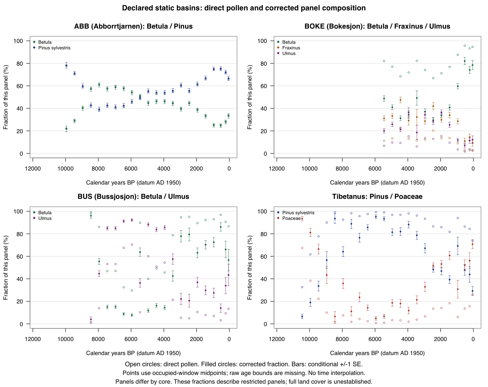

# Swedish pollen scenarios with declared static basins

The original LandClim metadata contains 84 Swedish rows. A coordinate,
site-alias and native-core search of the retained Neotoma capture found
leads for 58 rows, covering 59 datasets and 4,548 distinct native samples.
The retained capture contains 200 sites and 209 datasets; the other 26 rows
require further source discovery. A candidate match remains separate from
an authenticated historical prepared input.

This account executes new conditional reconstructions for four source-linked
lake cores using [declared assumptions](assumptions/protocol.json). Each
included sample explicitly reports every taxon on its small per-core panel.
The [machine report](report.json) retains derived core-window counts, selected
calibrated chronologies, count denominators and exact source-support hashes.
Individual raw sample/depth/age records and their native identifiers stay in
the local source-bound captures until their publication scope is admitted.

| Core / native dataset | Literal panel | Included / native samples | Occupied windows | Panel NISP / all reported pollen NISP in included samples |
| --- | --- | ---: | ---: | ---: |
| Abborrtjärnen / 19913 | Betula; Pinus sylvestris | 106 / 107 | 22 | 105,525 / 128,593 (82.06%) |
| Bökesjön / 54001 | Betula; Fraxinus; Ulmus | 50 / 52 | 13 | 11,295 / 40,999 (27.55%) |
| Bussjösjön / 53995 | Betula; Ulmus | 60 / 69 | 19 | 6,848 / 63,678 (10.75%) |
| Lake Tibetanus / 53980 | Pinus sylvestris; Poaceae | 45 / 45 | 23 | 11,286 / 43,851 (25.74%) |

The four outcomes use 261 of 273 source samples in 77 occupied core-windows.
Six source ages fall outside the declared nonnegative windows and six
Bussjösjön samples lack an explicit Ulmus datum. All 261 included point ages
lack raw younger/older bounds. Missing bounds do not imply exact ages or
provide a chronology posterior. The source chronologies are calibrated
radiocarbon years BP, with the AD 1950 datum documented in
[Neotoma manual section 7.5](https://open.neotomadb.org/manual/database-design-concepts.html).
Collection and publication dates do not reset zero BP.

Each metadata radius is interpreted as a fixed circular receiving disk:
98 m for Abborrtjärnen, 80 m for Bökesjön, 69 m for Bussjösjön and 100 m for
Tibetanus. The homogeneous land annulus extends from that disk edge to
100 km. The maintained
[physical receiver response](https://github.com/bijux/bijux-pollenomics/blob/main/packages/bijux-pollenomics-lra/src/bijux_pollenomics_lra/dispersal/receiver_annulus.py)
uses the source GPM convention with fall speed and wind in m/s, distance
in metres, turbulence parameter 0.25 and empirical transport coefficient
0.12. That coefficient is not an SI diffusivity in m²/s. Uniform disk
reception, stationary isotropic transport and a fixed basin are scenario
assumptions. Tibetanus retains the metadata-versus-native elevation
disagreement (161 versus 568 m) and approximately 398 m coordinate separation.

The [conditional inverse correction](https://github.com/bijux/bijux-pollenomics/blob/main/packages/bijux-pollenomics-lra/src/bijux_pollenomics_lra/reconstruction/fixed_site_covariance.py)
closes weights proportional to each count divided by its physical response
and PPE. Public LandClim PPE standard deviations supply a diagonal covariance
with all off-diagonal covariances assumed zero. Conditional standard errors
combine multinomial counting variance and this assumed PPE covariance.
Chronology, basin, transport and site-selection uncertainty remain outside
those standard errors. The native source names match the public parameter
strings literally; scientific parameter transfer is explicitly assumed and
does not close the existing source-concept reviews.

For radius $r$, regional extent $L$, fall speed $v_i$, wind $u$,
empirical transport coefficient $D$ and turbulence parameter $\gamma$,
the displacement survival is

$$
S_i(d)=\exp(-a_i d^{\gamma/2}),\qquad
a_i=\frac{4v_i}{\gamma u\sqrt{\pi}D}.
$$

The physical response is the uniform disk average of the probability that
an isotropic displacement lands in the declared land annulus. An equivalent
circle-overlap integral used in independent verification is

$$
K_i=\int_0^{\infty} e^{-q}
\frac{A(r,L,d_i(q))-A(r,r,d_i(q))}{\pi r^2}\,dq,
\qquad d_i(q)=(q/a_i)^{2/\gamma},
$$

where $A(r,b,d)$ is the overlap area of circles of radii $r$ and $b$
whose centers are separated by $d$. For a pooled core-window count vector,
the estimand is the corrected composition on its declared panel:

$$
b_i=(K_i\mathrm{PPE}_i)^{-1},\quad
W=\sum_j b_j n_j,\quad c_i=b_i n_i/W.
$$

The count Jacobian is $J_{ij}=\delta_{ij}b_i/W-c_i b_j/W$, and the PPE
Jacobian is $H_{ij}=c_i(c_j-\delta_{ij})/\mathrm{PPE}_j$. With panel
total $N$ and direct fraction $f=n/N$, the reported delta covariance is

$$
C_c=J\,N[\operatorname{diag}(f)-ff^T]\,J^T
   +H\,\operatorname{diag}(\mathrm{SD}_{\mathrm{PPE}}^2)\,H^T.
$$

Pooling within a window assumes a common conditional panel composition;
variation between source samples is not independently estimated. The closed
panel composition and this conditional covariance are the numerical targets.

For example, the Tibetanus 0–100 cal BP window contains one source point
and pooled counts of 111 Pinus sylvestris and 39 Poaceae grains. Its two-taxon pollen fractions are 74% and
26%; the baseline corrected fractions are 29.21299% and 70.78701%, each with
conditional standard error 3.93339 percentage points. This panel represents
150 of that window's 1,024 reported pollen grains. These fractions describe
the declared panel, not total vegetation cover. The four panels have
different axes and cannot be pooled or used to compare vegetation between
cores.

Halving and doubling radius change area by factors 0.25 and 4. Across the
retained windows, the largest corresponding cover changes are 0.27–0.56
percentage points. Wind scenarios at 2 and 4 m/s produce largest changes of
1.37–5.44 percentage points. The report retains every scenario and a
zero-PPE-variance comparison. These comparisons describe assumption
sensitivity; they are not probability intervals or independent validation.

The original Bussjösjön Betula/Poaceae attempt is preserved in
`negative_predecessors`: zero of 69 samples supported that literal panel.
The source actually uses `Poaceae undiff. (<40 µm)`, and its mapping was not
silently changed. A separate Betula/Ulmus successor admits 60 samples using
explicit source observations. The other three successful outcomes were
reused unchanged.

The [actual run receipts](execution/actual-runs.json) preserve the two native
exit-zero captures, source-custody checks, resource scope and original receipt
identities. Their scientific source candidate is
`5fe91a5c64cdae35eeddc77e529e6c0e44eb529c` with the explicitly admitted
covariance source overlay SHA-256
`4dde1a078ae7d57f3c93e93fa8cc4e73756f551e774d78aadb606fa47c483448`.
The machine report separately records its subsequent canonical admission;
later Git history does not replace the actual run identity. Counts, cover
closure, the PPE/count covariance decomposition and measured-taxon refusals
were checked during execution. Independent scalar inverse/count/PPE checks covered 385 cases and 77
zero-PPE controls. A separate analytic circle-overlap integral checked 55
physical response factors, with largest absolute difference 7.50 × 10⁻¹¹
from the maintained disk/angle quadrature. Exact source counts, window
assignment, exclusions and missing bounds were also independently checked;
the [scoped mathematical review](execution/independent-math-review.json)
retains these results. This account supplies neither historical LandClim replay,
a complete 31-taxon reconstruction, original-author R identity for these scenarios nor
independent vegetation accuracy.

The [source identities](inputs/source-identities.json) name the original
LandClim workbook/parameter bytes and native Neotoma parts. Data contributors
are Thomas Giesecke (Abborrtjärnen), Marie-José Gaillard-Lemdahl (Bökesjön), Joachim Regnéll
(Bussjösjön) and Lena Barnekow (Tibetanus), as retained in the actual source
dataset records. The European Pollen Database curates these records; exact
dataset DOI strings remain in the report, including the Neotoma and EPD
identities where the source supplies both. The
[official Neotoma policy](https://www.neotomadb.org/data/data-use-and-embargo-policy)
states CC BY 4.0 use for available data with attribution to Neotoma, the
constituent database and original contributors/publications. Historical
LandClim R/NR flags and the separate rights/source decisions are preserved in
[source reconciliation](assumptions/source-reconciliation.json). No private
Rootsi workbook or author LUT is used by these scenarios, and this account
does not grant publication rights for those separate sources. Complete
primary-publication attribution and any actual access restriction remain
publication follow-through.

The [167 plotted core-window-taxon points](figures/panel-comparison.csv) come from the baseline profiles of the retained numerical captures. Open markers show direct pollen panel fractions; filled markers and bars show corrected fractions and conditional one standard error. Each core has its own taxon panel. The actual R Quartz capture and layout inspection are recorded in [figure-capture.json](execution/figure-capture.json); this figure supplies no numerical R/Python parity or reader-feedback claim.

The [maintained producer capture](execution/maintained-producer-capture.json) records actual independent reference and replay directories with identical report bytes and exact agreement with the original scoped numerical captures. The [observed import closure](execution/observed-imports.json) and [capture receipt](execution/import-observation-capture.json) retain 59 actual project module origins from a separate cold import and callable observation. That observation establishes import source identities; it does not trace every dynamic scientific file read or establish platform completeness.

## Independent native R numerical reference

A separate [native R reference](execution/independent-r-reference.json) now
checks the retained conditional calculation. The R implementation uses an
independent displacement/circle-overlap integral and the declared counting
and diagonal-PPE moment formulas; it is not the original authors' R code.
Across four cores, 24 case profiles and 462 matched windows, both the
fresh-factor and saved-factor tracks pass: **16,868 actual saved-cell
comparisons**, plus **2,572 separately computed R-only zero-PPE controls**,
with zero mismatches. Missing zero-PPE direct-fraction and covariance arrays
were not fabricated. The 385 full saved rows and 77 reduced zero-PPE rows
retain their different schemas.

The 45 physical response factors have maximum absolute difference
`1.2822659600786324e-12`. The largest window-cell absolute differences are
`1.4715451079894137e-12` for the fresh-factor track and `6.106226635438361e-16` for the saved-factor
track. The moment checks use absolute and relative tolerances of `1e-8` and
`2e-12` for those respective tracks; the factor absolute tolerance is `1e-8`.
These are numerical comparison tolerances, not confidence levels.

The actual R and comparison stages and their collector exited zero on
`6763e5574b56863089bcaba45bdc307bfca1d71b`, using five explicitly declared
source overlays subsequently adopted byte-identically at
`d670491f09e35b08045b3c39930cc2150176e755`. The saved report retains source
epoch `1988f522002e8bb5362083b9e8b46bd4fa17685e`; the unchanged input export
retains `db2f4d5616616472e3baf5c86a5af207f6a0de0f`. The earlier failed R
attempt and original-factor refusals remain retained separately. This
reference supplies conditional marginal numerical agreement, not historical
reproduction, source-qualified basin/transport or chronology uncertainty,
independent vegetation accuracy, complete taxon coverage, source-use rights
or qualified human endorsement. Existing unresolved scientific acceptance
conditions remain unchanged.

<!-- scientific-account-route:begin -->
## Scientific verification and limits

Source-bound conditional reconstruction or exposed pollen development wrapper; own source assumptions and exact scored/refused populations must be preserved alongside account links.

**Supported claim.** Four native Swedish cores support conditional inverse panel estimates with counting and assumed diagonal-PPE covariance under fixed receiver-radius/wind alternatives. Every successful core/window and the failed original Bussjösjön panel remain distinct. A separate independent native R numerical reference passes both fresh-factor and saved-factor conditional moment tracks on the retained four-core population.

**Unsupported claim.** These different taxon panels cannot be pooled as comparable whole vegetation. No historical LandClim reproduction, complete 31-taxon reconstruction, original-author R identity, dated basin geometry, calibrated total uncertainty or independent vegetation accuracy is supplied.

**Actual verification performed.** A fresh current-source maintained producer reproduced all four cores, 261 included samples and 77 occupied windows; all 11,955 saved core numeric values remain exact and only four source-identity metadata fields changed. Explicit call-site observation compared all 8,718 covariance array values across 462 actual current-input calls byte for byte with the exact historical function; this is implementation parity, not an independent oracle. The actual maintained figure producer reproduced all 167 CSV rows exactly and refused unbound report bytes. Eleven native source/age/output refusal regressions passed. Original independent checks of 385 inverse/count/PPE cases, 77 zero-PPE controls and 55 response factors retain their historical source scope; those earlier checks did not rerun independent R or human scientific review. Separately, the independent R reference and comparison ran with five declared source overlays. Both stages and the collector completed successfully: 45 factors, 462 windows, 16,868 comparisons against saved values and 2,572 separate R-only zero-PPE controls, with zero mismatches. The execution source overlays were subsequently adopted byte-for-byte into canonical source. The original saved report, retained input export, numerical execution and later source adoption retain their distinct recorded identities. This checks conditional marginal numerical implementation, not field truth or the original authors' R implementation.

**Remaining input or review.** All 261 retained point ages lack raw bounds. Static circular basins, homogeneous annulus/metre diffusion convention, literal parameter transfer and diagonal PPE covariance remain assumptions. Tibetanus source elevation/coordinate disagreement, source publication attribution and separate source-use/historical selection and external scientific decisions remain unresolved.

**Cause category.** data | assumption | comparability | access/rights | qualified review

**Consequence.** Marginal count/PPE SE excludes chronology, geometry, transport and site-selection uncertainty. Radius/wind differences describe finite assumption sensitivity rather than a probability interval. Small area sensitivity does not authenticate the metadata radius or local shoreline.

**Precise next acceptance route.** Qualify native taxon identity, source chronologies/bounds, historical basin support and intended-use attribution/rights. Keep source-supported successor panel distinct from the refused original. Freeze any new physical alternative separately; provide time-matched independent vegetation and qualified review before ecological accuracy or coverage claims.

**Negative or refused result.** The original Bussjösjön Betula/Poaceae panel has zero supported samples of 69 because the source uses Poaceae undiff. (<40 µm); no alias is silently admitted. Six source ages are outside the nonnegative domain and six Bussjösjön rows lack explicit Ulmus. The successor uses its literal Betula/Ulmus panel, preserving all other successful outputs. The original failed native R attempt and original-factor diagnostic with three typed refusals remain retained separately; corrected controls and moment comparison do not rewrite those outcomes.

**Matched denominator.** Four cores: 261/273 source samples and 77 occupied core/windows; each baseline plus finite radius/wind/zero-PPE controls has its own denominator. All 261 age bounds are missing. Tibetanus youngest window has 111 Pinus plus 39 Poaceae =150 panel grains of 1,024 reported NISP; its 29.21299/70.78701% corrected panel is not whole vegetation. The independent R reference covers 24 case profiles and 462 matched moment windows: 385 full saved rows and 77 reduced zero-PPE rows, with 19,440 computed R cells, 16,868 comparisons against saved values and 2,572 separate R-only controls. Missing saved arrays remain absent.

- [Retained qualification evidence: docs/report/pollen-reconstruction/swedish-static-basin-scenarios/report.json](report.json) (SHA-256 `8ccd776179ab48e1cd5258086046ed0cf58281482aecd83595800c83275790dd`).

- [Retained qualification evidence: docs/report/pollen-reconstruction/swedish-static-basin-scenarios/execution/independent-math-review.json](execution/independent-math-review.json) (SHA-256 `bbe0fa0fb324ff7eaa4b2a295d6624c31ab58cdc364720887e5d2064f3e3fc8a`).

- [Retained qualification evidence: docs/report/pollen-reconstruction/swedish-static-basin-scenarios/assumptions/source-reconciliation.json](assumptions/source-reconciliation.json) (SHA-256 `c88355fa3ad588e91261f6906884e2d68fe6968dc6f1aa4eccb36ae04b94cb6e`).

- [Retained qualification evidence: docs/report/pollen-reconstruction/swedish-static-basin-scenarios/execution/independent-r-reference.json](execution/independent-r-reference.json) (SHA-256 `e598482f99f8c3ecebc5544da04df2b7196a94509224423515422e5cd96b6f98`).

- [Canonical scientific account: reports/science/source-cohorts.md](https://github.com/bijux/bijux-pollenomics/blob/main/reports/science/source-cohorts.md).

JSON and CSV retain their domain source and numerical manifests; a reading route does not rerun those producers. PDF exports retain their export inventory and source pins and must be regenerated when their canonical account changes.
<!-- scientific-account-route:end -->
