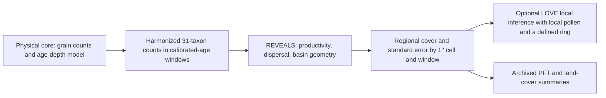

# LandClim II: what the paper reconstructs and what our replay establishes

**Paper.** Githumbi, E., Fyfe, R., Gaillard, M.-J., Trondman, A.-K., Mazier, F., Nielsen, A.-B., Poska, A., Sugita, S., Woodbridge, J., Azuara, J., Feurdean, A., Grindean, R., Lebreton, V., Marquer, L., Nebout-Combourieu, N., Stančikaitė, M., Tanţău, I., Tonkov, S., Shumilovskikh, L., and LandClimII data contributors (2022), “[European pollen-based REVEALS land-cover reconstructions for the Holocene: methodology, mapping and potentials](https://doi.org/10.5194/essd-14-1581-2022),” *Earth System Science Data* **14**, 1581–1619. The associated estimate deposit is [PANGAEA 937075](https://doi.org/10.1594/PANGAEA.937075).

**Question for a new collaborator.** Can fossil pollen counts yield spatially extensive, quantitative estimates of European vegetation cover through the Holocene, with enough temporal and uncertainty information to inform climate and land-use research? The paper presents a regional reconstruction; it does not measure the historical vegetation directly. Our narrower question is whether the released author example, our installed calculation and the deposited estimate agree on *identical* inputs and time support. They agree numerically between author R and our implementation on the two released example grids. The archived grid estimates differ on their sole exactly aligned time window, and we cannot yet establish whether the example and archive used the same historical pollen inputs. That difference is a product-provenance question, not an identified ecological or software cause. [Paper, Abstract and Sects. 1–2](https://essd.copernicus.org/articles/14/1581/2022/); [our correspondence decision](publication-correspondence.md); [exact-window ledger](../../docs/report/publication-replay/landclim-published-window-provenance/paper-correspondence.csv).

## From sediment to a regional estimate

A fossil pollen **sample** is a count of identified grains from a physical sediment depth. A **sequence** is a set of such samples from one site, with an age–depth model assigning calibrated ages. “cal BP” means calibrated calendar years before the conventional 1950 reference; a window label is not the observed age of each grain. The paper labels its youngest window as present to 100 BP, with “present” defined as the year of coring. The paper harmonizes source pollen types onto 31 modeled taxa, aggregates eligible counts by site and age window, then groups sites in 1° × 1° cells. A cell/window/taxon value is an estimated *regional vegetation-cover fraction*, not a grain percentage, point observation or independent field survey. The published study screened 1,143 candidate records to 1,128 lake and bog records; its 16,711 “samples” are aggregated site/window counts, containing over 59 million individual identifications, rather than 16,711 sediment depths. The paper reports at most 420 cells per window across 25 windows over 11,700 cal BP to the present; site support changes by window. [Paper, Sects. 2.2, 2.4 and 4.1](https://essd.copernicus.org/articles/14/1581/2022/).



Raw pollen percentages are affected by how prolifically plants produce pollen and how far their grains travel. **REVEALS** (“Regional Estimates of VEgetation Abundance from Large Sites”) adjusts the counts with taxon-specific relative pollen productivity estimates (**RPP**, called PPE in our implementation), pollen fall speed, dispersal and deposition, and lake/bog basin type and radius. Its regional extent and wind/atmospheric settings also matter. A counted grain therefore is not one unit of vegetation cover. **LOVE** (“LOcal Vegetation Estimates”) uses a regional REVEALS background with pollen from a local site and a defined surrounding ring to estimate *local* cover; the LandClim II paper publishes REVEALS regional cells, not LOVE results. Our constructed analytical LOVE interface is a method check, not a published LandClim local reconstruction. [Paper, Sects. 1 and 2.1–2.4](https://essd.copernicus.org/articles/14/1581/2022/); [source-specific method profile](publication-correspondence/author-method-profile.md); [bounded interface receipt](reveals-love-interface/README.md).

The paper used a Gaussian plume dispersal model, neutral atmospheric conditions, 3 m/s wind and 100 km maximum regional extent; its parameter table supplies taxon RPP and fall speeds. Lake and bog deposition follow different geometries, and multiple small sites can inform a regional cell with different uncertainty from a large lake. The two released examples contain **17 lakes** in grids 512 (nine) and 562 (eight), 31 taxa and 25 author bins; their exact 2016 R function and input axis define our replay profile. They cannot by themselves approve those settings for a different Nordic core or bog. A **PFT** is a plant functional type grouping of modeled taxa; an **LCT** is a broader land-cover type. An **SE** is the model's reported standard error for estimated cover, affected by count size, productivity uncertainty and across-site variation. A mean ± one SE envelope describes reported precision, not a confidence interval established by our comparison. The paper describes delta-method aggregation for grouped SEs, so grouped means may sum while their SEs require covariance-aware calculation. [Paper, Sects. 2.1, 2.3–2.4 and 4.1](https://essd.copernicus.org/articles/14/1581/2022/); [method crosswalk](../../docs/report/publication-replay/landclim-method-profile/method_crosswalk.csv); [PFT review](publication-correspondence/pft-crosswalk/README.md).

The physical and numerical denominators differ. In the author examples, 17 sites × 25 bins provide **425 possible site-windows**, of which **184** have supported estimates; each supported window supplies 31 means and 31 SEs. The resulting 11,408 paired site-level values, plus regional values, make **14,074** compared R/native numbers. The deposited archive has 25 mean files and 25 SE files, each with 420 rows: **10,500 paired grid/window rows** and **493,500 paired mean/SE values** across its 47 reported variables. Its 150 coordinate-refused rows and three small negative mean tokens remain in the source account; neither is silently converted to zero. None of these output rows is an additional pollen sample or a vegetation truth label. [Site replay](publication-correspondence/author-example-site-replay.md); [archive inventory](publication-correspondence/published-inventory/README.md).

## One trace: White Horse Hill to a modeled value

The released 2016 author source calls `WHH05` the White Horse Hill 2005 section, a lake in grid 512 with 150 m radius (300 m diameter). Its raw depth-16 row has age **1320 cal BP** and **301 grains** in 30 named taxon fields; `Sum` is a total column. Four specified one-grain source fields are excluded in preparation, leaving **297 grains** mapped into the 31-target vector, ten taxa positive. That is the denominator of this prepared *example row*, not proof of the complete historical counting protocol. Age 1320 belongs to the author's **[1250, 1750) cal BP** interval, labelled **1500 BP**. The label is a bin identifier, not a newly dated sample. [Raw-to-prepared trace and source exclusions](publication-correspondence/author-example-site-replay.md); [replay ledger](../../docs/report/publication-replay/landclim-author-example-correspondence/paper-correspondence.csv).

Running the author's R function and our native calculation on this prepared input gives the same 31 modeled **site** means and 31 SEs to numerical tolerance. In that window, author R gives *Calluna vulgaris* **0.9248830793** cover with **0.0468069771** SE, and Poaceae **0.0574176519** with **0.0154854693** SE, both in fractional-cover units. The first mean is about **92.49% modeled cover** on the site's 31-taxon output axis; it is not the percentage of the 297 prepared grains. The largest R/native gap over the 31 means is **4.77 × 10⁻¹⁵** fraction; for SE it is **8.90 × 10⁻¹⁶**. The nine sites together enter the grid 512 regional estimate; WHH05's site vector is not that grid's archived regional vector and is not measured vegetation. [One-site result](publication-correspondence/author-example-site-replay.md); [independent two-grid R/native execution](publication-correspondence/author-example-reexecution.md).

## What the paper found, and what our calculations found

**Published scope and finding.** The authors present cover estimates for 31 taxa, stated as 12 PFTs and three LCTs, across 25 Holocene windows over Europe and part of the eastern Mediterranean–Black Sea–Caspian corridor (30–75° N, 25° W–50° E). Their eight selected-window maps illustrate an increase in modeled open-land cover from the mid-Holocene and widespread values above 60% in much of central, southern and western Europe during the last two millennia, while modeled summer-green tree cover declines from its mid-Holocene extent. These are grid estimates and mapped patterns, not a measured vegetation accuracy score or proof of a single human cause: the authors explicitly caution that open land includes naturally open vegetation and that low-cover estimates can have large SE. [Paper, Abstract, Sects. 3.1, 4.1 and 4.3](https://essd.copernicus.org/articles/14/1581/2022/).

**Our matched calculation.** Against the independently reexecuted author R, our installed REVEALS profile has maximum absolute differences of **1.83881 × 10⁻¹³** for means and **7.15331 × 10⁻¹⁴** for SEs in fractional units across the **14,074 supported example values**, inside declared tolerances. All 17 prepared `LRAready` example files were regenerated byte for byte from the released raw site files, with 15,028 prepared cells checked. This establishes formatting and numerical correspondence for the retained **two grids**, not a rerun of the article's 1,128 historical records. [R/native execution](publication-correspondence/author-example-reexecution.md); [raw-to-prepared source account](../../docs/report/source-relations/landclim/author-example-taxon-support/README.md); [paper-result row](../../docs/report/pollen-reconstruction/paper-correspondence.csv).

**Our archive comparison.** Only **TW2, 100–350 BP**, has identical interval bounds in the 25 author-example and deposited axes. We compared 31 taxon means and 31 SEs for each of grids 512 and 562, converting author fractions to archive percentage-cover units. The largest author-R/archive mean gaps are **9.19787** and **10.55270 percentage points**, respectively; largest SE gaps are **3.21615** and **4.25814 points**. Their full 31-taxon mean L1 gaps are **18.481237** and **22.140770 points** (total variation **0.092406** and **0.110704**). Python/R residuals on those same rows are at most about **1.238 × 10⁻¹¹ percentage points**. All 31 corresponding mean ± one-SE envelopes overlap in each grid, but dependence and source identity are unknown; that overlap is no significance test. Most later windows differ by 50 years at both bounds, and author TW1 starts at −65 BP versus 0 BP in the published label, so we do not compare those as identical intervals. These numbers compare *modeled products*; archive input revisions, chronology and preparation remain unverified. [124-row exact-window ledger](../../docs/report/publication-replay/landclim-published-window-provenance/paper-correspondence.csv); [provenance interpretation](publication-correspondence/published-window-provenance.md); [window alignment](../../docs/report/publication-replay/landclim-window-alignment/README.md); [SE-envelope ledger](../../docs/report/publication-replay/landclim-published-window-uncertainty/taxon-envelopes.csv).

**Archive grouping discrepancy.** The article states **12 PFTs**, the deposit description **11**, and the archived header has **13 PFT positions**, including `ISTS`, absent from the parameter table. Across all **10,500** archived grid/window mean rows, `ISTS` equals the sum of archived *Corylus.avellana*, *Fraxinus* and *Quercus.deciduous* means, while archived `TBS` equals the six other taxa in the parameter table's nine-taxon TBS group (combined residual at most **1.02 × 10⁻¹³ percentage points**). The paper assigns deciduous Quercus type to TBS. We have verified the mean arithmetic and the paper-side table, but the released script writes only 31 taxon columns; it does not authenticate the archive-producing PFT/LCT code, biological meaning of `ISTS`, name mapping for deciduous Quercus, or grouped SE computation. We preserve this mismatch rather than changing the archived taxonomy. [Paper, Sect. 3.2 and Table 1](https://essd.copernicus.org/articles/14/1581/2022/); [PFT and uncertainty ledgers](publication-correspondence/pft-crosswalk/README.md); [released-script boundary](publication-correspondence/pft-crosswalk/author-release-lineage.md).

## What remains unavailable and why it matters

| Desired conclusion | Present evidence and denominator | Missing input or decision; consequence |
| --- | --- | --- |
| Full historical reproduction of the published reconstruction | Paper: 1,128 selected records; our evidence: 79 unique Rootsi metadata workbook candidates, **zero authenticated historical primary inputs** and **zero reproduction-ready rows** | Candidate workbook structure does not establish publication membership, exact count taxon denominator, selected chronology, basin/profile geometry or per-sequence rights. We cannot replay all published grid values or diagnose the TW2 difference from those candidates. [Historical source inventory](../../docs/report/publication-replay/landclim-study-inputs/README.md); [Rootsi decision](publication-correspondence.md). |
| A source explanation for the two-grid TW2 archive gap | Author R and native values agree; exact-window archive products differ on 124 paired values | Need identical historical raw sequence revisions, prepared site/bin count rows, age models, parameter and site memberships for each published grid/window. A changed source is a possibility, not a demonstrated cause. [Exact-window result](publication-correspondence/published-window-provenance.md). |
| A certified 11/12/13 PFT interpretation and grouped uncertainty replay | Exact archived mean arithmetic and necessary SE bounds hold across 10,500 rows | Need the archive-producing taxon-to-PFT/LCT transformation, version, `ISTS` definition, deciduous Quercus mapping and SE covariance/delta-method inputs. Numerical sum does not supply biological or uncertainty semantics. [PFT review](publication-correspondence/pft-crosswalk/README.md). |
| Accuracy against independent vegetation, or a Nordic local LOVE result | Current Swedish reference screen admits **0/16** nearby measured vegetation pairs; LOVE interface is a constructed ring check | Need matched physical site, collection time, taxa, measured cover fractions, landscape support and an admissible local ring. A pollen prediction score or another REVEALS output cannot stand in for measured vegetation. [Vegetation decision](vegetation-reference.md); [LOVE interface](reveals-love-interface/README.md). |

The historical absence is scoped to the retained evidence closure: **0/1,128** authenticated original-input records here is not a claim that those inputs do not exist. The Rootsi structural replay found 78 of 79 workbook sample-count claims consistent with mechanical rows; one `EKE` workbook claims 25 but contains 42 such rows. Structure alone also does not clear redistribution rights. The private author-example capsule is retained with a manifest and 193 files, but its source terms have not been cleared for redistribution or promoted to full historical coverage. [Publication correspondence](publication-correspondence.md); [author custody](../../docs/report/pollen-reconstruction/author-source-custody.json).

## Recheck the evidence and resolve the open questions

From the repository root, a reader can inspect the [paper-result matrix](../../docs/report/pollen-reconstruction/paper-correspondence.csv), [one-site trace](publication-correspondence/author-example-site-replay.md), [two-grid execution receipt](../../docs/report/publication-replay/landclim-example-reexecution/report.json), [exact-window rows](../../docs/report/publication-replay/landclim-published-window-provenance/paper-correspondence.csv) and [archived PFT review](publication-correspondence/pft-crosswalk/README.md). The published archive inventory can be rechecked without private author inputs:

```sh
PYTHONDONTWRITEBYTECODE=1 .venv/bin/python \
  reports/science/publication-correspondence/published-inventory/replay.py \
  --output artifacts/jobs/landclim-published-inventory/replay.json
cmp artifacts/jobs/landclim-published-inventory/replay.json \
  reports/science/publication-correspondence/published-inventory/report.json
```

The [two-grid execution instructions](publication-correspondence/author-example-reexecution.md) give the pinned R dependency and commands for a fresh R/native run with the private author-reference capsule; the [method profile](publication-correspondence/author-method-profile.md) names the exact input checks. Those routes require lawful access to the capsule. A public reader can inspect the retained receipts and source hashes without possessing it. The same archive cannot independently test vegetation accuracy. Our [Nordic pollen study](nordic-pollen-study.md) reports separate observed-pollen development and holdout scores; those do not inherit a LandClim vegetation-validation claim.

The following source and reviewer questions are **prepared but unsent**. For grids **512 and 562, TW2 (100–350 BP)**, the LandClim source owner should identify the exact historical source sequence revisions, selected sample ages, count harmonization and denominators, site/basin records, chronology versions and calculation inputs that produced each archived vector. For the other 24 windows, they should state the interval-boundary convention and whether the author example and deposit represent different temporal definitions. For the archived summaries, they should provide the producing taxon/PFT/LCT transformation, `ISTS` definition, deciduous Quercus name route and grouped-SE procedure, with versioned inputs. For one fully specified historical row, they should confirm primary workbook/archive membership and reuse terms before a raw-input replay is attempted. A qualified palynology/landscape-reconstruction reviewer should then assess the taxon, basin, chronology and target-area choices; a matched field-reference owner should assess whether any proposed vegetation pair measures the same estimand. No request has been sent and no independent scientific endorsement is claimed. [Existing source questions](publication-correspondence.md); [source-bound method profile](publication-correspondence/author-method-profile.md); [vegetation-reference decision](vegetation-reference.md).
