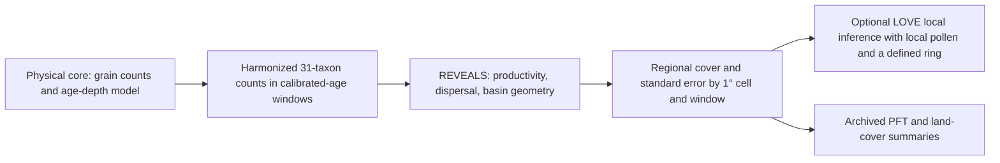

# LandClim II: what the paper reconstructs and what our replay establishes

**Paper.** Githumbi, E., Fyfe, R., Gaillard, M.-J., Trondman, A.-K., Mazier, F., Nielsen, A.-B., Poska, A., Sugita, S., Woodbridge, J., Azuara, J., Feurdean, A., Grindean, R., Lebreton, V., Marquer, L., Nebout-Combourieu, N., Stančikaitė, M., Tanţău, I., Tonkov, S., Shumilovskikh, L., and LandClimII data contributors (2022), “[European pollen-based REVEALS land-cover reconstructions for the Holocene: methodology, mapping and potentials](https://doi.org/10.5194/essd-14-1581-2022),” *Earth System Science Data* **14**, 1581–1619. The associated estimate deposit is [PANGAEA 937075](https://doi.org/10.1594/PANGAEA.937075).

**Question for a new collaborator.** Can fossil pollen counts yield spatially extensive, quantitative estimates of European vegetation cover through the Holocene, with enough temporal and uncertainty information to inform climate and land-use research? The paper presents a regional reconstruction; it does not measure the historical vegetation directly. Our narrower question is whether the released author example, our installed calculation and the deposited estimate agree on *identical* inputs and time support. They agree numerically between author R and our implementation on the two released example grids. The archived grid estimates differ on their sole exactly aligned time window, and we cannot yet establish whether the example and archive used the same historical pollen inputs. That difference is a product-provenance question, not an identified ecological or software cause. Separately, recovered Swedish pollen counts now support maintained new reconstructions on explicit small panels and wider parameter-transfer alternatives; their historical identity and vegetation accuracy remain different questions. [Paper, Abstract and Sects. 1–2](https://essd.copernicus.org/articles/14/1581/2022/); [our correspondence decision](publication-correspondence.md); [exact-window ledger](../../docs/report/publication-replay/landclim-published-window-provenance/paper-correspondence.csv).

## From sediment to a regional estimate

A fossil pollen **sample** is a count of identified grains from a physical sediment depth. A **sequence** is a set of such samples from one site, with an age–depth model assigning calibrated ages. “cal BP” means calibrated calendar years before the conventional 1950 reference; a window label is not the observed age of each grain. The paper labels its youngest window as present to 100 BP, with “present” defined as the year of coring. The paper harmonizes source pollen types onto 31 modeled taxa, aggregates eligible counts by site and age window, then groups sites in 1° × 1° cells. A cell/window/taxon value is an estimated *regional vegetation-cover fraction*, not a grain percentage, point observation or independent field survey. The published study screened 1,143 candidate records to 1,128 lake and bog records; its 16,711 “samples” are aggregated site/window counts, containing over 59 million individual identifications, rather than 16,711 sediment depths. The paper reports at most 420 cells per window across 25 windows over 11,700 cal BP to the present; site support changes by window. [Paper, Sects. 2.2, 2.4 and 4.1](https://essd.copernicus.org/articles/14/1581/2022/).



Raw pollen percentages are affected by how prolifically plants produce pollen and how far their grains travel. **REVEALS** (“Regional Estimates of VEgetation Abundance from Large Sites”) adjusts the counts with taxon-specific relative pollen productivity estimates (**RPP**, called PPE in our implementation), pollen fall speed, dispersal and deposition, and lake/bog basin type and radius. Its regional extent and wind/atmospheric settings also matter. A counted grain therefore is not one unit of vegetation cover. **LOVE** (“LOcal Vegetation Estimates”) uses a regional REVEALS background with pollen from a local site and a defined surrounding ring to estimate *local* cover; the LandClim II paper publishes REVEALS regional cells, not LOVE results. Our constructed analytical LOVE interface is a method check, not a published LandClim local reconstruction. [Paper, Sects. 1 and 2.1–2.4](https://essd.copernicus.org/articles/14/1581/2022/); [source-specific method profile](publication-correspondence/author-method-profile.md); [bounded interface receipt](reveals-love-interface/README.md).

The paper used a Gaussian plume dispersal model, neutral atmospheric conditions, 3 m/s wind and 100 km maximum regional extent; its parameter table supplies taxon RPP and fall speeds. Lake and bog deposition follow different geometries, and multiple small sites can inform a regional cell with different uncertainty from a large lake. The two released examples contain **17 lakes** in grids 512 (nine) and 562 (eight), 31 taxa and 25 author bins; their exact 2016 R function and input axis define our replay profile. They cannot by themselves approve those settings for a different Nordic core or bog. A **PFT** is a plant functional type grouping of modeled taxa; an **LCT** is a broader land-cover type. An **SE** is the model's reported standard error for estimated cover, affected by count size, productivity uncertainty and across-site variation. A mean ± one SE envelope describes reported precision, not a confidence interval established by our comparison. The paper describes delta-method aggregation for grouped SEs, so grouped means may sum while their SEs require covariance-aware calculation. [Paper, Sects. 2.1, 2.3–2.4 and 4.1](https://essd.copernicus.org/articles/14/1581/2022/); [method crosswalk](../../docs/report/publication-replay/landclim-method-profile/method_crosswalk.csv); [PFT review](publication-correspondence/pft-crosswalk/README.md).

The physical and numerical denominators differ. In the author examples, 17 sites × 25 bins provide **425 possible site-windows**, of which **184** have supported estimates; each supported window supplies 31 means and 31 SEs. The resulting 11,408 paired site-level values, plus regional values, make **14,074** compared R/native numbers. The deposited archive has 25 mean files and 25 SE files, each with 420 rows: **10,500 paired grid/window rows** and **493,500 paired mean/SE values** across its 47 reported variables. Its 150 coordinate-refused rows and three small negative mean tokens remain in the source account; neither is silently converted to zero. None of these output rows is an additional pollen sample or a vegetation truth label. [Site replay](publication-correspondence/author-example-site-replay.md); [archive inventory](publication-correspondence/published-inventory/README.md).

## One trace: White Horse Hill to a modeled value

The released 2016 author source calls `WHH05` the White Horse Hill 2005 section, a lake in grid 512 with 150 m radius (300 m diameter). Its raw depth-16 row has age **1320 cal BP** and **301 grains** in 30 named taxon fields; `Sum` is a total column. Four specified one-grain source fields are excluded in preparation, leaving **297 grains** mapped into the 31-target vector, ten taxa positive. That is the denominator of this prepared *example row*, not proof of the complete historical counting protocol. Age 1320 belongs to the author's **[1250, 1750) cal BP** interval, labelled **1500 BP**. The label is a bin identifier, not a newly dated sample. [Raw-to-prepared trace and source exclusions](publication-correspondence/author-example-site-replay.md); [replay ledger](../../docs/report/publication-replay/landclim-author-example-correspondence/paper-correspondence.csv).

Running the author's R function and our native calculation on this prepared input gives the same 31 modeled **site** means and 31 SEs to numerical tolerance. In that window, author R gives *Calluna vulgaris* **0.9248830793** cover with **0.0468069771** SE, and Poaceae **0.0574176519** with **0.0154854693** SE, both in fractional-cover units. The first mean is about **92.49% modeled cover** on the site's 31-taxon output axis; it is not the percentage of the 297 prepared grains. The largest R/native gap over the 31 means is **4.77 × 10⁻¹⁵** fraction; for SE it is **8.90 × 10⁻¹⁶**. The nine sites together enter the grid 512 regional estimate; WHH05's site vector is not that grid's archived regional vector and is not measured vegetation. [One-site result](publication-correspondence/author-example-site-replay.md); [independent two-grid R/native execution](publication-correspondence/author-example-reexecution.md).

## What the paper found, and what our calculations found

**Published scope and finding.** The authors present cover estimates for 31 taxa, stated as 12 PFTs and three LCTs, across 25 Holocene windows over Europe and part of the eastern Mediterranean–Black Sea–Caspian corridor (30–75° N, 25° W–50° E). Their eight selected-window maps illustrate an increase in modeled open-land cover from the mid-Holocene and widespread values above 60% in much of central, southern and western Europe during the last two millennia, while modeled summer-green tree cover declines from its mid-Holocene extent. These are grid estimates and mapped patterns, not a measured vegetation accuracy score or proof of a single human cause: the authors explicitly caution that open land includes naturally open vegetation and that low-cover estimates can have large SE. [Paper, Abstract, Sects. 3.1, 4.1 and 4.3](https://essd.copernicus.org/articles/14/1581/2022/).

**Our matched calculation.** Against the independently reexecuted author R, our installed REVEALS profile has maximum absolute differences of **1.83881 × 10⁻¹³** for means and **7.15331 × 10⁻¹⁴** for SEs in fractional units across the **14,074 supported example values**, inside declared tolerances. All 17 prepared `LRAready` example files were regenerated byte for byte from the released raw site files, with 15,028 prepared cells checked. This establishes formatting and numerical correspondence for the retained **two grids**, not a rerun of the article's 1,128 historical records. [R/native execution](publication-correspondence/author-example-reexecution.md); [raw-to-prepared source account](../../docs/report/source-relations/landclim/author-example-taxon-support/README.md); [paper-result row](../../docs/report/pollen-reconstruction/paper-correspondence.csv).

**Our archive comparison.** Only **TW2, 100–350 BP**, has identical interval bounds in the 25 author-example and deposited axes. We compared 31 taxon means and 31 SEs for each of grids 512 and 562, converting author fractions to archive percentage-cover units. The largest author-R/archive mean gaps are **9.19787** and **10.55270 percentage points**, respectively; largest SE gaps are **3.21615** and **4.25814 points**. Their full 31-taxon mean L1 gaps are **18.481237** and **22.140770 points** (total variation **0.092406** and **0.110704**). Python/R residuals on those same rows are at most about **1.238 × 10⁻¹¹ percentage points**. All 31 corresponding mean ± one-SE envelopes overlap in each grid, but dependence and source identity are unknown; that overlap is no significance test. Most later windows differ by 50 years at both bounds, and author TW1 starts at −65 BP versus 0 BP in the published label, so we do not compare those as identical intervals. These numbers compare *modeled products*; archive input revisions, chronology and preparation remain unverified. [124-row exact-window ledger](../../docs/report/publication-replay/landclim-published-window-provenance/paper-correspondence.csv); [provenance interpretation](publication-correspondence/published-window-provenance.md); [window alignment](../../docs/report/publication-replay/landclim-window-alignment/README.md); [SE-envelope ledger](../../docs/report/publication-replay/landclim-published-window-uncertainty/taxon-envelopes.csv).

**Archive grouping discrepancy.** The article states **12 PFTs**, the deposit description **11**, and the archived header has **13 PFT positions**, including `ISTS`, absent from the parameter table. Across all **10,500** archived grid/window mean rows, `ISTS` equals the sum of archived *Corylus.avellana*, *Fraxinus* and *Quercus.deciduous* means, while archived `TBS` equals the six other taxa in the parameter table's nine-taxon TBS group (combined residual at most **1.02 × 10⁻¹³ percentage points**). The paper assigns deciduous Quercus type to TBS. We have verified the mean arithmetic and the paper-side table, but the released script writes only 31 taxon columns; it does not authenticate the archive-producing PFT/LCT code, biological meaning of `ISTS`, name mapping for deciduous Quercus, or grouped SE computation. We preserve this mismatch rather than changing the archived taxonomy. [Paper, Sect. 3.2 and Table 1](https://essd.copernicus.org/articles/14/1581/2022/); [PFT and uncertainty ledgers](publication-correspondence/pft-crosswalk/README.md); [released-script boundary](publication-correspondence/pft-crosswalk/author-release-lineage.md).

## Which LandClim data we already hold

The seven original acquired assets in [`data/landclim/raw`](../../data/landclim/raw/landclim_sources.json) are identified by file size and SHA-256 in their acquisition receipt. Their five Excel workbooks contain **32 visible tabs**, with no stored formula cells. We ingested stored values across all 32 tabs and performed the source-specific audits below. Independent grid arithmetic confirms a repeated project ID at two different places and a localized PFT mean-composition deficit in the older LandClim I workbooks. These observations preserve the raw values; they do not identify an authorized correction or authenticate each release's calculation inputs. The [source observations](publication-correspondence/landclim-metadata-integrity/README.md) retain the exact rows, spatial keys and discrepancy. Existing readers and retained accounts already inspect the LandClim II metadata, parameter table and all 50 archived result tables.

| Retained asset | What it supplies |
| --- | --- |
| [`landclim_ii_site_metadata.xlsx`](../../data/landclim/raw/landclim_ii_site_metadata.xlsx), two tabs | Readme and metadata for all **1,128 selected records**, including site type, radius, coordinates, grid, sample-count claims, chronology-source labels and window-support flags. These are useful site and source leads; the workbook does not contain the original sample-by-taxon count tables or selected age vectors. |
| [`landclim_ii_taxa_pft_ppe_fsp_values.csv`](../../data/landclim/raw/landclim_ii_taxa_pft_ppe_fsp_values.csv) | The published 31-taxon productivity, productivity-SD, fall-speed and grouping table. These parameters are available; the exact archive-producing executable, overrides and grouped-SE procedure still need identification. |
| [`landclim_ii_reveals_results.zip`](../../data/landclim/raw/landclim_ii_reveals_results.zip) | All 25 mean and 25 SE files: **10,500 paired grid/window rows** and **493,500 paired output values**. These are computed reconstruction results, rather than the grain counts needed to calculate them again. |
| [`landclim_ii_grid_cell_quality.xlsx`](../../data/landclim/raw/landclim_ii_grid_cell_quality.xlsx), two tabs | Readme and grid/window quality indicators; these describe modeled-product support. |
| LandClim I [LCT](../../data/landclim/raw/landclim_i_land_cover_types.xlsx) and [PFT](../../data/landclim/raw/landclim_i_plant_functional_types.xlsx) workbooks, 12 tabs each | Metadata, site data and older modeled mean/SE products. They are separate releases, not automatically the 2021 LandClim II calculation inputs. |
| [`marquer_2017_reveals_taxa_grid_cells.xlsx`](../../data/landclim/raw/marquer_2017_reveals_taxa_grid_cells.xlsx), four tabs | Metadata, window codes, modeled taxon estimates and SEs for an older 36-grid release. |

The **79 Rootsi workbook candidates** are a separate retained source set linked to publication metadata; they are not the number of records in these five public Excel assets. We checked all 79 candidate workbook structures. Neither metadata nor the archived cover percentages can supply a missing grain-count denominator: multiplying vegetation-cover estimates by a listed sample count would not recover pollen observations.

## Swedish sources and conditional reconstructions

The LandClim II metadata contains **84 Swedish rows**. A source search using coordinates, aliases and native dataset/core support found leads for 58 rows in a retained Neotoma capture containing **59 pollen datasets and 4,548 distinct native sample IDs**. The other 26 rows need further discovery. This is a recovered source population, not 59 authenticated historical LandClim inputs. Matching a name or coordinate does not establish the original count revision, selected chronology or physical core used by the published calculation. [Swedish source account](../../docs/report/pollen-reconstruction/swedish-static-basin-scenarios/README.md).

Two maintained accounts now calculate **new conditional compositions** for four named cores. Their evidence answers a different question from historical reproduction: what do the recovered counts imply under explicit pollen-productivity, transport, basin, chronology and taxon-support assumptions? Their parameter panels differ by core, so their fractions do not constitute a common 31-taxon regional product or an independent vegetation measurement.

The [small literal-panel account](../../docs/report/pollen-reconstruction/swedish-static-basin-scenarios/README.md) requires an explicit reported integer NISP datum for every selected taxon in each included sample. It uses the selected calibrated Neotoma chronologies, public PPE/fall-speed table, circular receiving disks and homogeneous land annuli. Missing selected rows are refused rather than converted into measured zeros.

| Core / native dataset | Literal panel | Included / source samples | Occupied core/windows | Panel NISP / all reported pollen NISP in included samples |
| --- | --- | ---: | ---: | ---: |
| ABB / Abborrtjärnen / 19913 | Betula; Pinus sylvestris | 106 / 107 | 22 | 105,525 / 128,593 (82.06%) |
| BOKE / Bökesjön / 54001 | Betula; Fraxinus; Ulmus | 50 / 52 | 13 | 11,295 / 40,999 (27.55%) |
| BUS / Bussjösjön / 53995 | Betula; Ulmus | 60 / 69 | 19 | 6,848 / 63,678 (10.75%) |
| Tibetanus / 53980 | Pinus sylvestris; Poaceae | 45 / 45 | 23 | 11,286 / 43,851 (25.74%) |

Together these give **261 of 273 source samples in 77 occupied core/windows**. Six source ages lie outside the chosen nonnegative windows, and six BUS samples lack an explicit Ulmus datum. The earlier BUS Betula/Poaceae attempt retained **0/69 samples** because literal Poaceae support was absent: the source instead reports `Poaceae undiff. (<40 µm)`. The successful Betula/Ulmus successor retains that negative result. In Tibetanus's 0–100 cal BP window, 111 Pinus and 39 Poaceae grains give direct panel fractions of **74% and 26%**; inverse productivity/transport correction gives approximately **29.21% and 70.79%**, each with conditional SE **3.93 percentage points**. Those 150 panel grains are only 150 of the window's 1,024 reported pollen grains. [Counts, equations and original scoped checks](../../docs/report/pollen-reconstruction/swedish-static-basin-scenarios/README.md); [actual small-panel report](../../docs/report/pollen-reconstruction/swedish-static-basin-scenarios/report.json).

The [wider parameter-transfer account](../../docs/report/pollen-reconstruction/swedish-parameter-transfer-scenarios/README.md) retains four mapping alternatives for each core, giving **16 cases**. Each alternative uses **267/273 samples in 79 occupied core/windows**, with **278,368 all-reported pollen NISP grains** in its included samples. The six excluded ages remain outside the chosen nonnegative windows. BUS now includes 66/69 samples and 21 windows because unreported selected source labels are *hypothesized* to contribute zero; the additional six samples and two windows do not represent newly measured cells. The wider literal-label alternative already requires this sparse-reporting assumption, unlike the small explicitly complete panels. [Declared alternatives](../../docs/report/pollen-reconstruction/swedish-parameter-transfer-scenarios/assumptions/parameter-transfer.json).

The four alternatives use literal public parameter strings, major source-label transfers, an added dwarf-birch transfer onto Betula PPE, and an added large-grass transfer onto Cerealia-type PPE. Major transfers include generic Pinus onto Pinus sylvestris parameters and small undifferentiated Poaceae onto Poaceae parameters. These are explicit surrogate choices: shared dwarf-birch PPE does not identify forest, and the large-grass proxy does not identify cultivated cereals. Unsupported Humulus/Cannabis, Phragmites and other labels remain residual where appropriate.

| Core | Wider literal-label count coverage / targets | Major-transfer count coverage / targets | Additional alternative |
| --- | ---: | ---: | --- |
| ABB | 90.1814% / 14 | 98.0885% / 22 | Neither extra transfer changes this source vector |
| BOKE | 33.6130% / 11 | 96.1072% / 22 | Neither extra transfer changes this source vector |
| BUS | 21.9592% / 9 | 82.7632% / 20 | Large-grass cereal-PPE proxy: 82.9557% / 21 |
| Tibetanus | 27.9560% / 8 | 87.5328% / 11 | Shared dwarf-birch PPE: 96.4060% / 11 |

These percentages divide mapped pollen counts by all reported pollen counts in included samples. They are **count-mass coverage**, not vegetation coverage or reconstruction accuracy. Residual counts remain explicit: every source count is allocated once, and mapped plus residual counts must equal the reported NISP denominator. Actual row-presence masks remain separate from hypothetical complete model masks, including before many-to-one merges. The major-transfer alternative assumes **969, 310, 410 and 139 source-label zero cells** for ABB, BOKE, BUS and Tibetanus, respectively. A present birch row cannot conceal an absent sibling contribution. Finite selected parent/child guards refuse ambiguous allocations; they do not authenticate the full taxonomic hierarchy or mutual exclusivity of every reported type. [Source-mask and allocation review](../../docs/report/pollen-reconstruction/swedish-parameter-transfer-scenarios/execution/independent-source-mask-review.json).

Those alternatives can materially change the result. Sharing dwarf-birch PPE raises Tibetanus's conditional Betula fraction by as much as **13.7963 percentage points** in 10,200–10,700 cal BP. The BUS large-grass proxy lowers its conditional Poaceae fraction by as much as **3.06615 points** in 0–100 cal BP. The retained comparisons keep both target axes and denominators. These are differences between assumptions, not measured ecological changes. High mapped-count coverage cannot prove that the residual types have negligible vegetation area. [Wider result and limitations](../../docs/report/pollen-reconstruction/swedish-parameter-transfer-scenarios/README.md).

Both accounts interpret metadata radii of **98, 80, 69 and 100 m** as fixed circular receiving disks, with land annuli extending to 100 km. Uniform disk reception and stationary isotropic transport are assumptions. Baseline wind is 3 m/s, with 2 and 4 m/s sensitivities; half/double-radius profiles change area by factors 0.25 and 4. The GPM coefficient 0.12 follows the empirical metre-based convention; it is not an SI diffusivity. Tibetanus's basin link remains provisional: LandClim elevation is 161 m versus 568 m in the native record, with approximately 398 m coordinate separation. Radius transfer does not resolve that discrepancy. [Physical equations](../../docs/report/pollen-reconstruction/swedish-static-basin-scenarios/README.md); [source reconciliation](../../docs/report/pollen-reconstruction/swedish-static-basin-scenarios/assumptions/source-reconciliation.json).

Corrected weights are proportional to count divided by physical response and PPE, then closed on the declared mapped panel. Reported conditional SEs combine fixed-total multinomial counting variance with a diagonal covariance of the public PPE standard deviations, assuming independence between taxon PPEs. Pooling samples within a core/window assumes a common conditional composition; sample heterogeneity is not independently estimated. All **267 wider-panel point ages lack raw bounds**. Chronology, taxon/PPE transfer, sparse reporting, basin geometry, transport uncertainty and model discrepancy are outside the conditional delta SEs. A zero plug-in SE at a reported or hypothetical zero is not evidence of absence or interval coverage.

The age reference is source-specific. Selected native calibrated BP ages use **AD 1950**, as documented by the [Neotoma manual](https://open.neotomadb.org/manual/database-design-concepts.html); collection and publication years do not reset zero BP. The new scenario windows start at **0 BP**, whereas the historical paper's youngest window begins at the **actual core-surface date**. Negative BP ages can therefore be valid dates while falling outside these chosen nonnegative windows. The [LandClim II deposit](https://doi.pangaea.de/10.1594/PANGAEA.937075) and [original LandClim I methods](https://onlinelibrary.wiley.com/doi/full/10.1111/gcb.12737) specify their own 1950-based windows. None of these conventions establishes the historical selected chronology or gives missing age bounds a zero width.

Verification keeps its actual consumer scope. The small-panel account has **385 scalar cover/covariance checks, 77 zero-PPE controls and 55 independently evaluated physical integrals**. The wider account has two maintained writers with identical report bytes and exact agreement on **344,952 saved point, SE and baseline-covariance values**. Its separate scalar/mask review checks all 16 populations and allocations, **1,896 transport/window result rows** and **14,910 selected covariance coordinates** from first/middle/last baseline windows; it does not independently verify every profile's covariance. A separate circle-overlap/radial-integration consumer recomputes **300 distinct physical tuples covering 1,340 actual uses**, including 250 tuples absent from the old footprint. Maximum response difference is **1.5019 × 10⁻¹¹**; quadrature estimates are nonrigorous diagnostics, not certified physical-error bounds. Failed numerical-review predecessors and the earlier exact-byte serialization failure remain preserved. These checks establish bounded numerical behavior; native R parity for these new scenarios, independent vegetation accuracy and qualified external scientific review remain open. [Writer capture](../../docs/report/pollen-reconstruction/swedish-parameter-transfer-scenarios/execution/maintained-producer-capture.json); [selected covariance review](../../docs/report/pollen-reconstruction/swedish-parameter-transfer-scenarios/execution/independent-source-mask-review.json); [new physical review](../../docs/report/pollen-reconstruction/swedish-parameter-transfer-scenarios/execution/independent-physical-response-review.json).

Thus **0/1,128 authenticated historical primary inputs** and successful new Swedish calculations can both be true. The former measures identity with the original published preparation; the latter uses recovered observations with explicitly declared new assumptions. Neither coordinate matching, numerical closure nor count coverage converts the new accounts into the original full historical reconstruction. Source-use decisions and attribution remain specific to their sources; these accounts do not authorize redistribution of private Rootsi workbooks or the author capsule.

The [Tibetanus source-chronology account](../../docs/report/pollen-reconstruction/tibetanus-point-age-sensitivity/README.md) separately compares native chronology 38408 with 45 uniquely depth-associated Arctic source point ages, retaining four unchanged parameter maps. **12/45 points change windows**, and **16/23 pooled-count windows change** in each map; the literal-panel Pinus sylvestris cover decrease reaches **22.768 percentage points** in 7,200–7,700 cal BP. Both age scenarios retain all 45 samples, with unknown age bounds. This sensitivity does not identify a more accurate or historical LandClim chronology.

## Nordic sources and conditional reconstructions

Four retained Neotoma cores in Finland, Norway and Denmark also support **new conditional reconstructions**. The [Nordic account](../../docs/report/pollen-reconstruction/nordic-static-basin-scenarios/README.md) retains **313/314 source samples**, 80 distinct occupied core/windows and nine core/geometry cases producing **182 window results**. Every selected literal pollen label is present in each accepted sample; none is inserted as zero. The calculation closes on each declared parameter panel, while unparameterized pollen remains in the reported NISP denominator. These differing panels do not measure comparable whole vegetation fractions.

| Core | Native dataset / selected CalBP chronology | Accepted/source samples; occupied windows | Literal parameter panel | Panel grains / included reported NISP | Largest correction from direct panel pollen |
| --- | --- | --- | --- | --- | --- |
| Laihalampi (LAIH), Finland | 52082 / 37160 | 150/150; 24 | Betula, Pinus sylvestris | 62,607/85,303 (73.39%) | 1.344 percentage points |
| Dalmutladdo (DALMUT), Norway | 20034 / 11601 | 72/72; 22 | Betula, Pinus sylvestris, Poaceae | 40,576/47,085 (86.18%) | 32.428 percentage points |
| Solsø81, Denmark | 4445 / 25732 | 65/66; 23 | Betula, Calluna vulgaris | 36,849/101,470 (36.32%) | 45.477 percentage points |
| Solsø83, Denmark | 4446 / 25740 | 26/26; 11 | Alnus glutinosa, Betula, Calluna vulgaris, Corylus avellana, Tilia, Ulmus | 18,745/28,950 (64.75%) | 37.531 percentage points |

The corrections above compare productivity/transport-adjusted cover with the **same panel's** direct pollen fractions, using the metadata-radius baseline; they are not accuracy scores. Native collection units are 37925 (LAIH), 14989 (DALMUT), 4303 (Solsø81) and 4304 (Solsø83). The two Solsø cores belong to one lake. Calibrated source ages use AD 1950, retaining LAIH's CALIB4.2/IntCal98, DALMUT's author-preferred mixed-effects model and Solsø's MADCAP/clam/IntCal09 provenance. No default uncalibrated ages are relabelled, and no new calibration is performed. The point domain is **0 <= age < 11,700 cal BP**: Solsø81 excludes one 12,417-BP point containing 521 reported grains, but retains its 7-BP point despite a younger bound of −41. This differs from the earlier signed-bound cohort. All **222 LAIH/DALMUT ages lack both raw bounds**; missing bounds are not assigned zero uncertainty. [Source and cohort receipt](../../docs/report/pollen-reconstruction/nordic-static-basin-scenarios/verification/source-census.json).

Constant receiving radii are declared alternatives: LAIH 285 m or the circle for 25.5 ha; DALMUT 160 m or circles for 7.2/8.0 ha; both Solsø cores 89 m or the circle for 2.5 ha. Each uses the previously stated disk/annulus transport scenario, not reconstructed shorelines. Drained-lake and hiatus/core-connection notes remain material. Conditional counting and assumed diagonal PPE covariance yield each window's SE; joint cross-window/core PPE dependence, chronology, basin, taxonomic partition and model discrepancy are not propagated. Literal string agreement does not establish biological equivalence or exhaustive assemblage support. [Declared assumptions](../../docs/report/pollen-reconstruction/nordic-static-basin-scenarios/assumptions/protocol.json).

Actual independent checks use **50-digit decimal arithmetic on all 6,840 saved values** across the 182 results, including the three- and six-taxon covariance matrices, and separately recompute **23 physical tuples with 29 case uses**. Maximum cover difference is **1.4931 × 10⁻¹⁶** fraction and physical-response difference **1.0098 × 10⁻¹¹**; numerical integration error estimates remain nonrigorous. These bounded mathematical checks establish conditional numerical behavior, not vegetation accuracy or historical LandClim input identity. [Scalar/covariance review](../../docs/report/pollen-reconstruction/nordic-static-basin-scenarios/verification/independent-scalar-review.json); [physical review](../../docs/report/pollen-reconstruction/nordic-static-basin-scenarios/verification/independent-physical-review.json).

A separate native metadata qualification binds all four datasets to their returned primary publication relations: Heikkilä and Seppä (2003), Bjune, Birks and Seppä (2004), and Odgaard (1994) for both Solsø cores. Dataset DOIs and Neotoma/EPD attribution are retained separately. That source citation does not authenticate the historical selected count/age revision, original article contents, reuse rights or scientific endorsement. **0/1,128 authenticated historical inputs** therefore remains the historical inventory's result alongside these positive new calculations. [Actual citation qualification](../../docs/report/pollen-reconstruction/nordic-static-basin-scenarios/verification/publication-metadata/qualification.json).

## What remains unavailable and why it matters

| Desired conclusion | Present evidence and denominator | Missing input or decision; consequence |
| --- | --- | --- |
| Full historical reproduction of the published reconstruction | All **1,128 publication metadata records** and the deposited results are retained and inspected. Separately, 79 Rootsi workbook candidates have structural replay; **0/1,128 historical primary-count identities** and **0/1,128 historical reproduction-ready records** are authenticated in the declared study-input inventory. | Need the exact historical count tables or prepared site/window count vectors, selected chronology and taxon-preparation lineage, and their bridge to the archived site/window membership. Published site radii, parameters and method settings are already available, but their actual calculation versions and overrides remain unverified. [Historical source inventory](../../docs/report/publication-replay/landclim-study-inputs/README.md); [Rootsi decision](publication-correspondence.md). |
| A source explanation for the two-grid TW2 archive gap | Author R and native values agree; exact-window archive products differ on 124 paired values | Need identical historical raw sequence revisions, prepared site/bin count rows, age models, parameter and site memberships for each published grid/window. A changed source is a possibility, not a demonstrated cause. [Exact-window result](publication-correspondence/published-window-provenance.md). |
| A certified 11/12/13 PFT interpretation and grouped uncertainty replay | Exact archived mean arithmetic and necessary SE bounds hold across 10,500 rows | Need the archive-producing taxon-to-PFT/LCT transformation, version, `ISTS` definition, deciduous Quercus mapping and SE covariance/delta-method inputs. Numerical sum does not supply biological or uncertainty semantics. [PFT review](publication-correspondence/pft-crosswalk/README.md). |
| Accuracy against independent vegetation, or a Nordic local LOVE result | Current Swedish reference screen admits **0/16** nearby measured vegetation pairs; LOVE interface is a constructed ring check | Need matched physical site, collection time, taxa, measured cover fractions, landscape support and an admissible local ring. A pollen prediction score or another REVEALS output cannot stand in for measured vegetation. [Vegetation decision](vegetation-reference.md); [LOVE interface](reveals-love-interface/README.md). |

The historical absence is scoped to the declared study-input inventory: **0/1,128 authenticated original-input records** means that no count-table identity has been established as the exact historical input for a published record in that inventory. It does not mean that we possess no pollen data, have not opened the files, or have reproduced no calculation. The separate 17-site author example already has a raw-to-prepared replay and R/native numerical agreement; its historical identity bridge to the deposited reconstruction remains unresolved. The new four-core Swedish accounts likewise retain actual pollen counts and completed conditional calculations, without claiming that historical identity bridge. [Study-input inventory](../../docs/report/publication-replay/landclim-study-inputs/README.md); [author example](publication-correspondence/author-example-reexecution.md).

There are two concrete replay targets. For a **computational rerun of a deposited grid/window**, the minimum useful input is the author's exact prepared **site-by-window, 31-taxon grain-count vectors**, with the contributing site identifiers, lake/bog codes and radii, exact interval convention, taxon/PPE/fall-speed axis, covariance or resampling inputs, executable and settings. We already hold published metadata, parameters and settings; we need to bind them to the actual archived calculation and resolve any overrides. One completely identified grid/window could establish a bounded rerun before all 1,128 records are assembled. To reproduce **the historical preparation end to end**, we additionally need each selected original sample/count revision, the selected sample ages or age-model output, the taxon harmonization and exclusions, and the aggregation/membership decisions that produced those prepared count vectors. Recreating the archived PFT/LCT columns and SEs also requires their actual transformation and uncertainty code, including `ISTS`. Output estimates and metadata are not substitutes for either input route.

The Rootsi row discrepancy has a narrower resolved account: 78 workbook claims agree with mechanical row counts; `EKE` has 42 rows partitioned into **25 positive-feature and 17 zero-feature rows**, reconciling the 79-workbook metadata total after excluding those 17 rows. Twenty-four of EKE's 25 positive rows have noninteger feature values, so they are not silently rounded into authenticated grain counts. This partition does not establish units, original formula provenance, selected chronology or historical membership. [Source-bound EKE account](publication-correspondence.md).

Rights and lawful access determine permitted use and redistribution; qualified review assesses scientific assumptions, and independent vegetation measurements test accuracy. Those decisions remain open and must be reported, but none supplies the missing numerical count vector. The private author-example capsule has a manifest and 193 files; it is not promoted to full historical coverage or cleared for redistribution. [Author custody](../../docs/report/pollen-reconstruction/author-source-custody.json); [vegetation decision](vegetation-reference.md).

## Recheck the evidence and resolve the open questions

From the repository root, a reader can inspect the [paper-result matrix](../../docs/report/pollen-reconstruction/paper-correspondence.csv), [one-site trace](publication-correspondence/author-example-site-replay.md), [two-grid execution receipt](../../docs/report/publication-replay/landclim-example-reexecution/report.json), [exact-window rows](../../docs/report/publication-replay/landclim-published-window-provenance/paper-correspondence.csv) and [archived PFT review](publication-correspondence/pft-crosswalk/README.md). The [small-panel account](../../docs/report/pollen-reconstruction/swedish-static-basin-scenarios/README.md) and [wider parameter-transfer account](../../docs/report/pollen-reconstruction/swedish-parameter-transfer-scenarios/README.md) expose their assumptions, aggregate counts, covariance and actual numerical receipts separately. The published archive inventory can be rechecked without private author inputs:

```sh
PYTHONDONTWRITEBYTECODE=1 .venv/bin/python \
  reports/science/publication-correspondence/published-inventory/replay.py \
  --output artifacts/jobs/landclim-published-inventory/replay.json
cmp artifacts/jobs/landclim-published-inventory/replay.json \
  reports/science/publication-correspondence/published-inventory/report.json
```

The [two-grid execution instructions](publication-correspondence/author-example-reexecution.md) give the pinned R dependency and commands for a fresh R/native run with the private author-reference capsule; the [method profile](publication-correspondence/author-method-profile.md) names the exact input checks. Those routes require lawful access to the capsule. A public reader can inspect the retained receipts and source hashes without possessing it. The same archive cannot independently test vegetation accuracy. Our [Nordic pollen study](nordic-pollen-study.md) reports separate observed-pollen development and holdout scores; those do not inherit a LandClim vegetation-validation claim.

The following source and reviewer questions are **prepared but unsent**. For grids **512 and 562, TW2 (100–350 BP)**, the LandClim source owner should identify the exact historical source sequence revisions, selected sample ages, count harmonization and denominators, site/basin records, chronology versions and calculation inputs that produced each archived vector. For the other 24 windows, they should state the interval-boundary convention and whether the author example and deposit represent different temporal definitions. For the archived summaries, they should provide the producing taxon/PFT/LCT transformation, `ISTS` definition, deciduous Quercus name route and grouped-SE procedure, with versioned inputs. For one fully specified historical row, they should confirm primary workbook/archive membership and reuse terms before a raw-input replay is attempted. A qualified palynology/landscape-reconstruction reviewer should then assess the taxon, basin, chronology and target-area choices; a matched field-reference owner should assess whether any proposed vegetation pair measures the same estimand. No request has been sent and no independent scientific endorsement is claimed. [Existing source questions](publication-correspondence.md); [source-bound method profile](publication-correspondence/author-method-profile.md); [vegetation-reference decision](vegetation-reference.md).
