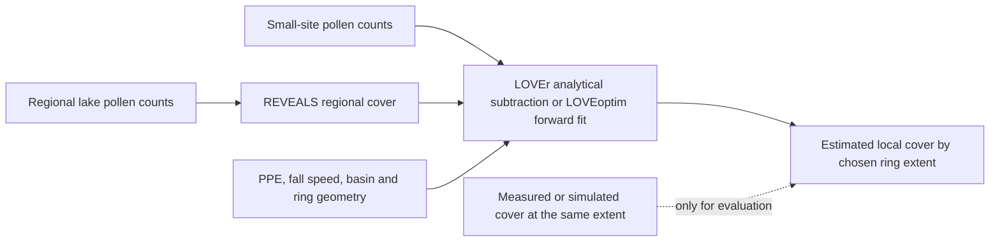

# LOVE and LOVEoptim: local vegetation inference and its tested boundary

**Paper.** Theuerkauf, M. and Couwenberg, J. (2024), “[LOVE Is in the R—Two R Tools for Local Vegetation Reconstruction](https://doi.org/10.3390/quat7020018),” *Quaternary* **7**(2), article 18. This technical note introduces `LOVEr`, an R implementation of analytical LOVE, and `LOVEoptim`, a numerical approach to estimating local vegetation from pollen at small sites. The scientific question is how to separate nearby vegetation's pollen signal from the regional pollen background, and what area a resulting local estimate can represent. We examine the paper because our landscape reconstruction engine implements corresponding calculations and needs a source-bound method account. [Original article, Abstract and Sects. 1–2](https://doi.org/10.3390/quat7020018); [our method correspondence](method-correspondence.md).

**Scoped conclusion.** In the paper's *simulated north-eastern German landscape*, both R tools yield local-cover curves close to simulated vegetation for eight artificial ponds, with the authors reporting somewhat better results for `LOVEoptim` in smaller inner areas and best behavior when roughly 100–500 m of rings are treated as local. We have matched its ten printed taxon parameters to a later, exact DISQOVER example and demonstrated bounded original-R, current-R and Python numerical agreement on declared fixtures. We have **not** rerun the article's eight-pond Figure 2 or validated local cover against independently measured vegetation. The modeled simulation truth, retained package example and a Nordic historical lake are different populations. [Paper, Sects. 2.4–4](https://doi.org/10.3390/quat7020018); [paper-source decision](../../docs/report/method-certification/love-paper-correspondence/README.md); [original R reference](../../docs/report/method-certification/original-r-reference/README.md).

## What the models consume and estimate

Pollen counts in a small lake or peatland reflect both plants close to that site and more distant plants. A nearby large lake predominantly samples the wider **regional** signal. **REVEALS** (“Regional Estimates of VEgetation Abundance from Large Sites”) converts the regional lake's pollen counts to an estimate of regional plant cover. **LOVE** (“LOcal Vegetation Estimates”) then combines that background with the small site's counts to estimate plant cover in a specified surrounding area. Pollen percentages and vegetation-cover fractions are different quantities: taxa release unequal amounts of pollen and their grains disperse differently. **PPE** means relative pollen productivity estimate, with a reported spread; **fall speed** affects dispersal and deposition. Basin geometry, ring areas and vegetation-free water or wetland fractions define what area contributes to each calculation. [Paper, Sects. 1–2.3](https://doi.org/10.3390/quat7020018); [source-method account](../../docs/report/method-certification/love-paper-correspondence/README.md).



`LOVEr` derives local cover analytically after subtracting regional pollen deposition. The paper identifies two restrictive assumptions behind that solution: total distance-weighted plant abundance is similar among small sites, and local vegetation is homogeneous with the regional composition in the relevant area. `LOVEoptim` retains the premise that pollen deposition at a small site is local plus regional, then adjusts candidate local-cover fractions until their **forward-predicted pollen composition** resembles the small-site pollen. Its objective is log-Euclidean pollen mismatch, optimized with RcppDE's differential evolution in the paper's R implementation. Consecutive rings are assigned local cover one by one, so the output depends on the selected extent; ring-specific water and wetland fractions can enter the forward model. The algorithm's search success is a numerical matter, while whether its inferred cover represents real vegetation is a separate scientific matter. [Paper, Sects. 2.1–2.3](https://doi.org/10.3390/quat7020018); [optimized objective and source behavior](../../docs/report/method-certification/love-paper-correspondence/README.md); [solution-quality study](../../docs/report/method-certification/optimizer-solution-quality/README.md).

The paper's observation units are **one regional lake and eight artificial local ponds**, not historical Nordic cores. Its BÜK200-based map near Dobbin supplies 11 map-unit vegetation compositions, including water; it adds two sets of ponds of approximately 10, 50, 100 and 200 m diameter, and models ten taxa over a 100 km source extent with Lagrangian stochastic dispersal under unstable conditions. For `LOVEr` and `LOVEoptim`, the article describes **100 runs** with perturbed counts and PPE to obtain uncertainty summaries. Figure 2 plots true versus reconstructed cover and root mean square error (**RMSE**) as local extent changes; it does not publish a source numerical table from which we can recover all its exact result rows. RMSE measures disagreement with the *known simulated map* in that experiment, not field-measured vegetation skill. [Paper, Sects. 2.4–3 and Fig. 2](https://doi.org/10.3390/quat7020018); [source packet inventory](../../docs/report/method-certification/love-paper-correspondence/README.md).

## One trace from a parameter and count row to a local result

The paper's Table 2 prints ten taxon PPE, PPE standard-deviation and fall-speed triples. For **Betula**, they are **4**, **0.4** and **0.024**, respectively. The table itself does not state the fall-speed unit, so this report leaves that printed number unitless. Our retained transcription matches all **30/30** numeric Table 2 cells, by row position, to the packaged DISQOVER 0.9.14 `LOVEexampleParams` source; **9/10** names match exactly, with paper `Grasses` versus package `Gras`. Table 1 also prints 11 map-unit compositions, but those fractions alone do not determine where each map unit occurs around a pond. This establishes an input correspondence, not that the later package generated the paper's simulation. [Paper, Tables 1–2](https://doi.org/10.3390/quat7020018); [exact table transcription](../../docs/report/method-certification/love-paper-correspondence/paper-parameter-tables.json); [30-cell comparison](../../docs/report/method-certification/love-paper-correspondence/source-parameter-correspondence.json).

The separate packaged `LOVEexample` has **one local** and **one regional** pollen row. Its Betula entries are **594 of 999 local** and **424 of 1,000 regional grains** in their respective ten-taxon count sums. Those are observed *fixture pollen proportions*, not Betula vegetation fractions. With the same packaged Betula PPE/fall-speed row, explicit local count and PPE draws, a supplied regional-cover vector and the example's eighth ring (bounds **7.5–10.5 in the fixture's native distance units**), source R `LOVEr` gives a two-repeat mean Betula estimate of **9.88732518130799** in fractional-cover units; current Python gives **9.8873251813080092** on exactly paired inputs. Ring 8 is one of three source-valid local extents among the first ten. The closeness tests calculation correspondence, while a fraction above one is **not physically valid vegetation cover**. We retain it without clipping; no Figure 2 pond or observed landscape is represented by this row. [Exact shared input](../../docs/report/method-certification/paired-love-draws/setup.json); [R Betula row](../../docs/report/method-certification/paired-love-draws/r-values.csv); [Python Betula row](../../docs/report/method-certification/paired-love-draws/python-values.csv); [paired-draw result](../../docs/report/method-certification/paired-love-draws/README.md).

## What the original paper found

Across the **eight simulated ponds**, the authors report broadly similar local-cover estimates from command-line LOVE, `LOVEr` and `LOVEoptim`, with `LOVEoptim` slightly more accurate than `LOVEr` for inner rings. They associate that difference in their simulation with analytical results outside 0–100% at small extents; their constrained optimized outputs remain within that range. Their **100–500 m** finding is an empirical range for *this* simulated map, dispersal choice and pond layout, not an accepted radius for another region. They note that including all rings tends to approach regional composition and that the link between best extent and pond size is weak in their test. [Paper, Sect. 3 and Fig. 2](https://doi.org/10.3390/quat7020018).

The authors explicitly caution that count/PPE perturbation does not capture all uncertainty from pollen preparation, parameter differences among studies, plant-to-plant variation or model assumptions. They also question whether their simulation describes short-range pollen deposition at tiny basins well, and conclude that the command-line **necessary source area of pollen** should not be treated as the actual spatial scale of reconstructed vegetation in their experiment. These are limits on ecological interpretation even if the numerical program agrees perfectly with its source. [Paper, Sects. 4.1–4.3](https://doi.org/10.3390/quat7020018).

## What our separate calculations establish

| Question and input population | Retained result and denominator | Interpretation and limit |
| --- | --- | --- |
| Do the original DISQOVER R vectors agree with our current engine on declared fixtures? | The authenticated DISQOVER **0.9.14** historical bundle has **25 original core** R cases plus **23 source-domain** cases that match current Python, with maximum absolute numerical difference **3.197442310920451 × 10⁻¹⁴**. The current replay considers 66 cases: **48 passed**, **18 refused** because the original bundle has no R result for those later prospective optimized fixtures. [Original-reference replay](../../docs/report/method-certification/original-r-reference/README.md). | Exact declared method cases, including analytical LOVE and candidate objective evaluation, agree. This is neither the 2024 executable version nor the eight-pond article output. |
| Can actual current native R run the expanded source cases? | Source-locked **R 4.6.0/DISQOVER 0.9.14** on macOS passed **43/43 core** and **23/23 source-domain** cases, including the **18** new optimized cases. The **48** historically shared vector cases also agree with original R; all **97** retained numeric CSVs match the fresh native result. [Native R account](../../docs/report/method-certification/current-r-oracle/README.md). | This fills the original bundle's absent 18-case result for the current source closure. It does not make the 2026 package the paper's 2024 code or establish identical optimizer search paths. |
| Is there a Linux R execution on a bounded source set? | A local **Linux ARM64**, source-built **R 4.6.0** run passed **43/43 core** and **23/23 source-domain** cases with the recorded source/runtime/library file closure. [Linux R account](../../docs/report/method-certification/linux-r-oracle/README.md). | Platform-specific numerical evidence; it is not the separate Ubuntu x86_64 CI release certificate or a check of a later source revision. |
| Do local draw and optimized candidate calculations agree on the packaged example? | On one ten-taxon fixture, **120 finite** analytical LOVE summary cells agree within **6.93 × 10⁻¹⁴** absolute difference and **280 missing** cells occupy identical positions. A separate optimized comparison has **36 rings × 10 taxa**, **two repeats**, **32 fixed candidates** per eight active ring/repeat calls: all selected candidate indices agree, with 40 finite cover and 40 pollen pairs equal, 360 ring factors within **5.11 × 10⁻¹⁵**, and eight objective pairs within **4.67 × 10⁻¹⁵**. [Paired local draws](../../docs/report/method-certification/paired-love-draws/README.md); [fixed-candidate source comparison](../../docs/report/numerical-performance/love-source-comparison/README.md). | Supplied-draw and fixed-candidate arithmetic correspond; random streams, complete search trajectories, convergence and ecological accuracy do not follow. |
| Do analytical outputs always form plausible cover? | Only **3/10** first example rings meet source local-basin support; among their **30** taxon/ring cells, **16** estimates are negative and **six** exceed one. [Ring-cover rows](analytical-love-ring-sensitivity/ring-cover.csv); [interpretation](analytical-love-ring-sensitivity/README.md). | Ring choice materially changes output, and even a finite value can be an inadmissible cover fraction. The result is not a recommended radius. |

The DISQOVER **0.9.14** archive used for these receipts was packaged in **January 2026**; the 2024 article cited DISQOVER as accessed in February 2024. Its source identity and GPL notice are recorded separately from the article PDF. The accessible article supplies printed parameters and descriptions, but we have not identified a deposited bundle containing its exact BÜK200 spatial extraction, pond coordinates/basins, ring-area fractions, simulated pollen or random realizations. The later packaged example describes **BÜK300**, and its one local/regional pair with 36 rings is not the paper's eight artificial ponds. We therefore assign **no numerical Figure 2 residual or reproduction status**. [DISQOVER identity](../../docs/report/method-certification/disqover-source-identity/README.md); [paper input review](../../docs/report/method-certification/love-paper-correspondence/README.md); [article data availability statement](https://doi.org/10.3390/quat7020018).

## Reproduction and decisions needed

From the repository root, the published-table correspondence can be rechecked without the private article packet or a source-built R library:

```sh
python3 docs/report/method-certification/love-paper-correspondence/verify.py \
  --repository . --check
```

The [original-reference replay](../../docs/report/method-certification/original-r-reference/README.md) checks the bundled R vectors against the current engine. A fresh native-R run needs the exact pinned source archives and isolated library described in the [current R instructions](../../docs/report/method-certification/current-r-oracle/README.md#reproduction); the [paired-draw](../../docs/report/method-certification/paired-love-draws/README.md) and [fixed-candidate](../../docs/report/numerical-performance/love-source-comparison/README.md) instructions write run products under `artifacts/`. The local Linux result has its own private runtime and container custody; its retained report is readable without that runtime. [Source adoption decision](../architecture/lra-source-adoption/README.md).

To reproduce the paper's **Figure 2**, the source owner would need to identify the simulation's exact BÜK200 map extract and land-unit assignment, regional and eight pond coordinates and geometry, all ring areas and water/wetland fractions, generated local/regional pollen inputs, random draws and executable version. A qualified landscape-reconstruction reviewer would then assess the model's local-area and uncertainty assumptions for any proposed historical site. Before claiming vegetation accuracy, a reference owner would need independent measured cover, dated and matched to the pollen and the actual spatial estimand; our current [vegetation-reference review](vegetation-reference.md) does not supply such a Nordic pair. These are **unsent source and reviewer requests**. No colleague reading exercise, qualified scientific endorsement, Nordic ring admission or independent vegetation score is recorded here.


<!-- scientific-verification-and-limits:begin -->
## Scientific verification and limits

**Supported claim.** 2024 paper population/results and later exact parameter/candidate arithmetic are separately documented.

**Unsupported claim.** Paper Figure 2 eight-pond RMSE reproduction or Nordic radius selection.

**Actual verification performed.** Retained printed Table 2 transcription, 30-cell comparison and later R/native fixture receipts are described; index did not rerun simulation.

**Remaining input or review.** Printed 30 parameter cells match a later package, but original BÜK200 map extract, eight-pond geometry, generated pollen and random draws are absent; BÜK300 fixture parity does not reproduce Figure 2 or select Nordic radius. Resolver: 2024 paper simulation custodian and qualified LOVE/basin reviewer Reopen when: Exact original simulation inputs and random realizations are versioned and reviewed before Figure 2 replay or transfer.

**Cause category.** data|assumption|comparability

**Consequence.** Keep BÜK300 later fixture parity separate from BÜK200 paper output and real lake geometry.

**Precise next acceptance route.** Exact original simulation inputs and random realizations are versioned and reviewed before Figure 2 replay or transfer. Then update reports/science/paper-accounts.md.

**Negative or refused result.** Original BÜK200 simulated pollen and random draws unavailable; no Nordic cover score evaluated.

**Matched denominator.** Paper: one regional lake and eight artificial ponds; 30/30 printed numeric parameter cells match later fixture by row, 9/10 names exactly.

Retained evidence: [docs/report/method-certification/love-paper-correspondence/README.md](../../docs/report/method-certification/love-paper-correspondence/README.md), [reports/science/method-correspondence.md](method-correspondence.md).

This account preserves the verification scope and source limitations; rendering these statements does not rerun or qualify the underlying science.

<!-- scientific-verification-and-limits:end -->
