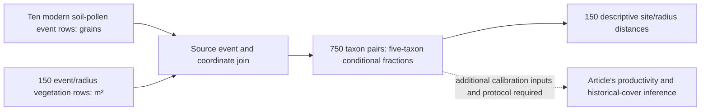

# Namibian pollen productivity and what the modern reference tables support

**Citation.** Tabares, X., Ratzmann, G., Kruse, S., Theuerkauf, M., Mapani, B. and Herzschuh, U. (2021), “[Relative pollen productivity estimates of savanna taxa from southern Africa and their application to reconstruct shrub encroachment during the last century](https://doi.org/10.1177/09596836211003193),” *The Holocene* **31**(7), 1100–1111. The study asks how to quantify savanna vegetation change using locally calibrated pollen productivity. Its publisher abstract reports five-taxon extended R-value calibration under Gaussian plume and Lagrangian stochastic dispersal, an unreliable Poaceae productivity estimate, and use of Combretaceae as the reference taxon. It also reports a Lake Otjikoto reconstruction spanning roughly 130 years, interpreted as increased woody cover in the recent period. Those are the authors' findings; we have not reproduced that calibration or historical reconstruction. [Primary publisher record](https://journals.sagepub.com/doi/10.1177/09596836211003193).

Our narrower result concerns its openly deposited **modern observations**: ten soil-pollen sites joined to vegetation areas at 15 publisher radius labels. We retain the exact source rows and describe their five-taxon composition mismatch. This supports an out-of-domain development source, with **no fitted model score, calibrated productivity result, recommended source radius or Nordic vegetation validation**. [Governed source account](../../docs/report/vegetation-reference/namibia-pollen-vegetation/README.md); [our vegetation-reference decision](vegetation-reference.md).

## Which sources answer which question

The [modern pollen dataset, PANGAEA.931033](https://doi.org/10.1594/PANGAEA.931033), contains grain counts for Acacia, Dichrostachys, Grewia, Poaceae and Combretaceae at ten named events. The [vegetation dataset, PANGAEA.931035](https://doi.org/10.1594/PANGAEA.931035), contains calculated vegetation areas in square metres for those sites at 100–1,500 m radius labels. Their parent [dataset series, PANGAEA.931037](https://doi.org/10.1594/PANGAEA.931037), identifies the article. Both original table headers state **CC BY 4.0**; reuse requires attribution to the datasets, series and investigators. The [source-bound report](../../docs/report/vegetation-reference/namibia-pollen-vegetation/report.json) records exact original SHA-256 identities.

The two source tables have different units. A pollen count measures grains; the vegetation table measures calculated area. Pollen production and transport mean their proportions need not coincide even at the same location. **PPE**, relative pollen productivity estimate, is a model parameter calibrated from such relationships, not the ratio of one arbitrary pair of fractions. **REVEALS**, Regional Estimates of VEgetation Abundance from Large Sites, uses productivity and dispersal with basin geometry to infer regional cover from pollen. Its historical output needs its own count, age and parameter inputs. Our joined modern observations have no such reconstruction attached.

The same pollen sample is repeated across the vegetation radius rows. Thus **150 site/radius rows are ten pollen sites**, not 150 independent pollen samples; **750 taxon pairs are not 750 independently measured landscapes**. At every radius label, the summary has ten site weights. The tables do not state exact soil-sampling or imagery dates. The [primary dataset series](https://doi.org/10.1594/PANGAEA.931037) describes mean cover calculated in 100 m rings; the vegetation table labels its spatial field “Ring sector, radius.” This supports a ring-specific interpretation, while the actual sector masks and pixel construction remain unverified. [Joined rows](../../docs/report/vegetation-reference/namibia-pollen-vegetation/paired.csv); [join producer](../../docs/report/vegetation-reference/namibia-pollen-vegetation/replay.py).

## Spatial support of the reported areas

We checked the 750 retained taxon-area rows across 50 site/taxon series. Nine of 700 adjacent-radius comparisons decrease, across eight series. A fixed taxon class measured in nested cumulative disks cannot lose area as the disk grows. All 150 five-taxon sums fit the full 100 m annulus at their radius label: dividing each sum by `pi * (r² - (r - 100)²)` gives 64.621%–93.534%. These arithmetic results support the [source description of rings](https://doi.org/10.1594/PANGAEA.931037); they do not independently establish the sector polygons, imagery dates or classification. The conditional five-taxon fractions and distances remain unchanged. A different map or mask at each radius could also explain nonmonotone areas, so this check does not recover the original calibration design. [Complete retained area rows](../../docs/report/vegetation-reference/namibia-pollen-vegetation/paired.csv).

## A worked event-to-composition trace

At **Namibia_T1**, the five named counts are **6 Acacia, 73 Dichrostachys, 5 Grewia, 374 Poaceae and 194 Combretaceae**, summing to **652 grains**. At the publisher's **100 m** label, the five vegetation areas sum to **26,255.796823 m²**; the Acacia area is **1,013.872200 m²**. Acacia's conditional pollen fraction is `6 / 652 = 0.009202453988`, while its conditional vegetation-area fraction is `1013.872200 / 26255.796823 = 0.038615175416`. These are shares of the **five reported taxa**, not all terrestrial pollen, all land cover, or a productivity estimate. [Five exact source-joined rows](../../docs/report/vegetation-reference/namibia-pollen-vegetation/paired.csv).

Using all five fractions at this site/label gives Hellinger distance **0.197287732007**. The calculation is `sqrt(sum((sqrt(p_i) - sqrt(v_i))²) / 2)`, with `p` the conditional pollen composition and `v` the conditional vegetation-area composition. Zero means equal compositions and one is the maximum. This distance describes two observations with distinct measurement routes; it does not score a prediction. [Site/radius ledger](../../docs/report/vegetation-reference/namibia-pollen-vegetation/radius-sensitivity.csv); [metric definition and source identities](../../docs/report/vegetation-reference/namibia-pollen-vegetation/radius-sensitivity.json).

| Publisher radius label | Sites per label | Mean descriptive Hellinger distance |
| --- | ---: | ---: |
| 100 m | 10 | 0.366360 |
| 400 m | 10 | 0.342668 |
| 1,500 m | 10 | 0.377736 |

The [full summary](../../docs/report/vegetation-reference/namibia-pollen-vegetation/radius-sensitivity.json) and [150 distances](../../docs/report/vegetation-reference/namibia-pollen-vegetation/radius-sensitivity.csv) preserve all 15 labels and the site ranges. A smaller mean at one inspected label does not select an ecological pollen-source area. These are already exposed development observations, with correlated repeated support across labels and no model fitting or independent confirmation.

## Verified scope and unresolved interpretation

The retained producers authenticate the two original table hashes, verify event identities and displayed coordinate correspondence, preserve count/area units, join the source rows, and calculate conditional fractions and distances deterministically. They do not recover the complete article calibration, its uncertainty procedure or the historical Lake Otjikoto calculation. The publisher record checked here supplies citation and abstract-level findings; it is not a reviewed full-text methods closure. We retain no claim of reproducing article tables or historical curves. [Join producer](../../docs/report/vegetation-reference/namibia-pollen-vegetation/replay.py); [distance producer](../../docs/report/vegetation-reference/namibia-pollen-vegetation/radius_sensitivity.py); [publisher record](https://journals.sagepub.com/doi/10.1177/09596836211003193).

The Namibian savanna taxa, soil sampling and calculated vegetation support differ from a Nordic sediment core and dated landscape measurement. Even a lawful modern-data join does not resolve Nordic basin history, calibrated sample ages, local-ring admissibility or the independent vegetation estimand. Our [Nordic EMPD2–NFI review](../../docs/report/validation/empd2-nfi-pairing/report.json) still has zero admitted pairs. These populations must not be pooled into a Nordic accuracy denominator.

## Reproduce and resolve the missing inputs

With the two exact original tables in a source directory, use the [join and sensitivity commands](../../docs/report/vegetation-reference/namibia-pollen-vegetation/README.md) or the explicit reproduction blocks on that page. The producers write isolated outputs under `artifacts/`; comparing all four numeric outputs with the retained files checks the bounded calculations. The first producer refuses changed source bytes before deriving rows. Public readers can inspect source dataset identifiers and retained outputs without a private runtime.

The precise **unsent** source request is for the full article methods and supplement, ERV input/design and parameter uncertainty, the exact ring-sector masks and spatial support construction, soil/imagery dates, mapped taxon-area construction and uncertainty, and the versioned Lake Otjikoto count/chronology/PPE/transport inputs. A qualified reviewer should first determine whether those source observations and spatial supports measure the proposed estimand. An independent reader exercise and scientific review are not recorded. These missing details keep calibration, historical reproduction and cross-domain vegetation validation open.
