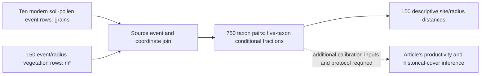

# Namibian pollen productivity and what the modern reference tables support

**Citation.** Tabares, X., Ratzmann, G., Kruse, S., Theuerkauf, M., Mapani, B. and Herzschuh, U. (2021), “[Relative pollen productivity estimates of savanna taxa from southern Africa and their application to reconstruct shrub encroachment during the last century](https://doi.org/10.1177/09596836211003193),” *The Holocene* **31**(7), 1100–1111. The study asks how to quantify savanna vegetation change using locally calibrated pollen productivity. The full article reports five-taxon extended R-value calibration under Gaussian plume and Lagrangian stochastic dispersal, an unreliable Poaceae productivity estimate, and use of Combretaceae as the reference taxon. It also reports a Lake Otjikoto reconstruction spanning roughly 130 years, interpreted as increased woody cover in the recent period. Those are the authors' findings; we have not reproduced that calibration or historical reconstruction. [Primary publisher record](https://journals.sagepub.com/doi/10.1177/09596836211003193).

Our narrower result concerns its openly deposited **modern observations**: ten soil-pollen sites joined to vegetation areas at 15 publisher radius labels. We retain the exact source rows and describe their five-taxon composition mismatch. The descriptive join supports an out-of-domain development source. A separate [grouped mapped-area experiment](../../docs/report/vegetation-reference/namibia-grouped-mapped-area/README.md) predicts mapped composition from pollen. The [forward pollen comparison](#forward-pollen-results-and-independent-confirmation) instead predicts pollen given deposited areas, retaining two failed fits and stronger-baseline losses. Both use already exposed observations; neither establishes calibrated productivity, a recommended source radius or Nordic vegetation validation. [Governed source account](../../docs/report/vegetation-reference/namibia-pollen-vegetation/README.md); [our vegetation-reference decision](vegetation-reference.md).

## Which sources answer which question

The [modern pollen dataset, PANGAEA.931033](https://doi.org/10.1594/PANGAEA.931033), contains grain counts for Acacia, Dichrostachys, Grewia, Poaceae and Combretaceae at ten named events. The [vegetation dataset, PANGAEA.931035](https://doi.org/10.1594/PANGAEA.931035), contains calculated vegetation areas in square metres for those sites at 100–1,500 m radius labels. Their parent [dataset series, PANGAEA.931037](https://doi.org/10.1594/PANGAEA.931037), identifies the article. Both original table headers state **CC BY 4.0**; reuse requires attribution to the datasets, series and investigators. The [source-bound report](../../docs/report/vegetation-reference/namibia-pollen-vegetation/report.json) records exact original SHA-256 identities.

The two source tables have different units. A pollen count measures grains; the vegetation table measures calculated area. Pollen production and transport mean their proportions need not coincide even at the same location. **PPE**, relative pollen productivity estimate, is a model parameter calibrated from such relationships, not the ratio of one arbitrary pair of fractions. **REVEALS**, Regional Estimates of VEgetation Abundance from Large Sites, uses productivity and dispersal with basin geometry to infer regional cover from pollen. Its historical output needs its own count, age and parameter inputs. Our joined modern observations have no such reconstruction attached.



The same pollen sample is repeated across the vegetation radius rows. Thus **150 site/radius rows are ten pollen sites**, not 150 independent pollen samples; **750 taxon pairs are not 750 independently measured landscapes**. At every radius label, the summary has ten site weights. The tables do not state exact soil-sampling or imagery dates. The [primary dataset series](https://doi.org/10.1594/PANGAEA.931037) describes mean cover calculated in 100 m rings; the vegetation table labels its spatial field “Ring sector, radius.” This supports a ring-specific interpretation, while the actual raster masks and pixel construction remain unverified. The full
article now specifies the intended concentric-ring design below. [Joined rows](../../docs/report/vegetation-reference/namibia-pollen-vegetation/paired.csv); [join producer](../../docs/report/vegetation-reference/namibia-pollen-vegetation/replay.py).

## Full article and supplement source review

The supplied 12-page article (journal pp. 1100–1111) and matching seven-page
supplement have now been read, including the calibration equations, tables,
field design and limitations. The article is 1,719,282 bytes, SHA-256
`ab0088f710ec575b1238ece8586f43cab386d091e21c73659b3596eaabfac82e`;
the supplement is 402,236 bytes, SHA-256
`5fb28a1d594aa1997fd64d1428e8ca884d40413ecb99cb932fee13756126fcac`.
These identify the reviewed originals, which are retained privately rather than
redistributed. Their availability resolves the article-download subquestion of
`namibia-radius-and-calibration`; it does not supply the original computation.
A separate source review checked the methods and numerical table identities.
No existing fit, join, distance or prediction was rerun for this reading.

Methods and Figure 2 (pp. 1101–1103) describe ten sites, each with eleven
5 × 5 m vegetation plots, spaced 50 m along a 500 m transect. Six subplots at
the central plot supplied the pooled surface-soil pollen sample. At least
400 pollen grains were counted per sample; the article percentages use the
total terrestrial pollen sum. The five selected taxa
represented 62%–81% of the full pollen sum and 56%–82% of vegetation cover
as reported on p. 1104. Our five-component closures still omit those other taxa;
these reported ranges do not recover each site's missing whole denominator.

The article explicitly specifies fifteen concentric 100 m rings to a 1.5 km
radius. GeoEye-1 and WorldView-2 imagery at 0.4 m resolution was pansharpened
and orthocorrected, then classified as bare soil, woody vegetation or grasses.
Field relevés supplied taxonomic composition. The printed woody-cover workflow
first forms `d = a*c`, then `f = d*e`, using mapped woody cover and two stated
field-abundance quantities. We preserve this two-stage description; the actual
`a,c,d,e,f` arrays, class rasters, training samples and implementation are absent.
Thus the intended ring geometry and area-construction method are now documented,
while the exact spatial masks and realized values remain unverified.

The calibration (p. 1103, equations 1–2) uses ERV submodel 3, estimating relative
productivity together with regional abundance/background pollen. ERVinR uses
R `optim` with conjugate gradients and a mean squared chord objective. The
paper compares GPM and LSM at 3, 10 and 50 km, initially with 20 repetitions,
and repeats the comparison without Poaceae. The selected 10 km/four-taxon
configuration receives 100 repetitions; smaller reported errors than at 50 km
contribute to its selection (p. 1104). These are development selections, not
independent confirmation. The published background model and objective differ
from our separately declared no-background per-grain-NLL forward comparison.
Its empirical response weights must not be relabeled as reproduced ERV PPEs.

| Taxon | Table 2 GPM PPE / SE | Table 2 LSM PPE / SE | Table 2 fall speed, m/s |
| --- | ---: | ---: | ---: |
| Acacia | 0.420 / 0.015 | 0.235 / 0.009 | 0.065 |
| Dichrostachys | 0.290 / 0.013 | 0.430 / 0.018 | 0.023 |
| Grewia | 0.230 / 0.010 | 0.090 / 0.004 | 0.067 |
| Combretaceae | 1 / 0, reference | 1 / 0, reference | 0.015 |
| Poaceae | not retained | not retained | 0.031 |

Table 2 contains the final 100-repetition results. Supplement S1 instead uses
Poaceae as reference with 20 repetitions; S3A/B use Combretaceae with five/four
taxa and 20 repetitions. S3B's 10 km means and errors differ from Table 2,
including GPM means 0.429/0.282/0.216 and LSM means 0.235/0.480/0.116 for
Acacia/Dichrostachys/Grewia. Do not mix means and SEs across these experiments.
The reported SEs are not field dispersion or a supplied joint uncertainty law;
original repetitions, seeds, covariance and their generating procedure remain
missing. A separate literal discrepancy remains: Table 2 gives Combretaceae
fall speed 0.015 m/s, while Results prose on p. 1104 says 0.014 m/s. Neither
has been silently selected as a correction or substituted into an existing run.

Historical REVEALS uses Table 2 GPM values and an external Poaceae PPE of
2.02 relative to Combretaceae from Duffin and Bunting (2008), because this
study's own Poaceae fit was poor. The 2012–2015 imagery period is now explicit
(p. 1104), but per-scene/site acquisition and soil-sampling dates remain absent.
The authors compare the matching REVEALS-period mean with northern Karstveld
sites T1–T5 because no survey around Lake Otjikoto was available. That is a
regional proxy comparison, not independent measured catchment validation.
Supplement S6 identifies charcoal core 15OJ06 and pollen core 15OJ10 and the
zone context; it does not supply the raw pollen/count/chronology replay packet.
The paper itself also cautions that soil pollen can arrive through local plants,
trampling, vehicles or dung, and that European atmospheric settings remain
unvalidated for this region (pp. 1107–1108).

## Spatial support of the reported areas

We checked the 750 retained taxon-area rows across 50 site/taxon series. Nine of 700 adjacent-radius comparisons decrease, across eight series. A fixed taxon class measured in nested cumulative disks cannot lose area as the disk grows. All 150 five-taxon sums fit the full 100 m annulus at their radius label: dividing each sum by `pi * (r² - (r - 100)²)` gives 64.621%–93.534%. These arithmetic results support the [source description of rings](https://doi.org/10.1594/PANGAEA.931037); they do not independently recover the realized raster footprints, per-site imagery dates or classification arrays. The conditional five-taxon fractions and distances remain unchanged. A different map or mask at each radius could also explain nonmonotone areas, so this arithmetic check alone does not recover the realized raster or original calibration inputs. [Complete retained area rows](../../docs/report/vegetation-reference/namibia-pollen-vegetation/paired.csv).

## A worked event-to-composition trace

At **Namibia_T1**, the five named counts are **6 Acacia, 73 Dichrostachys, 5 Grewia, 374 Poaceae and 194 Combretaceae**, summing to **652 grains**. At the publisher's **100 m** label, the five vegetation areas sum to **26,255.796823 m²**; the Acacia area is **1,013.872200 m²**. Acacia's conditional pollen fraction is `6 / 652 = 0.009202453988`, while its conditional vegetation-area fraction is `1013.872200 / 26255.796823 = 0.038615175416`. These are shares of the **five reported taxa**, not all terrestrial pollen, all land cover, or a productivity estimate. [Five exact source-joined rows](../../docs/report/vegetation-reference/namibia-pollen-vegetation/paired.csv).

Using all five fractions at this site/label gives Hellinger distance **0.197287732007**. The calculation is `sqrt(sum((sqrt(p_i) - sqrt(v_i))²) / 2)`, with `p` the conditional pollen composition and `v` the conditional vegetation-area composition. Zero means equal compositions and one is the maximum. This distance describes two observations with distinct measurement routes; it does not score a prediction. [Site/radius ledger](../../docs/report/vegetation-reference/namibia-pollen-vegetation/radius-sensitivity.csv); [metric definition and source identities](../../docs/report/vegetation-reference/namibia-pollen-vegetation/radius-sensitivity.json).

| Publisher radius label | Sites per label | Mean descriptive Hellinger distance |
| --- | ---: | ---: |
| 100 m | 10 | 0.366360 |
| 400 m | 10 | 0.342668 |
| 1,500 m | 10 | 0.377736 |

The [full summary](../../docs/report/vegetation-reference/namibia-pollen-vegetation/radius-sensitivity.json) and [150 distances](../../docs/report/vegetation-reference/namibia-pollen-vegetation/radius-sensitivity.csv) preserve all 15 labels and the site ranges. A smaller mean at one inspected label does not select an ecological pollen-source area. These are already exposed development observations, with correlated repeated support across labels and no model fitting or independent confirmation.

## Separate empirical prediction of mapped area

The [grouped mapped-area account](../../docs/report/vegetation-reference/namibia-grouped-mapped-area/README.md) uses the same ten sites and 15 ring labels to evaluate a positive compositional correction. Its nine nominal spatial groups hold T4 and T5 together under declared 1.5 km circular envelopes. Actual classified raster footprints and independent campaigns remain unverified. Training excludes the whole held-out group at every radius; all 15 radii and both equal-site and equal-group means are retained.

The correction is the group-weighted mean of `log(mapped_share / pollen_share)` for each of the five source taxa. Predictions close the held-out pollen multiplied by the exponentiated correction. The [estimator proof](../../docs/report/vegetation-reference/namibia-grouped-mapped-area/estimator-proof.md) binds this conditional compositional objective; it does not identify pollen productivity or transport parameters. The two baselines are unchanged pollen and the training-only mapped composition.

The experiment retains 450 prediction vectors and 450 squared Hellinger losses, using `sum((sqrt(predicted) - sqrt(mapped))²) / 2`. This prediction loss differs from the descriptive Hellinger distance above, which takes its square root. In the 150 paired site/radius contrasts, the correction is better than unchanged pollen in 130 and poorer in 20. Against the training mapped baseline it is better in 60 and poorer in 90. The stronger mapped baseline has smaller mean loss at 8 of 15 radii under equal-site weighting and 9 of 15 under equal-group weighting. The [complete comparison account](../../docs/report/vegetation-reference/namibia-grouped-mapped-area/comparisons.json) retains every radius and all 110 poorer contrasts across the two baselines.

A separate implementation checked 7,290 numerical fields with 50-digit Decimal arithmetic under the unchanged 1e-12 tolerance. This numerical agreement authenticates the declared calculation, with shared-interpreter limitations. Outcomes were already exposed: the source is development evidence, with no untouched confirmation, calibrated uncertainty, field vegetation accuracy, historical reproduction or Nordic transfer claim. A fitted empirical correction does not resolve the article's unreliable grass productivity calibration. [Source and numerical qualification](../../docs/report/vegetation-reference/namibia-grouped-mapped-area/source-account.json).

## Forward pollen comparison protocol

We ask whether a shared empirical response fitted on training pollen predicts
the held-out site's five-taxon pollen composition better than fixed baselines
when its deposited mapped areas are available. This is a separate direction
from the preceding mapped-area prediction. The protocol is fixed before the
new fits; the observations were already exposed during development.

For native area `A[s,t]` and positive response weight `w[t]`, the prediction is
`q[s,t] = A[s,t] * w[t] / sum_j(A[s,j] * w[j])`. Training minimizes
`-sum_s,t(n[s,t] * log(q[s,t])) / sum_s,t(n[s,t])` over allowed sites.
Native grain effort determines training weight. Reporting sets the Combretaceae
response to one; multiplying every response by a common constant has no effect.
These empirical weights are neither vegetation fractions nor calibrated PPE,
ERV or dispersal parameters. Common area units cancel within each site.

The nine existing nominal groups, including T4/T5 together, are excluded in
turn at each of the 15 native ring labels. This gives 135 attempted fits and
150 held-out site/radius predictions per method. No radius is selected.
Baselines are the held-out mapped-area composition, pooled training pollen,
and the geographically nearest allowed training site's pollen composition.
Nearest uses native event coordinates, a 6,371,000 m spherical Earth and event
identifier order for exact ties. Held-out pollen supplies neither training
parameters nor baseline selection. All predictions precede scoring.

The primary score is per-grain negative log likelihood; secondary scores are
five-taxon mean absolute error and squared Hellinger loss. All radii retain
equal-site and equal-group means, matched comparison denominators and signed
contrasts, including deterioration. A failed or refused fit leaves its model
prediction and scores absent; baselines remain. Solver limits are 200 steps,
score tolerance `1e-12` and relative count tolerance `1e-10`, with the maintained
solver's information and numerical-resolution guards. There is no retry or
fallback selected from held-out scores. The bounded run permits 120 seconds
and a single result CSV below 1 MiB.

This protocol supplies no new independent observations. The repeated targets
remain ten pollen samples, while nominal grouping leaves actual masks and
campaign dependence unresolved. Exact soil/image dates, physical calibration,
field accuracy, untouched confirmation and Nordic transfer remain unavailable.

## Forward pollen results and independent confirmation

The [complete 150-row result](vegetation-reference/namibia-pollen-prediction.csv)
retains 135 distinct fit IDs, native count/area values, response weights, solver
status, four prediction vectors and every score and signed baseline contrast.
The T4/T5 rows share a fit ID. The actual consumer at source commit
`9f3b7d49ce5f841ea31b4b136e552f79a62dd3f3` exited zero in **2.25 seconds**,
producing **198,046 bytes** from the two original deposited tables. The
[committed numerical protocol](../../packages/bijux-pollenomics-dev/src/bijux_pollenomics_dev/source_completion/vegetation/namibia_pollen_prediction/comparison.py)
preceded these fits; its 43 controlled tests, lint, formatting and strict types pass.
No source collection, physical kernel or stochastic uncertainty draw was run.

**133 fits converged; two reached the fixed 200-step limit.** The failures are
held-out T7 at the 200 m and 500 m labels. Their model predictions and scores
remain absent. All three baselines retain all 150 predictions. No retry,
fallback, tolerance relaxation or replacement with an independent solver's
answer was used. Consequently, complete ten-site and nine-group model means
are unavailable at those two labels; they are not means over a favorable subset.

Across the 13 complete radius strata, the empirical model has lower mean
primary loss than area-only and nearest-site predictions under both weighting
rules. Against the pooled training-pollen baseline it has lower mean loss at
eight labels and higher loss at five. Neither result selects a radius or makes
a generally superior model. The primary loss is negative log probability per
observed grain, or cross entropy; a method-independent multinomial coefficient
is omitted. All methods at one target use the same five-taxon denominator.

| Native radius label, m | Model scored sites | Model site mean NLL | Pooled site mean NLL | Model group mean NLL | Pooled group mean NLL |
| --- | ---: | ---: | ---: | ---: | ---: |
| 100 | 10/10 | 0.857982 | 0.838155 | 0.882781 | 0.857798 |
| 200 | 9/10 | unavailable | 0.838155 | unavailable | 0.857798 |
| 300 | 10/10 | 0.811940 | 0.838155 | 0.831963 | 0.857798 |
| 400 | 10/10 | 0.800797 | 0.838155 | 0.819650 | 0.857798 |
| 500 | 9/10 | unavailable | 0.838155 | unavailable | 0.857798 |
| 600 | 10/10 | 0.818081 | 0.838155 | 0.837276 | 0.857798 |
| 700 | 10/10 | 0.817995 | 0.838155 | 0.836998 | 0.857798 |
| 800 | 10/10 | 0.819631 | 0.838155 | 0.839597 | 0.857798 |
| 900 | 10/10 | 0.811459 | 0.838155 | 0.831165 | 0.857798 |
| 1000 | 10/10 | 0.818581 | 0.838155 | 0.839286 | 0.857798 |
| 1100 | 10/10 | 0.827670 | 0.838155 | 0.849169 | 0.857798 |
| 1200 | 10/10 | 0.844433 | 0.838155 | 0.868585 | 0.857798 |
| 1300 | 10/10 | 0.850095 | 0.838155 | 0.875041 | 0.857798 |
| 1400 | 10/10 | 0.850753 | 0.838155 | 0.875677 | 0.857798 |
| 1500 | 10/10 | 0.839882 | 0.838155 | 0.863665 | 0.857798 |

The baselines based only on training pollen do not depend on radius. Their
repeated values do not create new observations. The full CSV also retains
area-only and nearest predictions, all three loss measures and signed
contrasts. Across the **148 matched model targets**, lower/higher counts are:

| Baseline | NLL lower/higher | MAE lower/higher | Squared Hellinger lower/higher |
| --- | ---: | ---: | ---: |
| Area only | 133/15 | 131/17 | 133/15 |
| Pooled training pollen | 78/70 | 75/73 | 81/67 |
| Nearest training site | 93/55 | 96/52 | 98/50 |

There are no exact binary64 ties. In particular, the 70 poorer primary-loss
contrasts against pooled pollen remain visible; neither the two failed fits
nor the stronger baseline is discarded to improve the model's description.

A separate implementation reparsed both original TSVs, independently solved
all 135 training likelihoods and checked the nine groups, native values,
training exclusions, nearest choices and source effort. It verified **598
prediction vectors, 1,794 metric values, 1,332 paired metric contrasts and
348 non-null site/group summary values**. Maximum absolute differences were
**1.56e-12 for probabilities**, **1.40e-12 for losses** and **3.08e-23 for the
training objective**, within the prospectively fixed 1e-8 probability and
1e-10 loss/objective bounds. Converged reported weights also satisfy independent
stationarity and relative expected-count checks. The two production failures
remain failures even though the independent solver finds their finite optima.

The [independent check](../../packages/bijux-pollenomics-dev/src/bijux_pollenomics_dev/source_completion/vegetation/namibia_pollen_prediction/verification.py) uses 160-digit Decimal arithmetic and its own Newton
solver and pivoted linear algebra; it imports no production solver or source
reader. Its first 80-digit attempt stalled because an objective decrease of
about 1e-109 could not be resolved. Increasing working precision left the
acceptance bounds, iteration limits and production result unchanged; the failed
check is retained. Both implementations share an interpreter. This confirms a
numerical calculation on exposed source tables, not environmental validity,
calibrated sampling uncertainty, untouched confirmation or independent sites.

Reproduce the forward study with the existing qualified publisher intake in
`SOURCE_STORE`, containing `vegetation/namibia-modern-pollen-vegetation` and its
original source manifest. The [existing source descriptor](../../configs/ci/qualified-report-sources/namibia-modern-pollen-vegetation.json)
identifies the two unchanged TSVs and their intake. Use an absent output file:

```bash
study_package=bijux_pollenomics_dev.source_completion.vegetation
mkdir -p artifacts/namibia-pollen-prediction
PYTHONDONTWRITEBYTECODE=1 .venv/bin/python -B -m \
  "$study_package.namibia_pollen_prediction" \
  --repository . --source-store "$SOURCE_STORE" \
  --output artifacts/namibia-pollen-prediction/predictions.csv
PYTHONDONTWRITEBYTECODE=1 .venv/bin/python -B -m \
  "$study_package.namibia_pollen_prediction.verification" \
  --source-dir "$SOURCE_STORE/vegetation/namibia-modern-pollen-vegetation" \
  --report artifacts/namibia-pollen-prediction/predictions.csv
```

The producer uses committed code and checks unchanged original inputs before
publication. The second command verifies the saved predictions independently;
it does not rerun the maintained producer. Its optional `--summary` argument
can additionally compare the producer's original JSON stdout. The retained
result above needs no private source vectors, environment snapshot or copied
package to read. The native five-taxon observations and all spatial/temporal
limitations remain the same as in the preceding studies.

## Separate numerical follow-through for the two failed training problems

The original 150-row CSV remains unchanged: 133 converged fits, two step-limit
failures, 148 model targets and the original incomplete radius means. A separate
[6,702-byte numerical result](vegetation-reference/namibia-fit-resolution.json)
evaluates only the two previously failed T7 training problems at the native
200 m and 500 m labels with the later maintained solver. It supplies no held-out
predictions, scores, radius selection or replacement study means.

The [committed protocol and consumer](../../packages/bijux-pollenomics-dev/src/bijux_pollenomics_dev/source_completion/vegetation/namibia_pollen_prediction/fit_resolution.py)
preceded this recomputation. Both problems retain the same nine training events,
including T4 and T5, all five taxa, 6,077 training grains, native area responses
and Combretaceae=1 reporting gauge. Natural grain-effort weights, the 200-step
budget, score tolerance `1e-12`, relative count tolerance `1e-10` and information
and resolution guards are unchanged. The later solver evaluates small objective
differences directly to reduce cancellation. The saved old diagnostics do not
establish the internal cause of either historical failure. The backend is the
maintained Python/NumPy/SciPy likelihood, not R or adopted C++.

At committed source `6735b643d0542d3b3be886febaf311d6adfdb8d0`, the actual
consumer exited zero in **1.508 seconds**, below its 30-second/64 KiB limits.
Both problems converged in **four steps**, with normalized score residual
`1.1102230246251565e-16`. Their relative count residuals are respectively
`1.0411767470134378e-15` and `1.6919122138968363e-15`.

| Native radius label | Training grains | Steps | Training per-grain NLL |
| --- | ---: | ---: | ---: |
| 200 m | 6,077 | 4 | 0.7685319013352131 |
| 500 m | 6,077 | 4 | 0.7638154879851273 |

These objective values omit only the multinomial coefficient. The result retains
all 90 training probability cells, response multipliers and actual diagnostics.
A separate Decimal160 solver confirmed those cells and both objectives in
**0.250 seconds**: maximum absolute gaps are **2.68e-16** and **5.55e-17**,
within the unchanged prospective `1e-8` probability and `1e-10` objective bounds.
It also independently checked returned-weight stationarity. Original source
bytes, the old CSV and consumed code remained unchanged during both runs;
22 controlled consumer tests and configured static checks had passed.

The actual command invoked the consumer above with `--repository`, the existing
shared `--source-store`, and `--output artifacts/science/namibia-fit-resolution/report.json`.
That sole numerical output was subsequently moved to the linked report path;
the original execution records keep their original output argument. Reproduction
requires the unchanged publisher intake described above and an absent output.
This is a numerical follow-through on two exposed training problems, not a new
prediction experiment. It neither replaces the original failures nor supports
improved field accuracy, calibrated PPE, uncertainty or historical solver
causation. Both implementations share an interpreter and source inputs.

## Verified scope and unresolved interpretation

The retained producers authenticate the two original table hashes, verify event identities and displayed coordinate correspondence, preserve count/area units, join the source rows, and calculate conditional fractions and distances deterministically. They do not recover the complete article calibration, its uncertainty procedure or the historical Lake Otjikoto calculation. The supplied full article and matching supplement now establish the published sampling, ring, imagery-period, ERV objective/background and parameter-selection design described above. They do not provide the realized source arrays, uncertainty law or original executable/version needed for numerical reproduction. We retain no claim of computationally reproducing the parameter tables or historical curves. [Join producer](../../docs/report/vegetation-reference/namibia-pollen-vegetation/replay.py); [distance producer](../../docs/report/vegetation-reference/namibia-pollen-vegetation/radius_sensitivity.py); [publisher record](https://journals.sagepub.com/doi/10.1177/09596836211003193).

The Namibian savanna taxa, soil sampling and calculated vegetation support differ from a Nordic sediment core and dated landscape measurement. Even a lawful modern-data join does not resolve Nordic basin history, calibrated sample ages, local-ring admissibility or the independent vegetation estimand. Our [Nordic EMPD2–NFI review](../../docs/report/validation/empd2-nfi-pairing/report.json) still has zero admitted pairs. These populations must not be pooled into a Nordic accuracy denominator.

## Reproduce and resolve the missing inputs

With the two exact original tables in a source directory, use the [join and sensitivity commands](../../docs/report/vegetation-reference/namibia-pollen-vegetation/README.md) or the explicit reproduction blocks on that page. The producers write isolated outputs under `artifacts/`; comparing all four numeric outputs with the retained files checks the bounded calculations. The first producer refuses changed source bytes before deriving rows. Public readers can inspect source dataset identifiers and retained outputs without a private runtime.

The article and matching supplement are received and reviewed; do not request them again. The existing request retains its **unsent outreach history** and now concerns original ERV inputs/runtime/version/background and repetition/covariance realizations, actual imagery scenes/masks/classification and taxon-area transformation arrays, per-site soil/image dates and rights, and the versioned Lake Otjikoto count/chronology/selection/transport replay packet. A qualified reviewer should first determine whether those source observations and spatial supports measure the proposed estimand. An independent reader exercise and scientific review are not recorded. These missing details keep calibration, historical reproduction and cross-domain vegetation validation open.


<!-- scientific-verification-and-limits:begin -->
## Scientific verification and limits

**Supported claim.** Original modern tables support five-taxon source comparisons and two separate, previously exposed development tasks: inverse mapped-area prediction and forward pollen prediction given deposited areas. The forward study excludes nine whole nominal groups and retains every native radius, all baselines and two failed fits. A separate fixed two-problem numerical follow-through converges under the later solver without replacing the original study or producing new held-out scores.

**Unsupported claim.** Calibrated PPE/ERV, recommended pollen-source radius, untouched confirmation, field vegetation or Nordic lake accuracy, historical Lake Otjikoto reproduction or causal shrub-encroachment inference.

**Actual verification performed.** The retained inverse calculation has 7,290 Decimal50 field checks. The new forward consumer at source 9f3b7d49c exits zero in 2.25 seconds: 135 attempts, 133 converged fits, two step limits, 148 empirical and 450 baseline vectors. Independent Decimal160 verification confirms 598 vectors, 1,794 scores, 1,332 contrasts and 348 non-null summaries. Maximum probability/loss gaps are 1.56e-12/1.40e-12 within fixed 1e-8/1e-10 bounds. Maintained verifier 32b69b04f also passes the saved CSV in 11.42 seconds; no producer refit. Its original 80-digit precision failure is retained; only working precision increased. Shared-interpreter arithmetic agreement supplies no qualified human review. Separate consumer 6735b643d recomputes only T7 training problems at 200/500 m: both converge in four steps under unchanged limits, exit zero in 1.508 seconds, 6702-byte result. Independent Decimal160 verification exits zero in 0.250 seconds and checks 90 training probabilities and two NLL values, maximum gaps 2.68e-16/5.55e-17 within unchanged 1e-8/1e-10 bounds. Both retain 6077 training grains; source and original CSV remain unchanged. Twenty-two controlled consumer tests and static checks pass.

**Remaining input or review.** CC BY 4.0 modern tables support source joins, a grouped inverse mapped-area study and a separate grouped forward-pollen development comparison. The full text now supplies intended concentric-ring geometry, field/imagery construction, the 2012–2015 imagery range, ERV objective/background design and separately identified parameter tables. Exact per-site soil/image dates, realized masks/transformation arrays, original ERV execution/repetition/covariance, historical Otjikoto replay inputs and qualified interpretation remain unbound; no Nordic measured-reference admission follows. Resolver: Namibian source custodian and independent qualified ERV/spatial/ecological reviewer Reopen when: A versioned packet supplies per-site sampling/imagery dates, realized raster masks and area-transformation arrays, original ERV execution/repetition/covariance inputs and historical Otjikoto counts/ages/parameters with intended-use terms; a qualified reviewer determines one comparable estimand.

**Cause category.** data|assumption|comparability|access/rights|qualified review

**Consequence.** Keep inverse mapped-area and forward pollen tasks distinct. Preserve failed-fit/null means and all stronger-baseline losses; distinguish Hellinger distance from squared-Hellinger loss. Empirical responses are not calibrated PPE/ERV, physical dispersal or measured vegetation accuracy. Prior exposure, dates, masks and campaign dependence remain unresolved.

**Precise next acceptance route.** Obtain the versioned dates/masks/area/ERV/historical packet and separate source-use terms; qualify spatial independence and estimand, then freeze a genuinely new evaluation protocol before new outcomes. Reproduce only a supported original calibration/historical claim with exact inputs, and update the Namibia and vegetation-reference accounts.

**Negative or refused result.** The inverse correction remains poorer than pollen in 20/150 and training mapped composition in 90/150 contrasts. Forward T7 fits at 200/500 m reach 200 steps; their predictions and full-support means stay absent. Among 148 matched targets, empirical primary loss is poorer than area-only 15 times, pooled pollen 70 and nearest 55. Across 13 complete radii, pooled pollen has lower mean loss at five under both site/group weights. No uncertainty, Nordic reference or field admission follows. The separate four-step convergence does not alter those historical failures or supply held-out scores; their saved diagnostics do not establish the internal cause.

**Matched denominator.** Ten source soil-pollen samples, 6,894 grains, five native taxa, 15 repeated native ring labels and nine nominal groups with T4/T5 together. The 450 inverse vectors remain separate. New forward result: 135 fit IDs/150 site-radius records; 148 empirical plus 450 baseline vectors, 1,794 metric values and 1,332 matched contrasts. These are not 150 independent samples or two independent source cohorts. Separate numerical follow-through: two fixed training problems, nine events and 6077 grains each, five axes and 90 training probabilities; no new observations or held-out scores.

Retained evidence: [docs/report/vegetation-reference/namibia-pollen-vegetation/report.json](../../docs/report/vegetation-reference/namibia-pollen-vegetation/report.json), [docs/report/vegetation-reference/namibia-pollen-vegetation/paired.csv](../../docs/report/vegetation-reference/namibia-pollen-vegetation/paired.csv), [docs/report/vegetation-reference/namibia-pollen-vegetation/radius-sensitivity.json](../../docs/report/vegetation-reference/namibia-pollen-vegetation/radius-sensitivity.json), [docs/report/vegetation-reference/namibia-grouped-mapped-area/report.json](../../docs/report/vegetation-reference/namibia-grouped-mapped-area/report.json), [docs/report/vegetation-reference/namibia-grouped-mapped-area/comparisons.json](../../docs/report/vegetation-reference/namibia-grouped-mapped-area/comparisons.json), [docs/report/vegetation-reference/namibia-grouped-mapped-area/source-account.json](../../docs/report/vegetation-reference/namibia-grouped-mapped-area/source-account.json), [reports/science/vegetation-reference/namibia-pollen-prediction.csv](vegetation-reference/namibia-pollen-prediction.csv), [reports/science/vegetation-reference/namibia-fit-resolution.json](vegetation-reference/namibia-fit-resolution.json).

This account preserves the verification scope and source limitations; rendering these statements does not rerun or qualify the underlying science.

<!-- scientific-verification-and-limits:end -->
