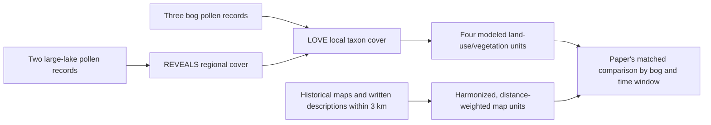

# Historical maps and pollen at three Småland bogs

**Paper.** Cui, Q.-Y., Gaillard, M.-J., Lemdahl, G., Stenberg, L., Sugita, S. and Zernova, G. (2014), “[Historical land-use and landscape change in southern Sweden and implications for present and future biodiversity](https://doi.org/10.1002/ece3.1198),” *Ecology and Evolution* **4**(18), 3555–3570. The [open article and its supporting appendix](https://pmc.ncbi.nlm.nih.gov/articles/PMC4224531/) ask whether the Landscape Reconstruction Algorithm (**LRA**) can estimate past local woodland/forest, grassland, wetland and cultivated-land cover in southern Sweden in a way that is compatible with historical maps. The authors also use both sources to interpret the region's changing landscape diversity. We examine it as a possible independent vegetation reference for our pollen reconstructions. Our retained source review establishes **map availability and pollen support for three bogs**, but does **not** recover the complete numerical, distance-weighted map-class fractions needed to score any repository prediction. [Paper, Abstract and Methods](https://pmc.ncbi.nlm.nih.gov/articles/PMC4224531/); [our vegetation-reference decision](vegetation-reference.md); [source-bound coverage result](vegetation-reference/smaland-historical-maps/coverage.json).

## What each source measures

The study's local pollen records come from the **Stavsåkra, Notteryd and Storasjö bogs**. Two larger lakes, **Trummen and Kansjön**, supply the regional pollen background. The authors use **REVEALS** (“Regional Estimates of VEgetation Abundance from Large Sites”) to estimate regional plant cover from large-site pollen, then **LOVE** (“LOcal Vegetation Estimates”) to infer local cover around each bog after accounting for that background. The modeled local response has **25 pollen taxa** with available relative pollen productivity estimates (**PPEs**), which correct for differences in how abundantly plants release pollen; grain dispersal and basin size also affect the inference. Pollen counts, modeled vegetation fractions and mapped land areas therefore have different denominators. [Paper, Introduction and Methods](https://pmc.ncbi.nlm.nih.gov/articles/PMC4224531/).

The independent source is a series of modern and historical cadastral maps and attached written descriptions within a **3 km radius** of each bog. The paper harmonizes their differing map labels into four land-use/vegetation units (**LuVs**): cultivated land, grassland, wetland and woodland/forest. It also groups modeled taxa into comparable LuVs. That translation requires assumptions: the authors assign each taxon to one LuV and test alternatives for *Calluna* because heather can occur in grassland, wetland or woodland. They **distance-weight** mapped class areas because nearby and distant vegetation contribute differently to a bog's pollen signal. The published map-window coverage percentage reports how much of the 3 km area has available maps; it is **not** the percentage of any vegetation class. Missing map areas were assumed by the authors to resemble mapped areas, an inference with greater consequence for sparse old maps. [Paper, Methods, Table 2 and Fig. 2](https://pmc.ncbi.nlm.nih.gov/articles/PMC4224531/); [appendix-bound coverage extraction](vegetation-reference/smaland-historical-maps/coverage.py).



The article defines **four calendar-year (AD/CE) windows**: TW1, **1950–2010**; TW2, **1925–1950**; TW3, **1825–1925**; and TW4, **1700–1825**. Modern topographic maps support TW1, an economy map TW2, and land-reform and older cadastral maps the older windows. The paper's Table 1 places the *same one* dated bog pollen sample at each site in TW1 and TW2; those windows are two map contexts, **not two independent pollen observations**. Its broad local age resolution and historical map dates are not interchangeable measurement times. The corresponding regional REVEALS anchor in TW1/TW2 is listed as **1950/1950 CE**, with **2,536** grains in the article's regional count column. [Paper, Table 1](https://pmc.ncbi.nlm.nih.gov/articles/PMC4224531/); [our exact Table 1 and appendix extraction](vegetation-reference/smaland-historical-maps/coverage.json).

## One source-map and pollen trace: Stavsåkra

For **Stavsåkra** (spelled `STAVÅKRA` in the appendix's map table), that table reports **100%** map coverage of the 3 km area for the modern maps used in TW1/TW2. Coverage falls to **75%** for the TW3 reform-period maps and is reported separately as **24% Storskifte-period** and **10% older-map** coverage for TW4. These are percentages of the area's *map availability*. They cannot be added or read as woodland or grassland shares. The article's Table 1 pairs the modern TW1 and TW2 map contexts with **one** Stavsåkra bog pollen sample dated **1930 CE**, containing **617 grains**. The regional row is shared across the three bogs, not a second Stavsåkra local count. [Primary article, Table 1](https://pmc.ncbi.nlm.nih.gov/articles/PMC4224531/); [retained appendix and table extraction](vegetation-reference/smaland-historical-maps/coverage.json).

The path from those facts to an interpretable comparison would be: identify the mapped parcels and their class areas within the circle; harmonize each map term using its associated text; apply the paper's distance weighting to each class; apply the declared missing-area assumption; aggregate the 25 modeled taxon estimates into each LuV under a specified *Calluna* scenario; then compare map and LRA percentages on the same site/window and spatial support. The retained article tables and appendix give the **coverage and pollen anchors**, but not the full numerical per-class mapped areas and distance-weighted fractions behind that final comparison. Our Stavsåkra reference fraction for every LuV is therefore **not evaluated**; neither 100% modern map coverage nor 617 grains supplies one. [Paper, Methods and Table 2](https://pmc.ncbi.nlm.nih.gov/articles/PMC4224531/); [source decision](vegetation-reference.md).

The same source-bound check gives **Notteryd** modern/TW3/TW4 Storskifte/older map coverage of **100/12/63/11%**, with one shared TW1/TW2 local pollen sample dated **1993 CE**, **841 grains**; **Storasjö** has **100/77/59/0%**, with one shared sample dated **1935 CE**, **574 grains**. Across the three sites this is **three** distinct modern pollen anchors, not six independent TW1/TW2 pollen samples. The TW3 and TW4 map periods remain separate sources and cannot repair the modern-window duplication. [Appendix-based three-site ledger](vegetation-reference/smaland-historical-maps/coverage.json); [paper Table 1](https://pmc.ncbi.nlm.nih.gov/articles/PMC4224531/).

## What the original authors found

The paper reports that mapped and pollen-based LuV cover often agree reasonably across its own **three bogs and four windows**, particularly after matching class definitions and testing *Calluna* assignments; some comparisons do not agree. It treats disagreements in light of map interpretation, incomplete coverage, vegetation-class assumptions and the pollen reconstruction's uncertainty. The authors' historical interpretation is site-specific: their maps show Storasjö shifting from a more varied mosaic toward greater woodland/forest dominance, while Stavsåkra and Notteryd have different trajectories. They argue that agrarian reforms and later land-use practice contributed to major losses of landscape diversity over the last three centuries in their study area. Those conclusions are the **published authors' interpretation of their original maps, LRA outputs and other sources**, not results reproduced by our program. [Paper, Results, Discussion and Conclusions](https://pmc.ncbi.nlm.nih.gov/articles/PMC4224531/).

Several paper-side limitations matter to a new comparison. Its LOVE-estimated relevant source area of pollen varies about **1.3–1.7 km radius** over the study, motivating a 3 km map search rather than implying that a whole 3 km disk was measured completely in every window. The article describes chronology precision near **±50 years** and notes that its pollen periods can exceed the maps' windows. It says LRA cultivated land uses cereal taxa for which PPEs were available, so that category can miss other cultivation. The paper's modeled uncertainty and *Calluna* scenarios are not confidence limits for our own predictions. [Paper, Methods, Results and Discussion](https://pmc.ncbi.nlm.nih.gov/articles/PMC4224531/); [appendix coverage source](vegetation-reference/smaland-historical-maps/coverage.py).

## What we verified, and what remains unavailable

| Question | Exact retained evidence | Current conclusion and needed input |
| --- | --- | --- |
| Are source identity, map support and modern pollen anchors reproducible? | The producer authenticates the article XML, appendix PDF and PMC metadata by SHA-256, checks DOI **10.1002/ece3.1198** and article CC BY metadata, reads the article's Table 1 and extracts all **12** site-by-map-period coverage values from the appendix. [Producer](vegetation-reference/smaland-historical-maps/coverage.py); [three-site result](vegetation-reference/smaland-historical-maps/coverage.json). | Yes for these **coverage and count** fields. They are source-support observations, not vegetation-cover fractions. |
| Can we reconstruct the paper's mapped LuV percentages or score our model against them? | The article and appendix do not give the full class-area and distance-weighted numeric array used in the authors' comparisons; the retained coverage result explicitly marks each of the **three** sites `refused_numeric_reference_unavailable`. [Coverage rows](vegetation-reference/smaland-historical-maps/coverage.json); [vegetation-reference decision](vegetation-reference.md). | **No admitted repository vegetation pair and no independent vegetation accuracy score.** Need original digitized map polygons or equivalent per-class areas and the exact weighting/normalization output for a chosen site/window. |
| Can TW1 and TW2 be counted as independent pollen validation cases? | Each of Stavsåkra, Notteryd and Storasjö has one dated/count local pollen row shared by TW1 and TW2 in article Table 1. [Primary table](https://pmc.ncbi.nlm.nih.gov/articles/PMC4224531/); [source row check](vegetation-reference/smaland-historical-maps/coverage.py). | No; two map windows do not double the **three** modern pollen anchors. Need distinct authenticated pollen observations and temporal matches before claiming additional pairs. |
| Does the paper's published model-map agreement validate a current repository prediction? | The article tested its own 25-taxon LRA, assumptions, sites and maps. Our [vegetation review](vegetation-reference.md) has not admitted the numerical reference fractions. | No; a current prediction would need a matched physical core, chronology, taxa, LuV transformation, spatial support and independently governed outcome before scoring. |

The local source packet is an article XML, supporting appendix PDF and PMC metadata, retained under a source store with exact SHA-256 identities in the [machine result](vegetation-reference/smaland-historical-maps/coverage.json). The PMC article metadata records a **CC BY** license. That receipt establishes the identity and stated article license of the read packet; it does not provide a separate release decision for newly derived parcel data or authorize us to invent missing measurements. [Primary article and license](https://pmc.ncbi.nlm.nih.gov/articles/PMC4224531/); [source producer](vegetation-reference/smaland-historical-maps/coverage.py).

## Reproduction and precise unsent requests

With the intact source packet available, regenerate the same support record from the repository root into an isolated artifact location:

```sh
PYTHONDONTWRITEBYTECODE=1 .venv/bin/python \
  reports/science/vegetation-reference/smaland-historical-maps/coverage.py \
  --source-root /path/to/private/reference-sources/smaland-historical-maps \
  --output artifacts/jobs/vegetation-reference/smaland-map-coverage.json
cmp artifacts/jobs/vegetation-reference/smaland-map-coverage.json \
  reports/science/vegetation-reference/smaland-historical-maps/coverage.json
```

The [public source review](../../docs/report/vegetation-reference/smaland-historical-maps/README.md) links the article and the retained result. A reader without the source packet can still inspect the three-site ledger and the primary article. Replaying coverage does not regenerate the paper's map digitization or LOVE calculation.

To reopen a numerical reference for **one named bog and one named window**, ask the source owner for the actual rectified/digitized map parcels, original class labels and attached descriptions, map footprints and missing-area treatment, harmonized class assignment, per-class area and distance-weighting factors, and the final LuV percentage table with provenance and reuse terms. Ask the pollen source owner for the exact bog and regional lake count rows, age-model/selection decisions, 25-taxon PPE and basin inputs, and the *Calluna* scenario used for that comparison. A qualified landscape/palynology reviewer must then decide whether map and pollen support the same local estimand and whether the class/chronology assumptions are acceptable for a new score. These requests are **prepared but unsent**; no independent review or colleague reading exercise is claimed. [Paper, model-data comparison method](https://pmc.ncbi.nlm.nih.gov/articles/PMC4224531/); [current vegetation-reference boundary](vegetation-reference.md).


<!-- scientific-verification-and-limits:begin -->
## Scientific verification and limits

**Supported claim.** Original three-bog map/pollen scope and exact coverage/sample anchors are retained.

**Unsupported claim.** Numeric reconstructed LuV cover or independent score against this repository’s prediction.

**Actual verification performed.** Retained article/appendix source-packet coverage result is described; index did not acquire missing parcel table.

**Remaining input or review.** Published map coverage and pollen anchors omit the class-area/distance-weighted LuV numeric array, missing-area handling and exact pollen/parameter binding; TW1/TW2 share one sample per bog. Resolver: Map and pollen source custodians plus qualified landscape/palynology reviewer Reopen when: For one bog/window, rectified parcels, class weights, final fractions, count/age/PPE inputs and permitted use are paired and reviewed.

**Cause category.** data|assumption|comparability|access/rights|qualified review

**Consequence.** Do not infer numeric vegetation fractions from map coverage alone or duplicate modern-window pollen rows.

**Precise next acceptance route.** For one bog/window, rectified parcels, class weights, final fractions, count/age/PPE inputs and permitted use are paired and reviewed. Then update reports/science/vegetation-reference.md.

**Negative or refused result.** Full distance-weighted class fractions absent; TW1/TW2 use one shared local pollen sample per bog, not six independent samples.

**Matched denominator.** Three bogs × four windows; one modern pollen anchor per bog; map reference area 3 km radius.

Retained evidence: [reports/science/vegetation-reference/smaland-historical-maps/coverage.json](vegetation-reference/smaland-historical-maps/coverage.json), [docs/report/vegetation-reference/smaland-historical-maps/README.md](../../docs/report/vegetation-reference/smaland-historical-maps/README.md).

This account preserves the verification scope and source limitations; rendering these statements does not rerun or qualify the underlying science.

<!-- scientific-verification-and-limits:end -->
