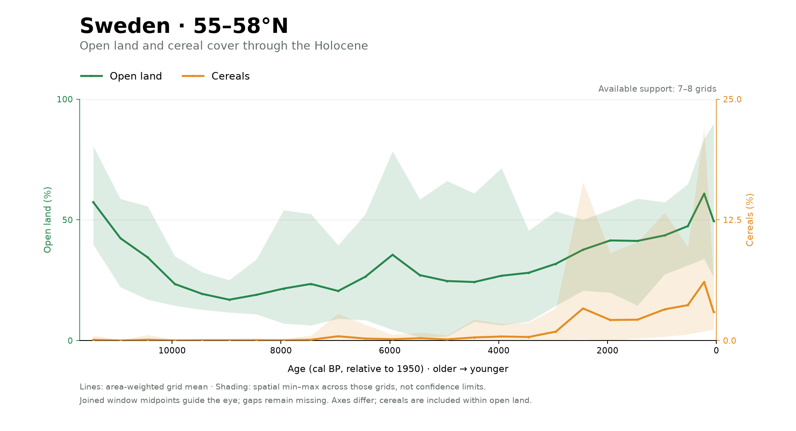

# Swedish landscape history: open land, cereals and forest

The southern Swedish grids show increasing open-land and cereal cover followed
by a decline in the youngest source window. Northern histories differ. These
figures compare existing published REVEALS estimates across **five latitude
bands**, with four- and six-band alternatives available below.

**Green:** published open land, left axis. **Orange:** cereals, right axis.
Lines show area-weighted grid means; shading shows **spatial minimum–maximum
across the contributing grids**, not confidence or prediction intervals.
The axes use different scales, fixed across regions. Joined window midpoints
guide the eye; no extra dates are estimated. Cereals are part of open land.

## Explore the five regions

Each regional chart shows the full published history using available grids in
each window. The last column gives the separate **common recent cohort**:
grids with valid data in every source window from 0 to 3200 BP.

| Latitude band | Regional figure | Common recent grids |
| --- | --- | ---: |
| 55–58°N | [PDF](figures/regions/latitude-55-58.pdf) · [SVG](figures/regions/latitude-55-58.svg) | 8 |
| 58–61°N | [PDF](figures/regions/latitude-58-61.pdf) · [SVG](figures/regions/latitude-58-61.svg) | 5 |
| 61–64°N | [PDF](figures/regions/latitude-61-64.pdf) · [SVG](figures/regions/latitude-61-64.svg) | 4 |
| 64–67°N | [PDF](figures/regions/latitude-64-67.pdf) · [SVG](figures/regions/latitude-64-67.svg) | 0 |
| 67–70°N | [PDF](figures/regions/latitude-67-70.pdf) · [SVG](figures/regions/latitude-67-70.svg) | 4 |

[All five regions together](figures/holocene-trajectories.pdf) ·
[Controlled recent comparison](figures/recent-trajectories.pdf) ·
[Forest proxy versus non-tree vegetation](figures/forest-open.pdf).

## What the comparison shows

- **Southern opening and recovery:** at 55–58°N, open land decreases from
  **60.83% to 49.52%**, and cereals from **6.06% to 2.94%**, between 100–350 BP
  and the youngest window. Tree-associated cover increases over that transition.
- **Different northern histories:** at 67–70°N the published cereal estimate is
  zero throughout the recent comparison. That does not prove cultivation was
  historically absent, or that all openness was caused by clearance.
- **An explicit coverage gap:** 64–67°N has available-grid results, but no grid
  remains valid in every recent window. The controlled recent figure keeps
  that band missing rather than filling it from a different cohort.

The southern rise-and-fall pattern qualitatively resembles the motivating
Estonian example. It is not a numerical reproduction or an independent
validation. The source windows are coarse; the youngest interval follows its
original coring support and is not a contemporary survey. BP is relative to 1950.

## Supporting figures and reproducible data

- [Four-, five- and six-band comparison](figures/latitude-band-comparison.pdf).
- [Grid map](figures/grid-support.pdf), [coverage](figures/coverage.pdf) and
  [common/available/high-quality support comparison](figures/support-sensitivity.pdf).
- [All means and min–max values](trajectories.csv),
  [650 source dispositions](cell-dispositions.csv) and [executed protocol](protocol.json).
- [Methods, definitions, uncertainty limits and reproduction commands](methods.md),
  [result identity](result.json) and [independent archive verification](independent-check.json).

Forest is an explicit tree-associated taxon proxy; shrubs remain separate in
the classification. These centre-selected grid summaries are not national
land-area measurements or new local LOVE predictions. Independent vegetation
accuracy remains unestablished.

Source: **Fyfe et al. (2021), [PANGAEA 937075](https://doi.org/10.1594/PANGAEA.937075)**,
CC BY 4.0; **Githumbi et al. (2022), [European pollen-based REVEALS land-cover
reconstructions](https://doi.org/10.5194/essd-14-1581-2022)**.

<!-- scientific-verification-and-limits:begin -->
## Scientific verification and limits

**Supported claim.** Source-bound Swedish-centre published REVEALS means are summarized in four, five and six latitude bands with fixed recent and changing-support views.

**Unsupported claim.** New raw-pollen or local LOVE reconstruction, national land-area census, measured vegetation accuracy, causal agricultural interpretation or quantitative Estonia reproduction.

**Actual verification performed.** The original 2,250 summaries and 650 native-row verification are retained. This presentation revision checks saved means and extrema, missing-window geometry, complete range scales, 30 focused tests and rendered exports; it does not rerun the pollen model.

**Remaining input or review.** Grid-centre support, coarse/mixed-life-form taxonomy and source age windows restrict interpretation; joint covariance and independent matched vegetation observations are unavailable. Resolver: Qualified Swedish palaeoecology, taxonomy, chronology and reference-data reviewers. Reopen when: A reviewed same-estimand physical source and matched independent observation packet supports a stronger claim.

**Cause category.** assumption|comparability|data|qualified review

**Consequence.** Retain the 64–67°N common-cohort gap, all source refusals, changing-support qualifications and unpooled source SEs.

**Precise next acceptance route.** Review the operational groups and geographical support, admit compatible independent reference observations, then freeze a separate accuracy protocol before evaluation.

**Negative or refused result.** 82 no-data cell/windows and one zero-mass composition excluded; eight recent five-band common-cohort summaries remain missing.

**Matched denominator.** 26 grids × 25 windows = 650 cell/windows; 567 valid; 2,250 layout/policy/weighting rows; five-band recent fixed support has 21 grids with 32 defined and 8 missing band/windows.

Retained evidence: [reports/science/swedish-landscape-history/result.json](result.json), [reports/science/swedish-landscape-history/trajectories.csv](trajectories.csv), [reports/science/swedish-landscape-history/independent-check.json](independent-check.json).

This account preserves the verification scope and source limitations; rendering these statements does not rerun or qualify the underlying science.

<!-- scientific-verification-and-limits:end -->
