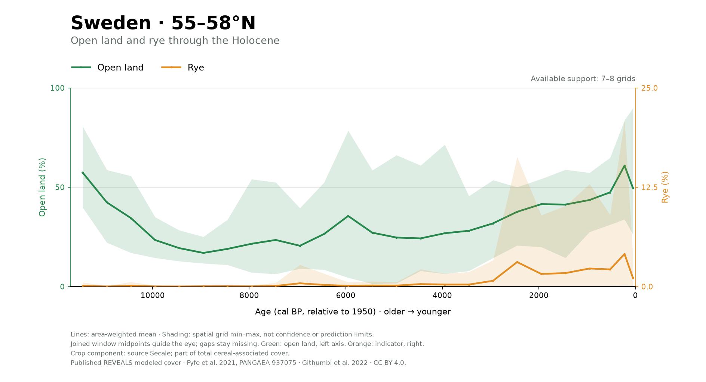

# Swedish crops and open-land context

Rye can be separated from the remaining cereal type in this published release.
Ribwort plantain type and seven non-cereal herb types add useful context for
open vegetation. They do not distinguish crops individually or measure pasture
area, grazing intensity or agricultural land use.



Each chart pairs **open land in green** with **one indicator in orange**.
Lines are area-weighted means and shading is the spatial minimum–maximum
across the same contributing grids. These are not confidence or prediction
intervals. Left axes span 0–100%; right axes differ by indicator but stay fixed
across its regions and time views. Curve heights and crossings across different
axes do not measure equal cover or statistical correlation.

## Choose a comparison

The full histories use available grids in each window. Recent comparisons use
the **same grids across all eight source windows from 0 to 3200 BP**. The
64–67°N recent gap remains explicit: it has no common valid grid.

| Indicator | Meaning in this source | Full history | Common recent cohort | Right axis |
| --- | --- | --- | --- | --- |
| Rye | `Secale`, a component of total cereals | [PDF](figures/rye/holocene.pdf) | [PDF](figures/rye/recent.pdf) | 0–25% |
| Non-rye cereal type | Pooled `Cerealia.t`, excluding rye | [PDF](figures/other-cereals/holocene.pdf) | [PDF](figures/other-cereals/recent.pdf) | 0–15% |
| Ribwort plantain type | `Plantago.lanceolata.type`; non-crop context | [PDF](figures/plantain/holocene.pdf) | [PDF](figures/plantain/recent.pdf) | 0–2% |
| Non-cereal herbs | Seven herb types, including plantain | [PDF](figures/non-cereal-herbs/holocene.pdf) | [PDF](figures/non-cereal-herbs/recent.pdf) | 0–100% |

[Total cereal comparison](../README.md) remains the main agricultural overview.
Open land includes cereals and these herb types. Plantain is already part of
the seven-herb group; the indicators overlap and must not be added as separate
land-use classes. Herbs also include natural and wetland vegetation.

### Individual regions

| Latitude band | Rye | Other cereals | Plantain | Non-cereal herbs |
| --- | --- | --- | --- | --- |
| 55–58°N | [PDF](figures/rye/latitude-55-58.pdf) | [PDF](figures/other-cereals/latitude-55-58.pdf) | [PDF](figures/plantain/latitude-55-58.pdf) | [PDF](figures/non-cereal-herbs/latitude-55-58.pdf) |
| 58–61°N | [PDF](figures/rye/latitude-58-61.pdf) | [PDF](figures/other-cereals/latitude-58-61.pdf) | [PDF](figures/plantain/latitude-58-61.pdf) | [PDF](figures/non-cereal-herbs/latitude-58-61.pdf) |
| 61–64°N | [PDF](figures/rye/latitude-61-64.pdf) | [PDF](figures/other-cereals/latitude-61-64.pdf) | [PDF](figures/plantain/latitude-61-64.pdf) | [PDF](figures/non-cereal-herbs/latitude-61-64.pdf) |
| 64–67°N | [PDF](figures/rye/latitude-64-67.pdf) | [PDF](figures/other-cereals/latitude-64-67.pdf) | [PDF](figures/plantain/latitude-64-67.pdf) | [PDF](figures/non-cereal-herbs/latitude-64-67.pdf) |
| 67–70°N | [PDF](figures/rye/latitude-67-70.pdf) | [PDF](figures/other-cereals/latitude-67-70.pdf) | [PDF](figures/plantain/latitude-67-70.pdf) | [PDF](figures/non-cereal-herbs/latitude-67-70.pdf) |

Every PDF has an accompanying SVG and PNG at the same relative filename.

## What the added detail shows

For the **same eight grids at 55–58°N**, the transition from 100–350 BP to the
youngest 0–100 BP source window is:

| Modeled cover | 100–350 BP | 0–100 BP |
| --- | ---: | ---: |
| Open land | 60.83% | 49.52% |
| Total cereals | 6.06% | 2.94% |
| Rye | 4.09% | 1.07% |
| Other cereal type | 1.97% | 1.87% |
| Ribwort plantain type | 0.31% | 0.21% |
| Non-cereal herbs | 29.96% | 27.49% |

Thus the cereal decline in this comparison is mostly in the rye component.
This is a descriptive contrast within a pollen-derived model, not independent
evidence of crop acreage or a causal explanation. BP is relative to 1950;
the youngest interval follows the original coring support, not a modern survey.
Joined source-window midpoints guide the eye without estimating new dates.

**Wheat, barley and oats cannot be separated** from this release's pooled
cereal type. Flax, hemp and buckwheat lack separate output taxa. Missing taxa
are unavailable indicators, not modeled zero cover. Source zeros for supported
taxa remain numeric zero and do not prove historical absence of cultivation.

## Source and reproducibility

Source: **Fyfe et al. (2021), [PANGAEA 937075](https://doi.org/10.1594/PANGAEA.937075)**,
CC BY 4.0; **Githumbi et al. (2022), [European pollen-based REVEALS land-cover
reconstructions](https://essd.copernicus.org/articles/14/1581/2022/)**,
Appendix A, Table A1, footnote b. That synthesis separates cereal type excluding
rye from rye. No PPE values were substituted from a different compilation.

The [parent methods](../methods.md) define grid-centre selection, all seven
herb types, whole-cell area weights, source chronology and quality exclusions.
These are 26 centre-selected one-degree grids, not national polygon-weighted
land measurements or new raw-pollen/LOVE predictions. The negative-LOVE rule
is not applied to these published REVEALS means.

The [executed protocol](protocol.json) retains the exact **2,250** parent
band/window/policy/weighting cohorts, including four- and six-band alternatives.
[Data](trajectories.csv) give means, direct cell extrema and support for all six
metrics. Cereal extrema are computed from each cell's total; they are never
sums of the separate rye and other-cereal extrema. No regional SE or covariance
is inferred.

The numerical owner was committed at `9f5bb2bb326016a3a1192b92c86cdf6af12b8687`
before execution. It checked all 20,250 inherited baseline statistics; an
independent archive reader checked all 2,250 rows, all six metrics and 650 source
cell/window dispositions. The [result identity](result.json) and
[independent proof](independent-check.json) retain source and calculation pins.
[Source interpretation receipt](source-claims.json) documents crop definitions.
All original numerical source owners, parent CSV, protocol and independent
proof remain unchanged. The shared renderer reproduces the original 36 exports
byte for byte. Fifty-two focused tests cover the new summaries and existing
regional/range behavior.

Run from the repository with the development package installed, using an absent
output directory:

```bash
python -B -m bijux_pollenomics_dev.landscape_history.landclim.indicators \
  --repository . --output artifacts/swedish-crop-reproduction
python reports/science/swedish-landscape-history/render_indicators.py \
  --study artifacts/swedish-crop-reproduction \
  --output artifacts/swedish-crop-figures
```

Matplotlib is required only for rendering. The renderer reads saved products
and exports 28 figures in PDF, SVG and PNG; it does not rerun the pollen model.


<!-- scientific-verification-and-limits:begin -->
## Scientific verification and limits

**Supported claim.** Descriptive source-bound rye, other cereal-type, plantain and seven-herb cover summaries on the unchanged published Swedish REVEALS cohorts.

**Unsupported claim.** Individual wheat/barley/oat or absent-crop estimates, measured crop acreage, pasture/grazing intensity, causal agricultural history, independent accuracy or fresh LRA reconstruction.

**Actual verification performed.** 52 focused tests; 2,250 JSON/CSV rows and six metrics independently checked against the raw archive, 650 source dispositions, source/calculation pins, rendered PNG/PDF readback and byte-identical reproduction of all 36 original exports.

**Remaining input or review.** Pooled taxonomy, changing support outside the recent common cohort and unavailable independent vegetation observations limit interpretation. Resolver: Qualified Swedish palaeoecology, crop-taxonomy, chronology and reference-data reviewers. Reopen when: Compatible independent observations or a finer source-qualified crop taxonomy become available.

**Cause category.** assumption|comparability|data|qualified review

**Consequence.** Retain taxon overlap, numeric zeros, all source exclusions and the common-cohort gap; do not infer agricultural land area from herb cover.

**Precise next acceptance route.** Review taxon definitions and geographical/chronological support, admit compatible independent observations and freeze an accuracy protocol before evaluation.

**Negative or refused result.** 82 source no-data and one zero-mass cell/window excluded; 64–67°N lacks any common recent grid. Unsupported crop taxa remain unavailable.

**Matched denominator.** 26 grids ×25 windows =650 native cell/windows, 567 eligible; 2,250 summaries ×6 metrics. Primary five-band recent support:21 grids,32 defined and8 missing band/windows.

Retained evidence: [reports/science/swedish-landscape-history/agricultural-indicators/result.json](result.json), [reports/science/swedish-landscape-history/agricultural-indicators/trajectories.csv](trajectories.csv), [reports/science/swedish-landscape-history/agricultural-indicators/independent-check.json](independent-check.json).

This account preserves the verification scope and source limitations; rendering these statements does not rerun or qualify the underlying science.

<!-- scientific-verification-and-limits:end -->
